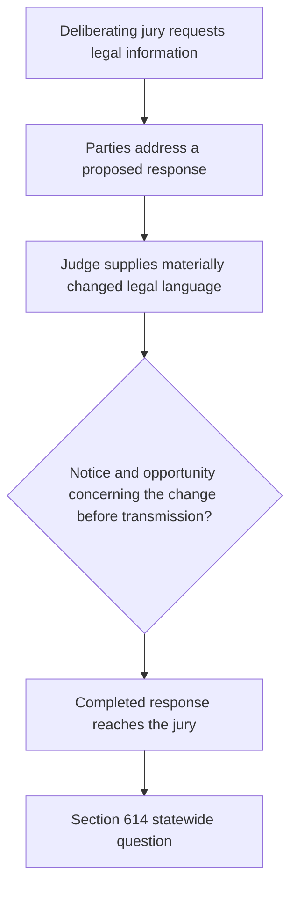
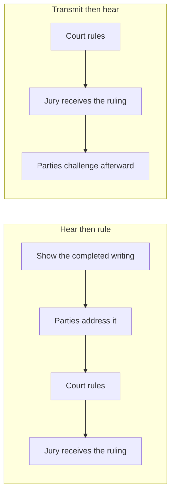
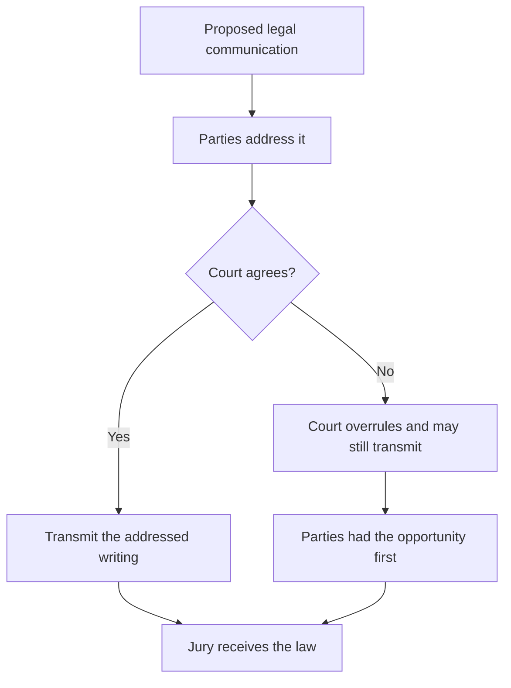
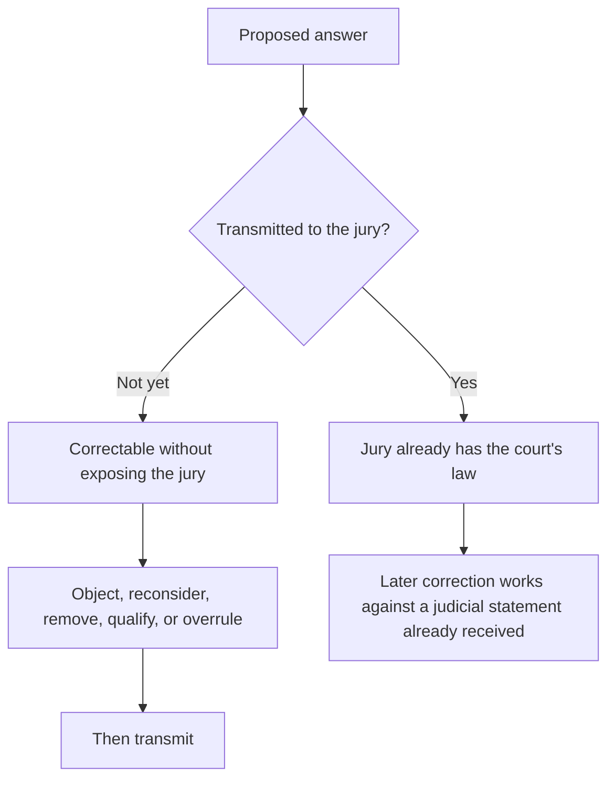
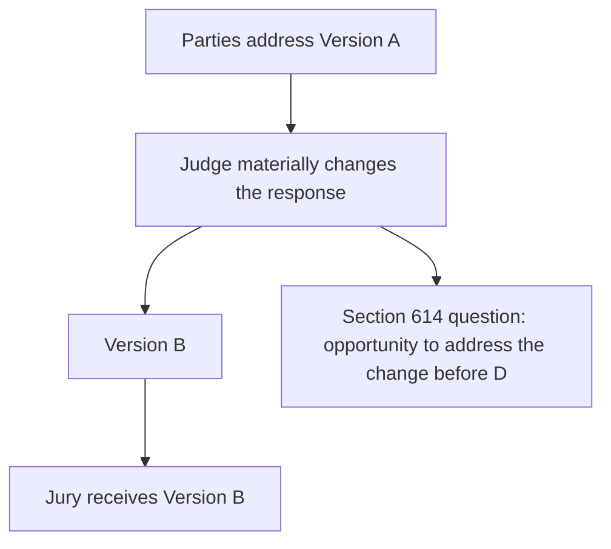
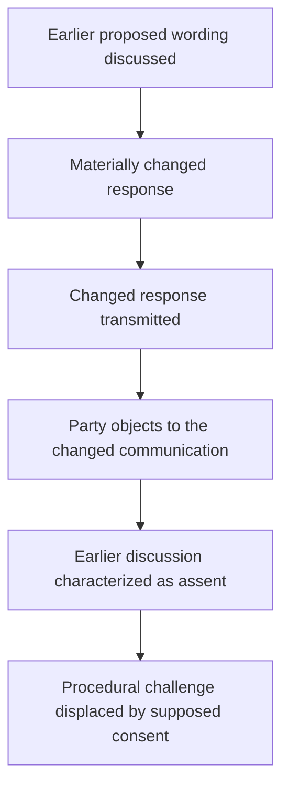
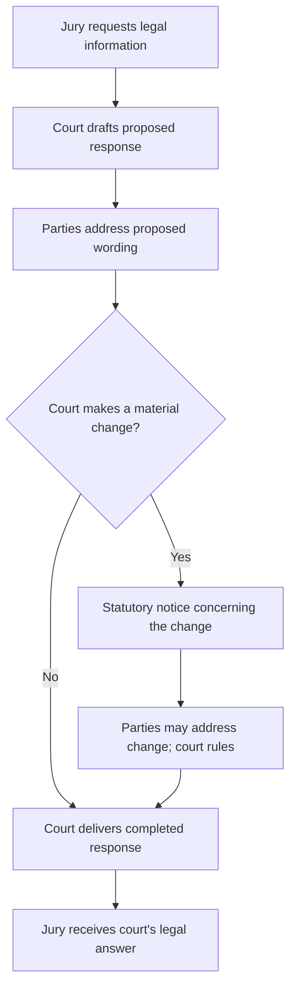

```markdown
# The Statewide Question

> **This page is commentary published October 17, 2026.** It is published as speech under the First Amendment to the United States Constitution and article I, section 2 of the California Constitution. It is not a court filing. It is not service of any paper on any party. It does not restart any Code of Civil Procedure section 128.7 period. Formal positions remain those stated in papers already on file.

## Contents

1. [The broader question](#1-the-broader-question)
2. [The governing principle](#2-the-governing-principle)
3. [The judge decides the law](#3-the-judge-decides-the-law)
4. [But the decision must remain adversarial](#4-but-the-decision-must-remain-adversarial)
5. [Section 614 is the statutory safeguard](#5-section-614-is-the-statutory-safeguard)
6. [The jury receives rules, not ordinary information](#6-the-jury-receives-rules-not-ordinary-information)
7. [The principle reaches more than added language](#7-the-principle-reaches-more-than-added-language)
8. [Why transmission is the critical dividing line](#8-why-transmission-is-the-critical-dividing-line)
9. [What the record proved](#9-what-the-record-proved)
    - [The fundamental wrong](#the-fundamental-wrong)
    - [The hinge: presented-then-delivered, then “Inaccurate”](#the-hinge-presented-then-delivered-then-inaccurate)
    - [The charges against the sitting trial judge](#the-charges-against-the-sitting-trial-judge)
    - [The court's responses to those charges](#the-courts-responses-to-those-charges)
    - [Reply No. 2 — the highway/street enhancement and sending](#reply-no-2--the-highwaystreet-enhancement-and-sending)
    - [Reply No. 1 — the separately challenged completed response](#reply-no-1--the-separately-challenged-completed-response)
    - [The plural response — objections and judicial issuance](#the-plural-response--objections-to-both-replies-and-judicial-authority-to-issue-them)
    - [Accusation-to-answer map](#accusation-to-answer-map)
    - [Admission by acquiescence: justification rather than denial](#admission-by-acquiescence-justification-rather-than-denial)
    - [The irrefutable chain](#the-irrefutable-chain)
10. [Notice of one version is not necessarily notice of another](#10-notice-of-one-version-is-not-necessarily-notice-of-another)
11. [Post-transmission objection is different](#11-post-transmission-objection-is-different)
12. [Judicial discretion has a procedural boundary](#12-judicial-discretion-has-a-procedural-boundary)
13. [Forfeiture, waiver, and invited error](#13-forfeiture-waiver-and-invited-error)
14. [The circularity problem](#14-the-circularity-problem)
15. [The broader statewide rule](#15-the-broader-statewide-rule)
16. [Why the issue extends beyond this case](#16-why-the-issue-extends-beyond-this-case)
17. [Why review is warranted](#17-why-review-is-warranted)

---

## 1. The broader question

The statewide question is not whether the trial judge correctly withheld a Vehicle Code instruction or correctly defined the word *highway*. The issue is **whether the court materially changed the legal response that would reach the deliberating jury and transmitted that changed response without Rosario's view of the completed writing, without his approval of it, and without his opportunity to object to it before delivery.** Correctness of the Vehicle Code text is a separate subject. The fundamental wrong is the unseen sending. The issue arose through **repeated accusations directed by Rosario to the sitting superior court judge**: “you had inserted information into the Jury” (11 RT 4:5–7), “You enhanced the statement and you sent that back” (11 RT 8:11), and “you sending back enhancements” (11 RT 13:19–20). **Section 9 maps each accusation to the judge's actual response, shows the court's pattern of justifying rather than denying, and sets out the irrefutable chain.**

**When a trial court materially changes a legal response discussed with the parties, what does Code of Civil Procedure section 614 require before the changed response may be communicated to a deliberating civil jury?**

That question encompasses a change made by adding language, inserting a definition, expanding a limitation, or combining a restriction with a refusal. The lawfulness of the resulting instruction is a separate subject. The procedural act is the court's preparation and delivery of the material change.

The specific statutory question is:

**Does notice of an earlier proposed response satisfy section 614 when the judge subsequently supplies materially different legal language and sends the completed response to the jury, or must notice extend to the material change that the jury actually receives?**

This commentary advances the latter rule. The parties need not approve the judge's final legal decision; they must be given the statutory opportunity to address the materially changed response before the judge transmits it.

The record supplies two separately identified jury replies. Reply No. 2 contains the particular highway/street addition that Rosario expressly accused the court of enhancing and sending. Reply No. 1 contains a juror-use restriction Rosario described accepting and a completed refusal clause read by the court, with a different stated justification. **The replies are not interchangeable.** Together, the court's responses and its later reference to **“these responses”** illuminate the statewide boundary between deciding what law to communicate and following the required process of communicating it.



---

## 2. The governing principle

The broader principle is simple:

**The judge decides the law. But the judicial act of deciding the law does not eliminate the parties' right to participate in the process before the court's substantive legal communication reaches a deliberating jury.**

The parties do not have:

1. Control of the judge's answer.
2. A veto.
3. A right to their proposed language merely because they object.

The court may still:

1. Reject their arguments.
2. Overrule their objections.
3. Give an instruction neither party prefers.

But there is a fundamental difference between:

**hearing the parties and ruling against them,**

and

**ruling first, communicating the ruling to the deliberating jury, and allowing the parties to challenge the completed communication afterward.**

The first is judicial decisionmaking within the adversarial process.

The second raises the statewide question presented here. It was not raised abstractly: **Rosario accused the judge of adding a street definition and already sending the enhanced answer to jurors** (Charge 5, 11 RT 8:7–12). The court's answer defended the words in the code; its later answer defended the discretion to issue **“these responses”** (11 RT 11:28–12:4). That is precisely the dividing line between defending a judicial choice and establishing that the statutory procedure preceded delivery.

| Path | Sequence | Character |
| --- | --- | --- |
| Adversarial ruling | Notice, hearing, ruling, then transmission | The court decides the law after the parties address the completed communication |
| Completed communication first | Ruling, transmission, then later challenge | The parties address an event that has already entered the jury room |

The legal ramification is the difference between an overruled objection and an unheard one. In the first path, the record contains the completed writing, the party's position on that writing, and the court's ruling. Review then asks whether the ruling was correct. In the second path, the jury already has the court's law before the party speaks to that law. Review is then asked to treat a later protest as tardy, or to treat an earlier discussion of a different writing as consent. The first path preserves both judicial authority and appellate review. The second path can extinguish review of the very communication the statute required the parties to see first.



---

## 3. The judge decides the law

Judicial independence in determining the law is not in dispute.

When a jury asks a question, the trial court must exercise judgment.

It may have to determine:

1. What statute governs.
2. What instruction applies.
3. Whether the jury's premise is mistaken.
4. Whether an existing instruction is sufficient.
5. Whether clarification is appropriate.
6. Whether additional legal information should be supplied.
7. Whether requested information would be misleading.
8. How much explanation is necessary.
9. Whether the requested instruction should be refused.

Those are exercises of judicial authority.

Section 614 does not transfer that authority to the parties.

The question is not whether the parties must consent to the judge's ultimate ruling.

They need not.

The question is whether the judge's authority to decide the ruling includes authority to bypass the procedure by which the parties are allowed to address the ruling before it enters the jury room. **When Rosario told the judge that he “enhanced the statement and ... sent that back,” the accusation was directed to the judge's exercise of authority over a completed jury communication, not simply to the merits of a statutory definition** (11 RT 8:7–12).

Those nine determinations are the content of the response. They remain with the court after the parties are heard. Section 614 does not assign any of them to counsel. This commentary urges a sequence that gives effect to its presence-or-notice protection: the material legal communication is disclosed, the parties have an opportunity to address it, and the court then transmits its completed answer. Collapsing the sequence into the content decision treats a ruling on the law as a ruling that the parties need not see the law first. That collapse is the statewide problem. The court still decides what the answer will be. The statute decides when that answer may enter the jury room.

---

## 4. But the decision must remain adversarial

The adversarial process has little meaning if it begins only after the judicial act capable of affecting the verdict has already occurred.

A party's opportunity to address a proposed legal communication serves several functions:

1. Identify controlling authority the court overlooked.
2. Identify an omitted qualification.
3. Explain that a proposed definition changes another instruction.
4. Show that the jury's question rests on an incorrect legal premise.
5. Argue that a statute not in the proposed response governs.
6. Identify prejudice from answering only part of the question.
7. Request a clarifying instruction.
8. Preserve an objection for review.

None of those functions requires that the court agree.

Their value lies in occurring **before the court's answer becomes authoritative law inside the jury room.**

The statewide principle therefore is not party control.

It is adversarial participation before judicial transmission. That is also the meaning of Rosario's repeated record correction: he contested the court's assertion that no objection had been made, recalled objections to materials “sent back,” and asked to reconstruct the unreported discussion (11 RT 10:12, 10:23–11:13). **The charge was not merely “I dislike the final words.” It was “the judge changed and sent the legal message, and my earlier opportunity did not encompass the completed change.”** This final sentence is a synthesis of Rosario's recorded positions, not a supposed verbatim quotation.

Each of those functions operates on a proposed writing that has not yet become the jury's law. Counsel can still point to a missing qualification, an omitted statute, or a definition that changes another instruction, and the court can still overrule. After transmission, the same points must be recast as a request to retract the court's own statement. The legal comparison is therefore not between a winning objection and a losing one. It is between an objection that can prevent the communication and an objection that can only ask the court to unsay it. The first is the opportunity this commentary contends section 614 protects. The second is a different remedy, with a different burden and a different effect on deliberations already underway.



---

## 5. Section 614 is the statutory safeguard

Code of Civil Procedure section 614 provides that, after deliberations begin, when jurors seek information on a point of law, the information “must be given in the presence of, or after notice to, the parties or counsel.” [Cal. Code Civ. Proc., § 614](https://codes.findlaw.com/ca/code-of-civil-procedure/ccp-sect-614/). **The statute is invoked here because Rosario repeatedly accused the trial judge of sending additional legal information into an already-deliberating jury**, including an identified street-language enhancement in Reply No. 2 (11 RT 5:20–27; 8:7–12; 13:16–22). The issue is the court's communication procedure, not whether the original trial evidence physically included the statutes.

The statutory object is **the information given**. That object is central when the court first discusses one proposed response and then materially changes it.

| Recorded event | Procedural significance |
| --- | --- |
| Jury asks a legal question | The court is called upon to supply legal guidance. |
| Parties discuss proposed response A | Their participation concerns the proposition or wording they actually addressed. |
| Court materially changes A to B | The court has supplied a different substantive communication. |
| Court sends B to the jury | B becomes the court's authoritative legal answer in deliberations. |
| Party objects to the change and the sending | The record identifies the disputed judicial communication and the timing of the objection. |

The construction urged here follows the object of the statute: when B is the information given, meaningful notice concerns B's material differences. The statute's presence-or-notice language supplies a procedural protection distinct from the judge's discretion to formulate a lawful answer.

In *Nelson v. Southern Pacific Co.* (1937) 8 Cal.2d 648, 655, the California Supreme Court addressed an unauthorized communication to a deliberating jury and described the section 614 procedure as a protection related to the substance of trial by jury. [*Nelson](https://scocal.stanford.edu/opinion/nelson-v-southern-pacific-co-28878)*. This page draws the related statewide question presented by materially changed jury-response wording: **what must be disclosed, and when, for the notice requirement to serve its function?**

---

## 6. The jury receives rules, not ordinary information

A judicial answer to a jury's legal question is different from ordinary information entering a trial.

| Source | What the jury may do with it |
| --- | --- |
| Witness | Accept or reject testimony |
| Attorney | Treat argument as argument, not evidence |
| Exhibit | Evaluate evidence |
| Judge answering a question of law | Follow the answer as the legal framework |

A witness gives testimony that the jury may accept or reject.

An attorney makes arguments that the jury is told are not evidence.

An exhibit supplies evidence the jury evaluates.

But when the trial judge answers a question of law, the jury receives the answer as an authoritative statement of the legal framework governing its decision.

The jury is expected to follow it.

That makes a substantive judge-to-jury communication uniquely consequential.

The communication can determine:

1. What legal duties matter.
2. Which facts are legally relevant.
3. What propositions jurors may consider.
4. What propositions jurors must disregard.
5. How statutory language should be understood.
6. What elements must be established.
7. How competing instructions relate to one another.
8. What rules govern the verdict.

A mid-deliberation legal answer therefore does more than provide information.

**It can change the rules under which deliberation proceeds.**

That is why the procedural protection must attach before transmission. **The seriousness of Charge 5 lies in its target:** Rosario did not accuse a witness of adding an exhibit; he accused **the judicial officer charged with instructing the jury** of enhancing the legal message and returning it to jurors. The judge's answer had legal authority for the jury regardless of either party's agreement with it.

The comparison is between evidence the jury may weigh and law the jury must apply. Testimony, argument, and exhibits remain subject to the jury's evaluation. A mid-deliberation judicial answer does not. The jurors have identified the legal uncertainty on which the verdict may turn, and the court has answered it. That answer can open or close duties, redefine statutory terms, and tell the jury what it may not consider. The ramification is that an unnoticed addition, restriction, or refusal is not an unnoticed piece of evidence. It is an unnoticed change in the rules. Section 614 exists at that moment because the communication is the court's law, not a party's proof.

---

## 7. The principle reaches more than added language

The material-change rule should follow what the jury received, not the mechanical form of the court's revision. A substantive change can be made by inserting a definition, deleting a qualification, expanding an exclusion, adding a new command, combining previously separate propositions, or refusing guidance in a response that earlier addressed only the jurors' own use of outside legal material.

The common event is **a difference between the response the parties addressed and the response the judge sent to the jury**. The court may make that change. Section 614 raises the separate question of how and when the parties receive notice of the material change before it is communicated.

That formulation keeps both jury responses in view without conflating their contents. Reply No. 2 concerns the addition of the street language to the vehicle/highway definition. Reply No. 1 concerns the difference between the juror-use proposition Rosario described accepting and the court's completed prohibition-and-refusal response. The source of the change, the words changed, and the judge's substantive rationale must be stated separately for each reply.

The statewide rule therefore addresses **materially altered judge-to-jury legal communications**, whatever drafting technique produced the alteration. **Rosario's charges name both a particular added sentence (“highways also indicates street,” 11 RT 8:7–12) and the broader act of “sending back enhancements” (11 RT 13:17–22).** The later accusation is what keeps the statewide principle from depending on one word or one definition.

---

## 8. Why transmission is the critical dividing line

Transmission is the critical event because that is when the court's proposed answer becomes the jury's legal instruction. **“You enhanced the statement and you sent that back” identifies both acts and their order** (11 RT 8:11). The sentence does not say Rosario saw the enhanced statement first. It says the enhanced statement was already sent. **“Second off, you sending back enhancements”** renews the sending charge after the judge explicitly asked for the asserted irregularities (11 RT 13:16–22). The repeated accusation makes transmission without Rosario's view, approval, or prior opportunity to object a reported controversy, not a merely hypothetical procedural hazard.

Before transmission, the process remains correctable without exposing the jury to the disputed communication:

1. A party may object.
2. The court may reconsider.
3. Language may be removed.
4. A missing qualification may be supplied.
5. A legal error may be corrected.
6. An ambiguity may be resolved.
7. The court may reject the objection and transmit the answer unchanged.

But the important point is that the adversarial process has performed its function before judicial authority enters the jury room.

After transmission, the problem changes.

The jury has received the answer from the court.

Any later correction must operate against something the jury has already been told by the judge.

The difference is therefore not merely chronological.

It is structural.

**Before transmission, the parties participate in determining whether an error reaches the jury. After transmission, they can only ask the court to repair an event that has already occurred.**



| Timing | What the parties can still do |
| --- | --- |
| Before transmission | Participate in whether the error reaches the jury |
| After transmission | Ask the court to repair an event that has already occurred |

The ramification of that comparison is practical and legal. Before transmission, an objection can keep the disputed sentence out of the jury room. After transmission, the same sentence is already the court's instruction. A later "correction" asks the jury to disregard a statement the judge has just made, or to prefer a second statement over the first. That is a different proceeding. It introduces questions of curability and prejudice that section 614 is designed to avoid by requiring notice first. Equating the two moments treats a repair as the statutory opportunity. The statute calls for presence or notice before the information is given; the earlier moment is the one this commentary seeks to protect.

---

## 9. What the record proved

The accusations come first because the judge's recorded explanations must be read **against the conduct Rosario was accusing him of committing**. The statutory question is the **opportunity to object to a material judicial change before it reached the deliberating jury**—not whether Rosario approved the change and not whether the court chose substantively correct law.

### Item 1 — The ten recorded accusations and objection-preservation statements

**Read the charges before the court's answers.** Rosario directed repeated accusations of judicial supplementation and transmission to the sitting Superior Court judge. The quotations below identify what Rosario said and the particular act he challenged. The judge's answers are analyzed in Item 2 and the following items. **Reply No. 1 and Reply No. 2 concern different legal communications; their words must not be interchanged.**

1. **Charge 1 — The court inserted Vehicle Code information into the jury's deliberations.** (**11 RT 4:1–7**.)

   > “The Court also, through its own admission, clarified something to the Jury by submitting a actual Vehicle Code, which was not introduced during the evidence, and by that cause alone, Your Honor, you had inserted information into the Jury which then -- by providing them information that was not available in the evidence itself.”

   **Target:** The **judge**, as the source of legal information sent to the jury.

2. **Charge 2 — Rosario challenged an addition following the juror-use proposition he described accepting.** (**11 RT 4:8–14**.)

   > “I do agree with the first one, the response to number one: You may not consider it because it is not part of the instructions. But when you added that into the second one, it caused this, because the Jury had to make the decision based upon the available evidence that was there.”

   **Target:** The alleged **addition**, distinguished from Rosario's description of the juror-use restriction. The completed Reply No. 1 later read by the judge contained both a prohibition and a refusal to instruct (**11 RT 6:23–27**). The highway/street enhancement is separately identified in Charge 5.

3. **Charge 3 — The judge inserted new information and supplied a code.** (**11 RT 4:26–5:8**.)

   > “The second one, they asked something that they did not have. And, again, that is information that was not presented in the evidence and suddenly new evidence or new information has been inserted by yourself. So those two clauses alone, there was no request for a code here. You provided a code.”

   **Target:** Judicial authorship of **additional legal information**.

4. **Charge 4 — The court inserted information after the jury had retired.** (**11 RT 5:20–27**.)

   > “Absolutely that is prejudice. The officer and the Defense had an opportunity to enter that Vehicle Code as well as the definition of a vehicle in their evidence. They did not do that. Inserting that information into the Jury after the fact, after they have gone into the sealed room back there, essentially, is extraneous influence over the Jury and their knowledge about this case.”

   **Target:** The **timing** of judicial communication to an already deliberating jury.

5. **Charge 5 — Reply No. 2 was enhanced by the highway/street language and sent back.** (**11 RT 8:7–12**.)

   > “Inaccurate, Your Honor. You enhanced it by adding that highways also indicates street. That is not in the actual black-letter law. You enhanced the statement and you sent that back. That is a direct influence over the Jury.”

   **Target:** The specific **highway/street enhancement** and **completed transmission** of Reply No. 2. This is the central material-change-and-sending accusation.

6. **Statement 6 — Rosario confirmed he wanted objections concerning both completed responses placed on the record.** (**11 RT 10:4–8**.)

   The judge reported that the courtroom clerk had informed him Rosario sought to place objections to Jury Request Forms Nos. 1 and 2 on the record. Rosario responded:

   > “Yes.”

   **Target:** The **recording of objections to both responses**, rather than a new accusation of modification in this one-word reply.

7. **Charge 7 — Rosario disputed the court's description of the earlier understanding.** (**11 RT 10:9–12**.)

   When the judge began stating that no objection was raised when the responses were completed, Rosario interrupted:

   > “That wasn't our understanding.”

   **Target:** The judge's account of **prior objection and agreement**.

8. **Charge 8 — Rosario identified an objection outside the reporter's presence and sought reconstruction.** (**11 RT 10:23–11:13**.)

   Rosario said, in pertinent part:

   > “Given that outside the presence of the Court Reporter, Plaintiff did object to any language or materials sent back because the information was already common knowledge, was unnecessary to be defined, specifically also the one that was defined by yourself to the Jury themselves.”
   >
   > “The citation on -- more specifically, the citation on what constitutes a vehicle, I did object to that, and that is inaccurate also.”
   >
   > “I would like to either reconstruct the record or we file my objection for that.”

   **Target:** His **earlier objection to giving a vehicle definition or clarification**, and the requested record correction. The statement does not specify a separate pre-transmission objection to the particular highway/street enhancement.

9. **Charge 9 — Rosario specified what he had objected to: giving the vehicle clarification.** (**11 RT 11:14–22**.)

   When the judge asked, “What's the correction?”, Rosario responded:

   > “The correction is that I objected to any of the material going back, the codes, because they were common knowledge; it wasn't necessary for anything to be sent back to the Jury, anything, any kind of clarification of vehicles, anything like that. It was unnecessary. I stated that. It was all common knowledge.”

   **Target:** The court's choice to **provide a definition or clarification of “vehicle” at all**. This is distinct from the later accusation that an enhanced version was transmitted.

10. **Charge 10 — Rosario renewed his accusation that the judge sent enhancements.** (**11 RT 13:16–22**.)

    After the judge asked, “What are the irregularities, sir?”, Rosario identified two separate concerns:

    > “The jurors -- I just went over that, the jurors having access to extemporaneous information, first off; second off, you sending back enhancements to a testimony that was not in, and any of the enhancements or any of the evidence would be used in their assessment.”

    **Target:** The court's own **sending of enhancements**, separate from the allegation of outside juror access.

**The central charge is No. 5, repeated in No. 10:** Rosario accused the judge of **enhancing and sending Reply No. 2**, while the earlier unreported objection described in Charges 8–9 concerned **whether a vehicle definition should be given**. The distinction fixes the section 614 issue on the materially enhanced communication, not the wisdom of supplying the definition in the first place.

---

### Item 2 — The central section 614 accusation

**The fundamental issue is whether a sitting Superior Court judge may materially modify a legal response intended for a deliberating jury, transmit the modified response, and then rely on the correctness, harmlessness, or discretionary character of that response rather than establish that the parties received the statutory opportunity to object to the material change before transmission.**

The accusation was directed to the judge personally. Rosario repeatedly alleged that the court itself supplied additional legal information, altered the jury responses, and transmitted the enhanced material after deliberations had begun.

This was not merely a disagreement over the correct interpretation of the Vehicle Code. Rosario challenged the procedure by which court-authored legal information entered the jury room.

The relevant protection is Code of Civil Procedure section 614, which requires information requested by a deliberating jury on a point of law to be given in the presence of, or after notice to, the parties or counsel.

**The court may decide the law over a party's objection. It may not use its discretion over the substance of that law as a substitute for the statutory procedure governing its delivery.**

The reported confrontation presents that distinction directly.

#### Step A — The judge asserts prior presentation followed by delivery

At **11 RT 6:19–21**, the judge stated:

> “The Court presented that response in Jury request number one to each party before delivering it to the Jury.”

This is an express judicial assertion concerning the sequence of presentation and transmission for **Reply No. 1**.

The judge thus identified the very sequence that section 614 makes important: presentation to the parties followed by delivery to the jury.

In the same uninterrupted judicial turn, the court then addressed **Reply No. 2**. It read the vehicle and highway definitions, including the proposition that highway includes street. (**11 RT 7:10–26**.)

The court characterized its definition as potentially gratuitous:

> “even if this was something that was gratuitous on the part of the Court, the Court is defining something that is the word 'vehicle' for the purpose of the jury's use in this matter.”

The court also stated:

> “I find no harm nor prejudice against either party in this case.”

(**11 RT 7:27–8:6**.)

**The significance of this continuous judicial statement is the sequence of subjects.** The judge first asserted presentation-before-delivery concerning Reply No. 1. He then identified the court as the source of the definition in Reply No. 2 and justified supplying that information to the jury.

These were two separate responses addressed within one continuous judicial explanation.

#### Step B — Rosario immediately challenges the enhancement and its transmission

The next speaker was Rosario.

At **11 RT 8:7–12**, he stated:

> “Inaccurate, Your Honor. You enhanced it by adding that highways also indicates street. That is not in the actual black-letter law. You enhanced the statement and you sent that back. That is a direct influence over the Jury.”

**This is the central accusation.**

Rosario identified the judicial actor, the specific enhancement, and the completed transmission.

The actor was the trial judge.

The enhancement was the language concerning highway and street.

The action challenged was the judge's alteration of the response and its return to the deliberating jury.

The accusation also provides the chronological premise of the section 614 challenge: **the enhanced statement had already been sent when Rosario confronted the judge about the change.**

The significance of “Inaccurate, Your Honor” must be understood in the context of the entire preceding judicial explanation. The judge had asserted prior presentation of Reply No. 1 and had then defended the definition supplied in Reply No. 2. Rosario's specific ensuing accusation concerned the enhancement and transmission of **Reply No. 2**.

The reported accusation supplies the basis for Rosario's contention that the completed enhancement was not part of the communication he had previously been given an opportunity to address.

#### Step C — The judge answers the content accusation, not the transmission accusation

At **11 RT 8:13–16**, the judge responded:

> “Sir, do you want to take a look at this code section? It says, 'Highway includes street', close quote.”

That response addresses the accuracy of the statutory language.

It does not deny that the court added the highway/street language to the response.

It does not deny that the supplemented response had been sent to the jury.

It does not identify a prior presentation of the specific enhancement to Rosario before transmission.

**The logical inference is that the court's immediate answer defended the substantive justification for the disputed language rather than contesting Rosario's description of the enhancement and its transmission.**

That distinction is decisive to the statewide issue.

Whether the code book contained the words was a question about the correctness of the legal information.

Whether Rosario received the statutory opportunity to address the additional language before the jury received it was a different question.

**The first answer does not resolve the second question.**

#### Step D — The earlier objection concerned providing a vehicle definition

The record also contains Rosario's account of an objection made outside the court reporter's presence.

After challenging the court's account of his earlier objections, Rosario invoked California Rules of Court, rule 8.137, and requested correction or reconstruction of the proceedings. (**11 RT 10:23–11:13**.)

The judge asked:

> “Well, your objection is noted. What's the correction?”

(**11 RT 11:14–15**.)

Rosario explained:

> “The correction is that I objected to any of the material going back, the codes, because they were common knowledge; it wasn't necessary for anything to be sent back to the Jury, anything, any kind of clarification of vehicles, anything like that. It was unnecessary.”

(**11 RT 11:16–22**.)

**The subject of this earlier objection was the court's decision to provide a definition or clarification of “vehicle.”**

Rosario considered that clarification unnecessary because the concept was common knowledge.

That objection is distinguishable from his specific accusation concerning the highway/street enhancement.

The earlier objection addressed **whether the court should provide a vehicle definition at all**.

The later accusation addressed **what the court added to the response and what it transmitted to the jury**.

These are different objections directed to different judicial acts.

A party may object to providing a definition and subsequently object to the particular enhanced definition actually transmitted.

The existence of the earlier objection does not itself establish that the party had been shown the material enhancement before it was sent.

Nor does Rosario's description of an unreported objection identify the exact time at which that objection was made relative to transmission of the completed highway/street language.

The judge's question, “What's the correction?”, was part of the effort to place the disputed objection history on the record. It was not a recital identifying an earlier opportunity to object to the specific highway/street enhancement before transmission.

**The section 614 issue therefore follows the completed judicial communication, not merely the subject of the parties' earlier discussion.**

#### Step E — The judge acknowledges objections and invokes discretion to issue the responses

The discussion continued.

Rosario had disputed the court's earlier account:

> “That wasn't our understanding.”

(**11 RT 10:12**.)

He then explained his previously unreported objection to providing the vehicle definition and sought correction of the record.

The judge subsequently acknowledged and overruled the objections.

At **11 RT 11:28–12:4**, the court stated:

> “Your objections are noted. They are overruled and the Court believes that this is within its discretion to issue these responses in order to clarify for the Jury some issues that they have raised by way of their requests.”

**The phrase “these responses” matters.**

The court was addressing objections concerning both completed jury responses.

It defended its authority to issue the responses as a matter of judicial discretion.

That statement supplies a different justification from the judge's earlier explanation that the added highway/street language was neutral and harmless.

But both justifications concern the court's reasons for giving the information.

Neither statement identifies a pre-transmission opportunity for Rosario to address the specific highway/street enhancement.

The judge later expressly recognized that Rosario's objections concerned both responses:

> “You have already provided the Court and submitted your arguments to clarify what you believe is an objection to the Court's response to Jury request form number one and Jury request form number two.”

The court then stated that the objections had been submitted, considered, and overruled. (**11 RT 12:27–13:9**.)

**The record therefore contains an express judicial acknowledgment that Rosario presented objections to both responses and that the court ruled against him.**

The procedural significance is the relationship between those recorded objections and the earlier transmission of the challenged legal communications.

#### Step F — Rosario renews the accusation of judicially transmitted enhancements

The accusation did not end with the judge's assertion of discretion.

Later, Rosario identified an irregularity in the proceedings.

The judge asked:

> “What are the irregularities, sir?”

(**11 RT 13:16**.)

Rosario responded by distinguishing alleged juror access to outside information from a second irregularity involving the judge's own conduct:

> “The jurors -- I just went over that, the jurors having access to extemporaneous information, first off; second off, you sending back enhancements to a testimony that was not in, and any of the enhancements or any of the evidence would be used in their assessment.”

(**11 RT 13:17–22**.)

**The second accusation expressly identifies the judge's act of sending enhancements.**

Rosario was not merely repeating an accusation of juror misconduct.

He identified a separate judicial act.

The judge responded:

> “Sir, CCP Section 657 are grounds for a new trial. You are premature.”

(**11 RT 13:23–25**.)

That response addressed the timing of the procedural remedy.

It did not deny the accused transmission of enhancements.

Rosario explained that he had requested a mistrial. The court denied the request. (**11 RT 13:26–14:5**.)

The exchange reinforces the central sequence: **Rosario repeatedly accused the court of sending enhanced legal information, while the court responded through explanations concerning substantive correctness, lack of prejudice, judicial discretion, and procedural timing.**

---

---

### Item 3 — What the judge's answers establish

The judicial responses form a discernible sequence.

The judge first asserted a presentation-before-delivery sequence for Reply No. 1.

He then addressed Reply No. 2 and identified the court as the source of the definition supplied for the jury's use.

Rosario immediately accused him of enhancing Reply No. 2 and sending the enhanced statement back.

The judge defended the statutory language.

Rosario later disputed the court's account of the earlier objection history and identified his objection to supplying a vehicle clarification.

The judge acknowledged and overruled the objections to the responses, asserting discretion to issue them.

Finally, after Rosario renewed the accusation of sending enhancements, the judge addressed the procedural timing of the requested relief.

**The recurring feature is that the judge's responses addressed the content, propriety, effect, and authority of the judicial communications rather than expressly identifying when Rosario received an opportunity to address the specific highway/street enhancement before it was transmitted.**

That is the inference arising from the recorded exchange.

A response explaining that the words appear in the Vehicle Code establishes the judge's substantive justification.

A response finding no harm or prejudice expresses the judge's assessment of the effect.

A response invoking discretion explains the asserted authority to issue the responses.

A response declaring a new-trial request premature addresses the remedy.

**None of those explanations, standing as the answers recorded here, identifies a pre-delivery opportunity to object to the particular highway/street enhancement.**

That is why the distinction between authority and procedure matters.

The judge's power to determine the legal answer and the statutory method for communicating that answer are separate legal subjects.

---

### Item 4 — The inference concerning section 614 notice

The record provides a specific factual foundation for the statutory question.

Rosario expressly accused the court of enhancing Reply No. 2 and sending the enhanced response back to the deliberating jury.

The court acknowledged its role in supplying the vehicle and highway definition, defended its substance, and later asserted discretion to issue the responses.

Rosario also described an earlier objection to the decision to provide a vehicle definition. That objection concerned the proposed clarification generally.

His later highway/street accusation identified a more specific act: **the addition and transmission of the completed enhanced language**.

The resulting inference is that the procedural controversy concerned whether Rosario's earlier opportunity to address a proposed vehicle clarification encompassed the materially enhanced version ultimately sent to the jury.

The judge's answers did not identify a pre-transmission discussion or ruling concerning that particular addition.

**The central section 614 question is therefore whether the statutory notice requirement follows the actual substantive legal communication transmitted to the jury, including material language supplied by the court after an earlier discussion.**

The statute would lose much of its preventive function if notice of one proposed communication automatically supplied notice of materially different language subsequently inserted into the response.

The party would have addressed one legal communication.

The jury would receive another.

And the court's later willingness to hear objections would operate as a response to an accomplished transmission rather than an opportunity to prevent an error before it entered deliberations.

---

### Item 5 — The statewide rule established by the controversy

The recorded confrontation presents a recurring problem of civil jury administration.

A trial judge receives a legal question from a deliberating jury.

The judge formulates a response.

The parties may discuss the proposed answer.

The judge then supplies additional or materially different legal information.

The final response is communicated to the jury.

A party challenges the addition and transmission.

The court answers by defending the substance of the response, the absence of prejudice, or its discretion to issue instructions.

**The statewide question is whether those substantive explanations can substitute for the statutory opportunity to address the material judicial change before transmission.**

They should not.

A court may decide the law independently.

It may disagree with a party.

It may overrule the party's objection.

It may provide legal guidance the party considers unnecessary.

But **its discretion over the answer does not encompass discretion to eliminate the procedural protection governing how the completed answer reaches the deliberating jury.**

The rule proposed for California civil trials is:

> **When a trial court materially modifies a legal response intended for a deliberating jury, Code of Civil Procedure section 614 requires the statutory presence-or-notice protection to encompass the material modification before the completed response is communicated to the jury. An earlier objection to providing a particular subject of clarification does not, by itself, establish that the party received an opportunity to object to materially different language subsequently supplied by the court. Judicial discretion over the content of the response does not replace the statutory procedure governing its transmission.**

The principle is straightforward:

**The judge decides the law. The parties receive the legally required opportunity to object. The court then communicates its ruling to the jury.**

That is the procedural boundary this case asks the California Supreme Court to define.


---

## 10. Notice of one version is not necessarily notice of another

The distinction becomes important as soon as the court and the parties discuss a proposed response and the court thereafter supplies a materially changed one. In the reported confrontation, **Rosario alleged that the judge was the one who supplied the added language and returned the enhanced statement to the jury** (Charges 1, 3, 5, and 10). He also contested the claim that his earlier discussion amounted to acquiescence in the completed replies (Charges 7–9).

Call the response initially discussed **Version A**. Call the materially changed response actually returned to the jury **Version B**. The question posed by this case is whether the procedure associated with Version A can be treated as adequate notice of the material change embodied in Version B.

Rosario's enhancement-and-sending accusation concerns exactly that distinction. His objection was to a judicially augmented response already communicated to the jury. The court's answer defended the language supplied, not a showing of the material change to him before return.

| Communication | Relevant act |
| --- | --- |
| Version A | Wording or proposition the parties earlier discussed. |
| Court's material alteration | Judicial addition, restriction, refusal, or new definition. |
| Version B | Completed legal response the jury receives. |
| Section 614 question | Whether the parties had the statutory opportunity concerning the **material difference** before Version B was given. |



The rule urged is that **the legal communication actually given determines the object of section 614 notice**. A material judicial alteration is not transformed into a previously reviewed communication merely because some earlier wording was discussed.

---

## 11. Post-transmission objection is different

The act at issue here is the sending of a materially changed legal response. Timing gives that act its procedural significance. **Rosario expressly located judicial insertion after the jury entered its sealed deliberation room (11 RT 5:24–27), then identified the exact highway/street enhancement as already sent (11 RT 8:7–12).** These are the charged acts to which the pre-transmission opportunity must be related.

Before transmission, a party may identify the change, object to the new wording, and ask the court to reconsider or qualify it. The judge may overrule the objection and still transmit the answer. After transmission, the jury already has the court's authoritative language, and the party must instead seek an alteration to something already communicated.

| Before transmission | After transmission |
| --- | --- |
| “This is the material change I object to before the jury receives it.” | “The court has already sent the material change; I object to what was sent.” |
| The court can decide the objection before delivery. | The court must address a completed communication. |
| The jury has not yet received the challenged words. | The jury has received the challenged words as judicial guidance. |

The jury's exposure is why the chronology matters. A post-delivery objection identifies and preserves a challenge to the event; it does not turn the already delivered words into a proposed response awaiting review.

**Section 614's notice requirement should be understood at the moment the court moves from a proposed answer to an authoritative communication given to the jury.** The party's statutory participation must concern the material alteration while it can still be addressed before delivery.

---

## 12. Judicial discretion has a procedural boundary

The record identifies the exact competing concepts. On Reply No. 2, the court called its definition neutral and said there was **“no harm nor prejudice.”** On Reply No. 1, the court said the cited statutes were **“not part of the evidence.”** Later, addressing the completed responses in the plural, it claimed **“discretion to issue these responses.”** (11 RT 7:4–9; 7:27–8:6; 11:28–12:4.) **These are three judicial explanations attached to distinct accusations: the substance of Reply No. 2, the completed substance of Reply No. 1, and the authority to issue both. None of those explanations itself describes pre-delivery disclosure of the highway/street enhancement to Rosario.**

These were answers about **the substance, purpose, or authority** for what the judge sent. Rosario's procedural complaint was about **the material change and its return to the jury before he could address it**.

**Substantive discretion and the section 614 procedure answer different questions.** Whether the definition came from a code book does not itself describe how the changed response was disclosed before transmission. Whether the court considered a response harmless does not itself identify when the parties saw the material change. The authority to issue instructions does not itself replace the statutory method for giving requested legal information to the jury.

The principle therefore remains:

> **The judge determines the lawful content of a jury response. Section 614 determines the procedure through which the judge's completed legal information reaches the jury.**

This is a limit on how judicial authority is exercised, not a veto over the legal answer. The court is free to reject an objection to the changed language; it must preserve the statutory process through which that objection can be made before the change reaches the jury.

---

## 13. Forfeiture, waiver, and invited error

The content of the communication also controls the preservation inquiry. A party's acceptance of one proposition is an act directed to that proposition; it does not automatically speak to additional material inserted in the communication subsequently returned to the jury. **Rosario affirmatively requested that objections to Forms Nos. 1 and 2 be placed on the record, contested the judge's statement about the earlier understanding, identified objections to returned materials, and asked for reconstruction** (11 RT 10:4–11:22). The judge later expressly described objections concerning both forms as submitted, considered, and overruled (11 RT 12:27–13:9). Those are recorded objections to identified acts, not an absence of complaint.

The specific distinctions presented by the record are:

1. **Reply No. 1:** Rosario identified his agreement as concerning the direction that jurors may not consider material outside the instructions. The court's completed reply also contained the separate statement that it would not instruct on identified Vehicle Code provisions. The court's substantive explanation addressed that completed reply.
2. **Reply No. 2:** Rosario challenged the highway/street addition and specifically stated that the court **“enhanced the statement and ... sent that back.”** The court answered by defending the added legal definition.
3. **Both replies:** Rosario contested the court's account of assent, sought to correct the record concerning his objections, and the court later described the objections to both responses as considered and overruled.

Forfeiture and invited error should be assessed against **the material communication challenged**, not against a generalized label of “agreement” that leaves the object of agreement undefined.

The same principle applies without taking any position on the correct substantive instruction. **The issue is what revised legal communication the judge actually transmitted and what opportunity the party had to object to that revision before it was sent.**

---

## 14. The circularity problem

The circularity arises when a materially changed judicial communication is treated as already accepted because the parties discussed an earlier proposition. **Rosario's objections attributed enhancement and return of legal material to the judge** (Charges 1, 3–5, 8–10); Rosario also disputed the court's account of the earlier understanding (Charges 2 and 7), and the judge overruled the objections to both responses. Identifying the exact challenged act is essential before labeling it invited or forfeited.

The sequence alleged in the reported exchange is straightforward. A jury asks for legal information. The court supplies additional or changed language. Rosario identifies the enhancement and says the judge **“sent that back.”** He objects to the court's insertion of material and disputes the court's account that he had acquiesced. The judge defends the completed language and invokes discretion to issue **“these responses.”**

If the party's earlier statement concerning different wording is then used to characterize the completed altered reply as unopposed, **the earlier conversation becomes a substitute for the statutory opportunity to address what was actually sent.**



The statewide rule should prevent this substitution. It should connect the opportunity to object to the **materially changed communication**, and it should identify the relevant judicial act as **delivery of that changed communication**, not the wisdom of the legal choice it contained.

---

## 15. The broader statewide rule

This commentary proposes the following statewide construction of Code of Civil Procedure section 614. **Rosario's ten recorded charges establish the practical setting for the rule: a party directly and repeatedly accuses the judge of changing and sending jury communications, while the judge defends the completed answers on their content, effect, and his authority to issue them.**

**When a deliberating civil jury asks for information on a point of law, the trial court retains authority to determine the lawful substance of its answer. When the court materially modifies a response that was previously presented or discussed, however, the statutory presence-or-notice requirement must apply to the material modification before the completed response is given to the jury. The court may overrule objections to the modification. It may not substitute its substantive reasons for the change for the procedure required before communicating that change.**

**Notice of a proposed response should not automatically count as notice of a materially different response. Nor should agreement to one proposition automatically count as assent to a changed legal communication that the court subsequently sends to the jury. The appellate inquiry must identify the changed response, the court's transmission of it, and the party's opportunity to address that change before transmission.**

The rule is about **procedure**, not whether the judge correctly interpreted the Vehicle Code, correctly refused an instruction, or correctly evaluated prejudice. A judge may believe the supplemented language is legally accurate and harmless. That belief is a substantive explanation. Section 614 addresses the separate sequence by which the court communicates its selected legal guidance to a deliberating jury.

> **The judge may change the legal answer. The statute governs how that changed answer reaches the jury.**

> **Judicial discretion determines the lawful content; adversarial procedure protects the opportunity to address a material change before the jury receives it.**



---

## 16. Why the issue extends beyond this case

The issue is not confined to one Vehicle Code provision, one jury request, one civil action, or one disputed sentence.

It arises whenever a California civil jury asks:

1. What does this instruction mean?
2. What law applies?
3. May we consider this?
4. What does this statutory term mean?
5. What happens if we find this fact?
6. Are these two instructions inconsistent?
7. Does this legal duty apply?
8. May we use this legal provision?
9. What is required before liability exists?
10. What legal rule controls our next decision?

At that moment, the court's answer may become more influential than an instruction given before deliberations began because the answer responds to a legal uncertainty the jury itself has identified.

Trial courts therefore need a uniform procedural rule.

Litigants need to know when their opportunity to object exists.

And reviewing courts need a common standard for determining whether that opportunity occurred and whether it was relinquished.

The issue affects every civil action capable of reaching a jury:

1. Negligence.
2. Contract.
3. Employment.
4. Insurance.
5. Products liability.
6. Professional liability.
7. Statutory causes of action.
8. Damages proceedings.
9. Comparative-fault cases.

The substantive law will change from case to case.

The procedural question does not.

The comparison across those jury asks, and across those civil fields, is the same comparison drawn above. The statute named in the note will change. The requested definition will change. The verdict form will change. The court's authority to decide the lawful answer remains. The proposed section 614 rule concerning a materially changed completed answer remains the same. A uniform rule is needed because a reviewing court in a contract case and a trial judge in a negligence case will otherwise treat notice of a draft, or a post-transmission invitation to object, as interchangeable with notice of the information given. Those substitutes are the same substitutes in every civil jury trial. The ramifications do not depend on Vehicle Code section 22107. They depend on whether section 614 follows the writing the jury received.

---

## 17. Why review is warranted

The proposed statewide question is narrow enough to administer uniformly and broad enough to matter across civil trials. **That boundary was tested by repeated accusations to the sitting superior court judge that he personally enhanced the jury responses and sent the additions back**, followed by the judge's responses concerning statutory wording, lack of prejudice, absence of the sections from the evidence, and discretion to issue the responses. The procedural significance arises from **what the judge was accused of doing and what he actually said in answer** (11 RT 4:1–5:27; 6:16–8:17; 10:4–12:4; 13:16–25).

**When the court changes a legal response after discussion with the parties, does section 614 require the parties to receive notice of the material change before the revised response is delivered to the deliberating jury?**

The record presents the issue through concrete judicial communications. Rosario identified an enhanced legal definition and accused the court of sending that enhanced statement back. The judge identified the definition as court-supplied, called it potentially gratuitous, found no harm, and answered the accusation by defending the street language. In a separate reply, the judge read the completed restriction-and-refusal text, offered a different substantive explanation, and expressly identified delivery. When the two responses were challenged, the judge defended his discretion to issue **“these responses”** and acknowledged overruling objections to both.

The statewide importance lies in the **relationship between the altered writing and the statutory opportunity to address it**. Every civil trial judge may need to send supplemental legal guidance to a deliberating jury. Every litigant needs to know whether participation concerning an earlier draft protects the opportunity to object to materially different final language. Reviewing courts need a consistent way to identify the particular response and the particular act of judicial transmission.

The Court should grant review to articulate that procedural boundary. The question can be resolved without making the underlying Vehicle Code dispute the principal issue:

> **A trial judge may decide what law to communicate, but material changes to a proposed legal communication remain subject to the statutory process governing what reaches the jury and when.**

---

### Authorities and record references

- [Code of Civil Procedure, § 614](https://codes.findlaw.com/ca/code-of-civil-procedure/ccp-sect-614/) — communication of information requested by a deliberating jury.
- [*Nelson v. Southern Pacific Co.* (1937) 8 Cal.2d 648, 655](https://scocal.stanford.edu/opinion/nelson-v-southern-pacific-co-28878) — jury communication and the section 614 procedural protection.
- **11 RT** — reporter's transcript, April 23, 2025, *Rosario v. Abdelhalim*, CGC-21-594102. Pinpoint references above identify the printed transcript page and line, not lines in this commentary.

```
