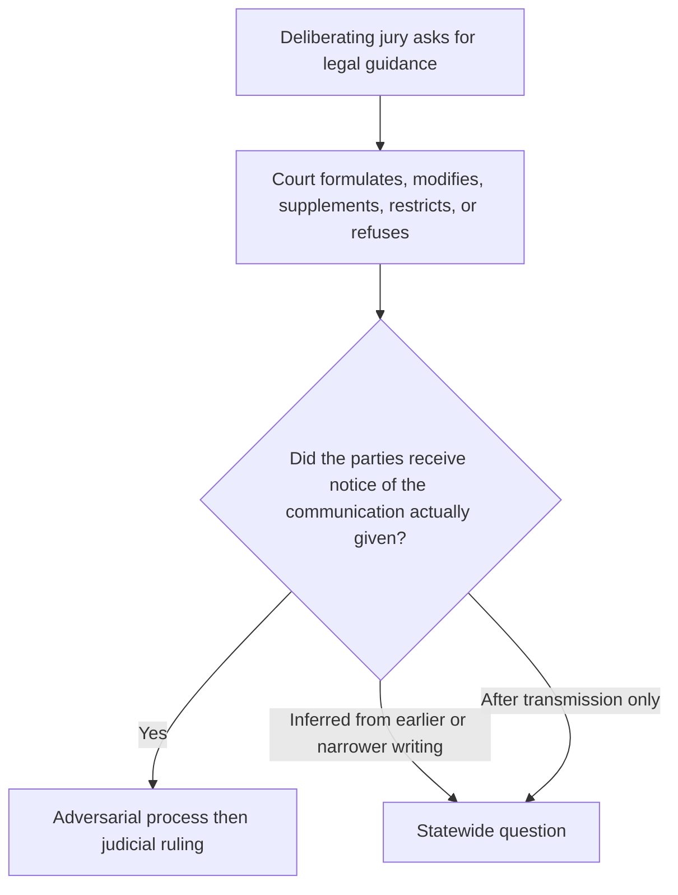
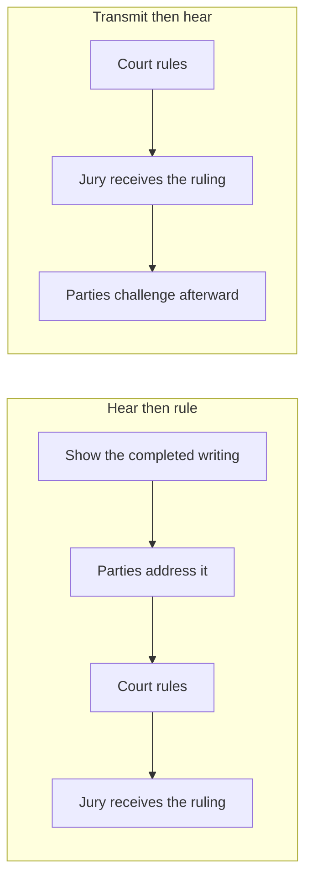
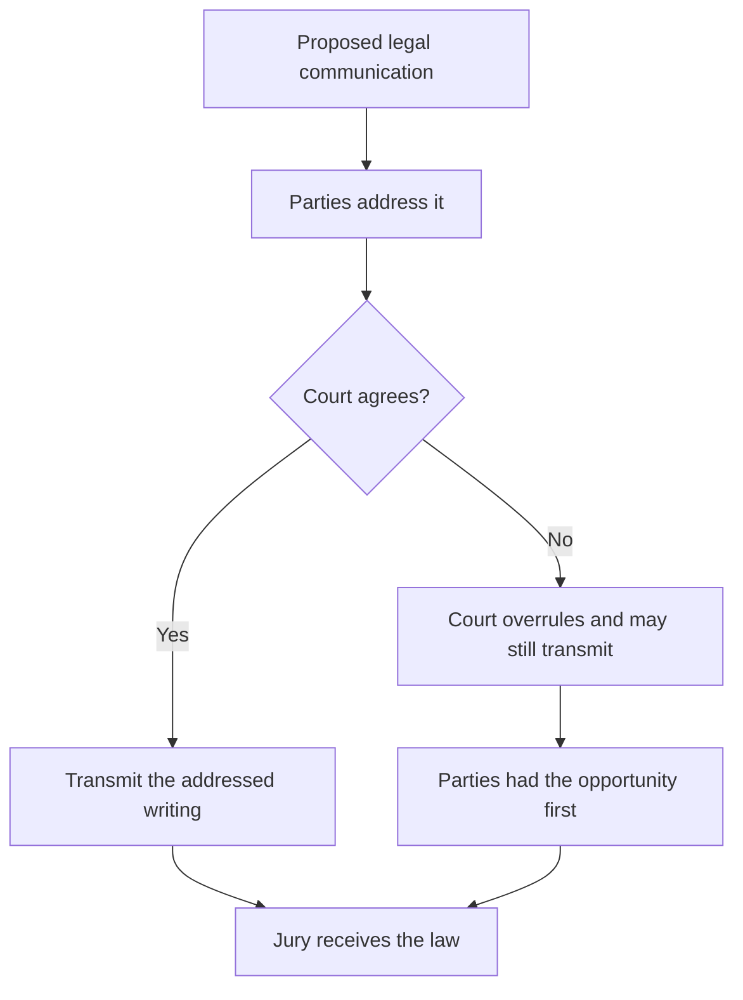
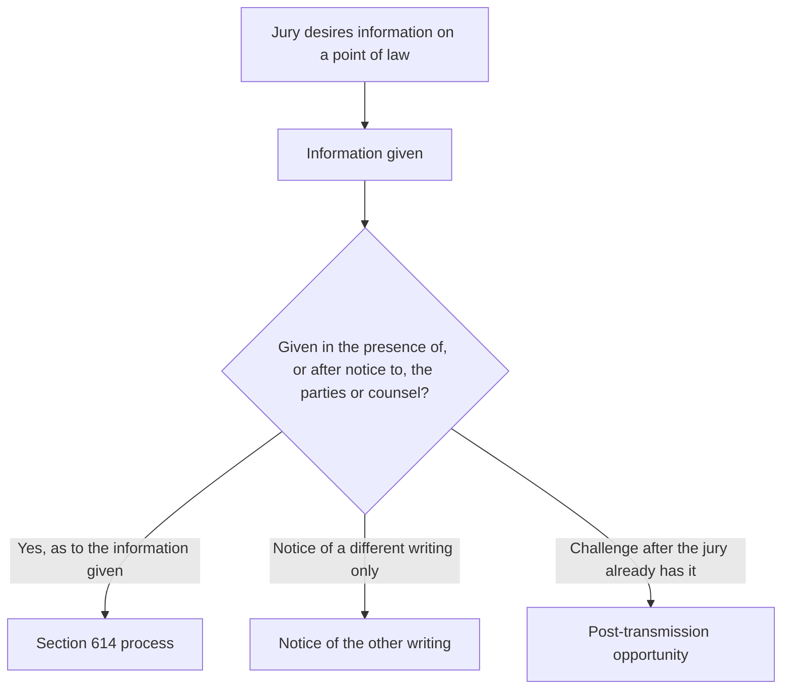
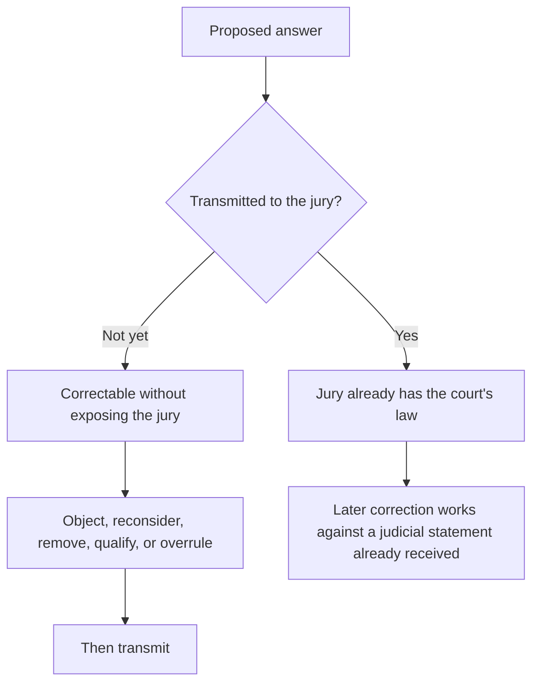
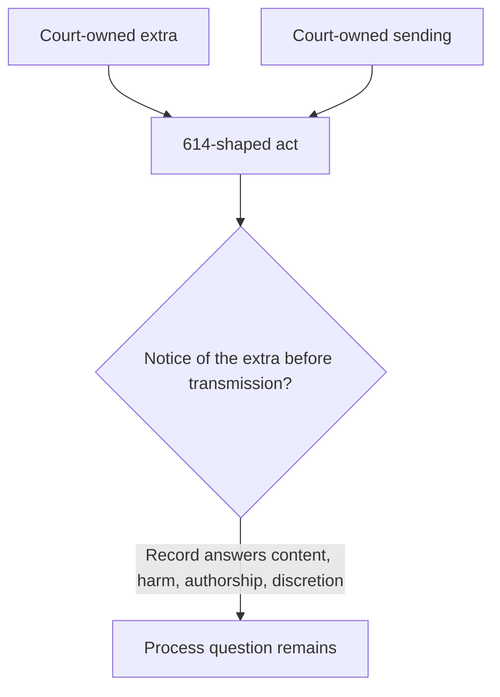
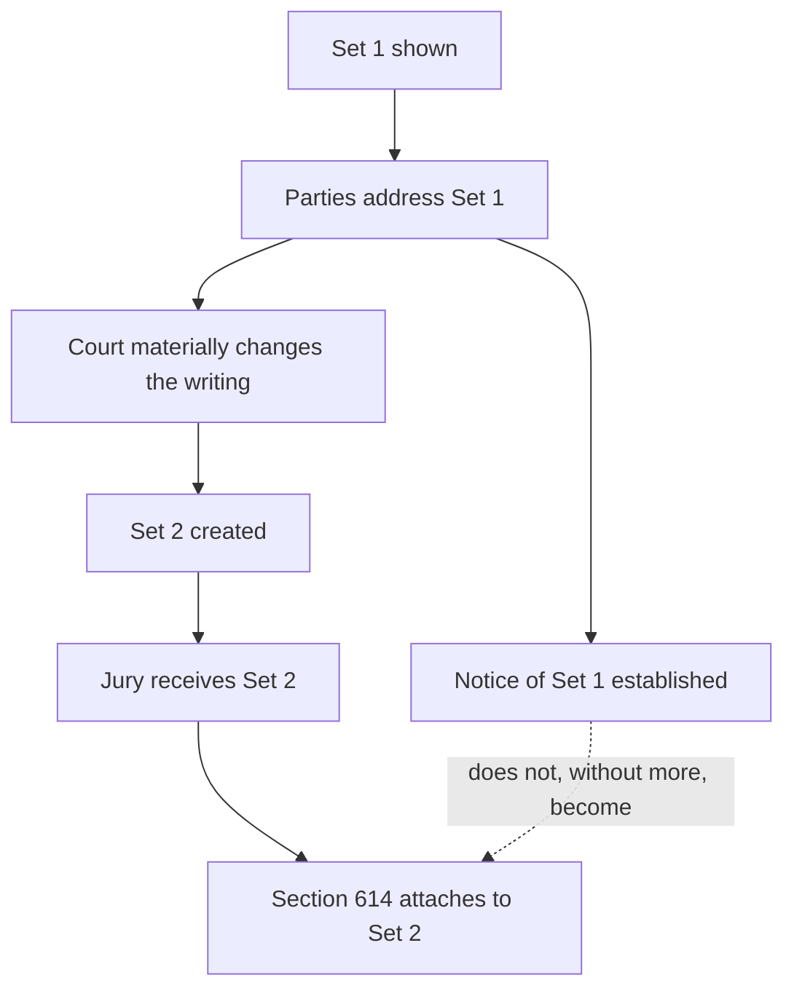
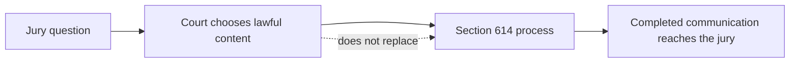
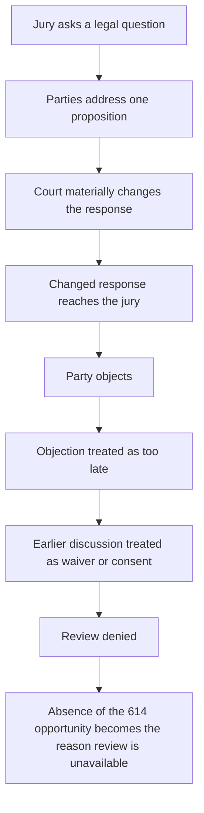
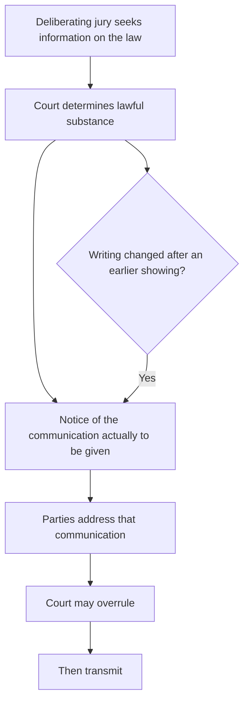

# The Statewide Question

> **This page is commentary published October 17, 2026.** It is published as speech under the First Amendment to the United States Constitution and article I, section 2 of the California Constitution. It is not a court filing. It is not service of any paper on any party. It does not restart any Code of Civil Procedure section 128.7 period. Formal positions remain those stated in papers already on file.

## Contents

1. [The broader question](#1-the-broader-question)
2. [The governing principle](#2-the-governing-principle)
3. [The judge decides the law](#3-the-judge-decides-the-law)
4. [But the decision must remain adversarial](#4-but-the-decision-must-remain-adversarial)
5. [Section 614 is the statutory safeguard](#5-section-614-is-the-statutory-safeguard)
6. [The jury receives rules, not ordinary information](#6-the-jury-receives-rules-not-ordinary-information)
7. [The principle reaches more than added language](#7-the-principle-reaches-more-than-added-language)
8. [Why transmission is the critical dividing line](#8-why-transmission-is-the-critical-dividing-line)
9. [What the record proved](#9-what-the-record-proved)
    - [The chain required to prove the act](#the-chain-required-to-prove-the-act)
10. [Notice of one version is not necessarily notice of another](#10-notice-of-one-version-is-not-necessarily-notice-of-another)
11. [Post-transmission objection is different](#11-post-transmission-objection-is-different)
12. [Judicial discretion has a procedural boundary](#12-judicial-discretion-has-a-procedural-boundary)
13. [Forfeiture, waiver, and invited error](#13-forfeiture-waiver-and-invited-error)
14. [The circularity problem](#14-the-circularity-problem)
15. [The broader statewide rule](#15-the-broader-statewide-rule)
16. [Why the issue extends beyond this case](#16-why-the-issue-extends-beyond-this-case)
17. [Why review is warranted](#17-why-review-is-warranted)

---

## 1. The broader question

The statewide question is broader than whether a trial judge may add one sentence to one jury response.

It is this:

**When a deliberating civil jury asks the court for legal guidance, what procedural limits constrain the court's authority to formulate, modify, supplement, restrict, or refuse that guidance before the court's answer becomes part of the jury's deliberative framework?**

More specifically:

**May a trial court exercise its discretion over the substance of a mid-deliberation legal response without first giving the parties notice of the substantive communication that will actually reach the jury and a meaningful opportunity to address it?**

And when the communication ultimately transmitted materially differs from what the parties previously addressed:

**May compliance with Code of Civil Procedure section 614 be inferred from notice of an earlier or narrower proposition, or must the statutory opportunity attach to the substantive judicial communication actually given?**

These questions concern the administration of every civil jury trial in California.

1. Broad: What procedural limits constrain mid-deliberation legal guidance before it becomes the jury's framework?
2. Specific: May the court decide the substance without first giving notice of the communication that will actually reach the jury?
3. When the writing changes: May section 614 compliance be inferred from notice of an earlier or narrower proposition?

The first question identifies the field. The second isolates the procedural act: notice of the writing that will actually reach the jury. The third is the recurring case. A court often shows or discusses one proposition, then transmits a different writing. If notice of the first writing satisfies section 614 as to the second, the statute attaches to a draft. If notice must attach to the communication actually given, the statute attaches to the information the jury receives. That is the difference between a drafting conversation and a completed judicial communication.

---

## 2. The governing principle

The broader principle is simple:

**The judge decides the law. But the judicial act of deciding the law does not eliminate the parties' right to participate in the process before the court's substantive legal communication reaches a deliberating jury.**

The parties do not have:

1. Control of the judge's answer.
2. A veto.
3. A right to their proposed language merely because they object.

The court may still:

1. Reject their arguments.
2. Overrule their objections.
3. Give an instruction neither party prefers.

But there is a fundamental difference between:

**hearing the parties and ruling against them,**

and

**ruling first, communicating the ruling to the deliberating jury, and allowing the parties to challenge the completed communication afterward.**

The first is judicial decisionmaking within the adversarial process.

The second raises the statewide question presented here.

| Path | Sequence | Character |
| --- | --- | --- |
| Adversarial ruling | Notice, hearing, ruling, then transmission | The court decides the law after the parties address the completed communication |
| Completed communication first | Ruling, transmission, then later challenge | The parties address an event that has already entered the jury room |

The legal ramification is the difference between an overruled objection and an unheard one. In the first path, the record contains the completed writing, the party's position on that writing, and the court's ruling. Review then asks whether the ruling was correct. In the second path, the jury already has the court's law before the party speaks to that law. Review is then asked to treat a later protest as tardy, or to treat an earlier discussion of a different writing as consent. The first path preserves both judicial authority and appellate review. The second path can extinguish review of the very communication the statute required the parties to see first.

---

## 3. The judge decides the law

Judicial independence in determining the law is not in dispute.

When a jury asks a question, the trial court must exercise judgment.

It may have to determine:

1. What statute governs.
2. What instruction applies.
3. Whether the jury's premise is mistaken.
4. Whether an existing instruction is sufficient.
5. Whether clarification is appropriate.
6. Whether additional legal information should be supplied.
7. Whether requested information would be misleading.
8. How much explanation is necessary.
9. Whether the requested instruction should be refused.

Those are exercises of judicial authority.

Section 614 does not transfer that authority to the parties.

The question is not whether the parties must consent to the judge's ultimate ruling.

They need not.

The question is whether the judge's authority to decide the ruling includes authority to bypass the procedure by which the parties are allowed to address the ruling before it enters the jury room.

Those nine determinations are the content of the response. They remain with the court after the parties are heard. Section 614 does not assign any of them to counsel. It assigns a sequence: the completed legal communication is shown or otherwise noticed, the parties address that communication, and the court then transmits. Collapsing the sequence into the content decision treats a ruling on the law as a ruling that the parties need not see the law first. That collapse is the statewide problem. The court still decides what the answer will be. The statute decides when that answer may enter the jury room.

---

## 4. But the decision must remain adversarial

The adversarial process has little meaning if it begins only after the judicial act capable of affecting the verdict has already occurred.

A party's opportunity to address a proposed legal communication serves several functions:

1. Identify controlling authority the court overlooked.
2. Identify an omitted qualification.
3. Explain that a proposed definition changes another instruction.
4. Show that the jury's question rests on an incorrect legal premise.
5. Argue that a statute not in the proposed response governs.
6. Identify prejudice from answering only part of the question.
7. Request a clarifying instruction.
8. Preserve an objection for review.

None of those functions requires that the court agree.

Their value lies in occurring **before the court's answer becomes authoritative law inside the jury room.**

The statewide principle therefore is not party control.

It is adversarial participation before judicial transmission.

Each of those functions operates on a proposed writing that has not yet become the jury's law. Counsel can still point to a missing qualification, an omitted statute, or a definition that changes another instruction, and the court can still overrule. After transmission, the same points must be recast as a request to retract the court's own statement. The legal comparison is therefore not between a winning objection and a losing one. It is between an objection that can prevent the communication and an objection that can only ask the court to unsay it. The first is the opportunity section 614 describes. The second is a different remedy, with a different burden and a different effect on deliberations already underway.

---

## 5. Section 614 is the statutory safeguard

Code of Civil Procedure section 614 gives that principle a specific statutory form after deliberations begin.

When jurors desire information on a point of law, the statute requires that the information be given "in the presence of, or after notice to, the parties or counsel."

The object of the statutory protection is the information given.

That distinction matters.

| What occurred | What it establishes | What it does not establish |
| --- | --- | --- |
| Notice that the jury asked a question | Notice of the request | Notice of what the court will tell the jury |
| Notice of one proposed response | Notice of that writing | Notice of a materially different response |
| Notice of one legal proposition | Notice of that proposition | Notice of a later inserted proposition |
| Opportunity to object after transmission | A later challenge | The opportunity the statute places before the information is given |

Section 614 therefore places a procedural boundary around the court's substantive authority.

The table is a comparison of objects. Notice of a jury request is notice that a question exists. It is not notice of the court's answer. Notice of one draft is notice of that draft. It is not notice of a later insertion, deletion, refusal, or restriction. A post-transmission objection is notice that the party has now seen what the jury already received. The statute's timing clause, "in the presence of, or after notice to," places the required opportunity before the information is given. Treating any of the first three rows as a substitute for the fourth row relocates that opportunity. The legal ramification is that the object of section 614 becomes whatever writing the court once discussed, rather than the writing the jury actually received.

---

## 6. The jury receives rules, not ordinary information

A judicial answer to a jury's legal question is different from ordinary information entering a trial.

| Source | What the jury may do with it |
| --- | --- |
| Witness | Accept or reject testimony |
| Attorney | Treat argument as argument, not evidence |
| Exhibit | Evaluate evidence |
| Judge answering a question of law | Follow the answer as the legal framework |

A witness gives testimony that the jury may accept or reject.

An attorney makes arguments that the jury is told are not evidence.

An exhibit supplies evidence the jury evaluates.

But when the trial judge answers a question of law, the jury receives the answer as an authoritative statement of the legal framework governing its decision.

The jury is expected to follow it.

That makes a substantive judge-to-jury communication uniquely consequential.

The communication can determine:

1. What legal duties matter.
2. Which facts are legally relevant.
3. What propositions jurors may consider.
4. What propositions jurors must disregard.
5. How statutory language should be understood.
6. What elements must be established.
7. How competing instructions relate to one another.
8. What rules govern the verdict.

A mid-deliberation legal answer therefore does more than provide information.

**It can change the rules under which deliberation proceeds.**

That is why the procedural protection must attach before transmission.

The comparison is between evidence the jury may weigh and law the jury must apply. Testimony, argument, and exhibits remain subject to the jury's evaluation. A mid-deliberation judicial answer does not. The jurors have identified the legal uncertainty on which the verdict may turn, and the court has answered it. That answer can open or close duties, redefine statutory terms, and tell the jury what it may not consider. The ramification is that an unnoticed addition, restriction, or refusal is not an unnoticed piece of evidence. It is an unnoticed change in the rules. Section 614 exists at that moment because the communication is the court's law, not a party's proof.

---

## 7. The principle reaches more than added language

The statewide problem should not be limited to a judge physically adding words to a draft.

The same principle applies whenever the court materially changes the legal framework communicated to a deliberating jury.

That can occur by:

1. Adding a legal proposition.
2. Deleting a qualification.
3. Supplying a statutory definition.
4. Modifying an existing instruction.
5. Giving a new instruction.
6. Refusing requested legal guidance.
7. Answering only part of a jury's question.
8. Combining separate legal propositions into one response.
9. Restricting consideration of a subject.
10. Characterizing a legal subject as unavailable to the jury.
11. Resolving an ambiguity in a way not previously disclosed.
12. Materially changing the proposed response after the parties addressed an earlier version.

The controlling question should therefore concern **substantive judicial communication**, not merely textual addition.

The rule should follow substance rather than drafting mechanics.

A rule confined to added words would leave the same harm available by other means. A court can change the legal framework by refusing the requested statute, by answering only half the question, or by combining a research limit with a later refusal. Each of those acts is a completed judicial communication. The comparison among the twelve methods is therefore not a catalog of drafting techniques. It is a comparison of ways the jury's law can change after the parties have addressed a different writing. Section 614 attaches to that change because the information given is the changed writing.

---

## 8. Why transmission is the critical dividing line

Transmission is the critical event because that is when the court's proposed answer becomes the jury's legal instruction.

Before transmission, the process remains correctable without exposing the jury to the disputed communication:

1. A party may object.
2. The court may reconsider.
3. Language may be removed.
4. A missing qualification may be supplied.
5. A legal error may be corrected.
6. An ambiguity may be resolved.
7. The court may reject the objection and transmit the answer unchanged.

But the important point is that the adversarial process has performed its function before judicial authority enters the jury room.

After transmission, the problem changes.

The jury has received the answer from the court.

Any later correction must operate against something the jury has already been told by the judge.

The difference is therefore not merely chronological.

It is structural.

**Before transmission, the parties participate in determining whether an error reaches the jury. After transmission, they can only ask the court to repair an event that has already occurred.**

| Timing | What the parties can still do |
| --- | --- |
| Before transmission | Participate in whether the error reaches the jury |
| After transmission | Ask the court to repair an event that has already occurred |

The ramification of that comparison is practical and legal. Before transmission, an objection can keep the disputed sentence out of the jury room. After transmission, the same sentence is already the court's instruction. A later "correction" asks the jury to disregard a statement the judge has just made, or to prefer a second statement over the first. That is a different proceeding. It introduces questions of curability and prejudice that section 614 is designed to avoid by requiring notice first. Equating the two moments treats a repair as the statutory opportunity. The statute describes the earlier moment.

---

## 9. What the record proved

### The chain required to prove the act

1. Acc. 5. 11 RT 8:7-12. "You enhanced it by adding that highways also indicates street. ... You enhanced the statement and you sent that back."
2. Court. 11 RT 7:27-8:2. "even if this was something that was gratuitous on the part of the Court, the Court is defining"
3. Court. 11 RT 8:13-16. "It says, 'Highway includes street.'"
4. Court. 11 RT 6:19-21. "delivering it to the Jury"
5. Court. 11 RT 11:28-12:4. "discretion to issue these responses"
6. Counsel. 11 RT 11:26-27. "I have nothing to add, Your Honor, to what Your Honor said."

Extra added. Extra sent. No sentence that either did not occur.

The material predicate presented here is the judicial act itself.

Additional legal language was supplied by the court.

The supplemented response was communicated to the deliberating jury.

Those propositions rest on the court's own descriptions of what occurred rather than on an Evidence Code section 600(b) deduction.

The court described the street sentence as "gratuitous on the part of the Court" and stated that "the Court is defining."

Rosario charged, "you sent that back."

The court spoke of "delivering it to the Jury" and later asserted its "discretion to issue these responses."

When confronted with the additional language, the court defended the legal proposition itself:

"It says, 'Highway includes street.'"

Counsel responded:

"I have nothing to add, Your Honor, to what Your Honor said."

The significant distinction is between two separate questions:

1. Was the judicially supplied proposition legally correct? That question concerns substance.
2. Was the statutory procedure followed before that proposition was communicated to the jury? That question concerns section 614.

A court's confidence in the substantive correctness of its answer does not itself establish compliance with the procedure governing transmission.

| Asked | Court's answer on this record | Question left |
| --- | --- | --- |
| Extra added? | "gratuitous on the part of the Court"; "the Court is defining" | Substance owned |
| Extra sent? | "you sent that back"; "delivering it to the Jury"; "discretion to issue these responses" | Sending owned |
| Is the extra correct? | "It says, 'Highway includes street.'" | Content |
| Was section 614 followed as to the extra? | Not answered by those verbs | Process |

The scorecard is a comparison of two inquiries. Extra plus sending are court-owned facts. The court claimed the street sentence as its own extra and used delivery and issuance verbs. Counsel joined the substance defense. Those verbs answer authorship, accuracy, and authority. They do not recite a showing of the completed extra before transmission. Nobody said the parties already had that page. Nobody said the extra was not sent. The legal ramification is that a reviewing court can take the addition and the sending as established without treating a later content defense as section 614 notice. *Nelson v. Southern Pacific Co.* (1937) 8 Cal.2d 648, 655, applied the statute by examining the communication that occurred. A spoken confession that the judge "violated section 614" is not the missing element. Notice of the extra is the remaining question.

---

## 10. Notice of one version is not necessarily notice of another

The distinction becomes especially important when the parties have previously seen or discussed some version of the response.

Suppose the parties are shown Set 1.

They address Set 1.

The court thereafter materially changes Set 1 and creates Set 2.

The jury receives Set 2.

The statutory question concerns Set 2.

Showing the parties Set 1 establishes that the parties saw Set 1.

It does not answer whether the parties received notice of the material difference between Set 1 and Set 2 before Set 2 was transmitted.

Otherwise, the first presentation would function as an unlimited authorization for later judicial modifications.

Section 614 contains no obvious reason to treat notice that broadly.

The information that matters is the substantive judicial communication actually given to the jury.

| Writing | What notice of that writing proves |
| --- | --- |
| Set 1 | The parties saw Set 1 |
| Set 2, the writing given | The statutory object |
| Set 1 used as notice of Set 2 | An inference the statute does not supply |

The comparison is between two writings. Set 1 is the writing the parties addressed. Set 2 is the writing the jury received. Section 614 names the information given. The information given is Set 2. Treating notice of Set 1 as notice of Set 2 converts an earlier discussion into a standing waiver of later judicial changes. The ramification statewide is that a court could show one definition, add a second definition, transmit the second, and then treat the first showing as the statutory opportunity. The party would have addressed a different page. Review would then be asked to call that address consent. The statute supplies no such substitution. Notice follows the writing that entered the jury room.

---

## 11. Post-transmission objection is different

The difference between pre-transmission participation and post-transmission objection is substantial.

Before transmission, a party can say:

**This should not be given to the jury in this form.**

After transmission, the party must say:

**The jury has already received this from the court; now something must be done about it.**

Those procedural positions are not equivalent.

The latter may require:

1. A corrective instruction.
2. An explanation of the correction.
3. Withdrawal of an earlier proposition.
4. Additional argument over curability.
5. Consideration of prejudice.
6. Consideration of whether the effect can be cured at all.

The point is not that every defect necessarily requires reversal or mistrial.

The point is that **the statutory opportunity before transmission serves a preventive function that a later opportunity cannot perfectly reproduce.**

| Moment | What the party can say |
| --- | --- |
| Before transmission | This should not be given to the jury in this form |
| After transmission | The jury has already received this from the court; now something must be done about it |

The two sentences are not interchangeable positions on the same record. The first is an objection to a proposed communication. The second is a request to unwind a communication already delivered. The first can be overruled and still satisfy section 614, because the party addressed the completed writing before the jury received it. The second cannot reconstruct that sequence. It can only ask whether prejudice can be undone. Equating them treats a curative motion as the statutory notice condition. The condition is prior. The later motion is a different claim, with a different standard.

---

## 12. Judicial discretion has a procedural boundary

This produces the central statewide distinction:

**Judicial discretion governs the lawful substance of a jury response. It does not necessarily govern whether the statutory procedure protecting adversarial participation will occur.**

The court may:

1. Decide the law.
2. Reject an objection.
3. Refuse an instruction.
4. Formulate its own answer.

But those substantive powers should not automatically carry an additional procedural power to decide:

**I may communicate this materially different legal ruling first and hear the parties afterward.**

If substantive discretion carried that procedural authority, the statutory protection would depend upon the discretion it is supposed to regulate.

The same judge would then control both the law the jury receives and whether anyone may challenge the completed legal communication before the jury receives it.

Section 614 supplies the boundary between those powers.

| Power | Who holds it | Limit |
| --- | --- | --- |
| Lawful substance of the response | The trial court | The court decides the law |
| Process of delivery | Section 614 | Presence or notice before the information is given |
| Combining the two | Not supplied by content discretion | The safeguard would then depend on the discretion it regulates |

The comparison is between two powers that belong to different sources. Content discretion is judicial. The court chooses the lawful answer. Process is statutory. The Legislature required presence or notice before the information is given. If the first power absorbs the second, the same officer decides both what the jury will be told and whether anyone may see that statement first. Section 614 then becomes optional in every case in which the court is confident of the substance. Confidence in the code book, a finding of no harm, or a claim of "discretion to issue" answers the content question. Those answers leave the process question open. The ramification is that substance discretion, used as a substitute for notice, makes the safeguard contingent on the discretion it was enacted to regulate.

---

## 13. Forfeiture, waiver, and invited error

The procedural distinction also matters when an appellate court considers preservation.

Waiver, forfeiture, and invited error should be tied to the judicial act actually challenged.

A reviewing court should therefore distinguish among:

1. Agreement with an earlier draft.
2. Agreement with one proposition contained within a response.
3. Agreement that jurors themselves should not independently research or apply uninstructed law.
4. Acquiescence in a procedural step.
5. Failure to object after adequate notice.
6. Actual assent to the completed substantive communication ultimately transmitted.

Those are not automatically equivalent.

If the challenged error is a judicial addition, modification, restriction, refusal, or other substantive change, the preservation inquiry should ask whether the party had the statutory opportunity to address **that challenged act** before it occurred.

The court should not be permitted to collapse a series of distinct propositions into one generalized finding of "agreement" without identifying what the party actually accepted.

The comparison among those six labels is a comparison of objects. Agreement to a research limit is agreement that jurors may not apply uninstructed law. It is not agreement to a later refusal of requested statutes, or to a later inserted definition. Acquiescence in a procedural step is a position on that step. Failure to object after adequate notice is a position on the noticed writing. Actual assent to the completed communication is the only one of the six that matches the 614 object. The ramification on review is invited-error and forfeiture doctrine. Those doctrines follow the act the party induced or declined to challenge. They do not convert assent to one writing into assent to a different writing the party was not shown. A composite finding of "agreement to the response" erases that assignment. It treats Set 1 conduct as Set 2 consent.

---

## 14. The circularity problem

Otherwise the process can become circular:

1. The jury asks a legal question.
2. The parties address one proposition.
3. The court materially changes the legal response.
4. The changed response reaches the jury.
5. The party learns what occurred and objects.
6. The objection is deemed too late.
7. The earlier discussion of another proposition is then characterized as waiver or consent.
8. Appellate review is denied because the party supposedly failed to object to the very communication the party contends was transmitted without the required prior opportunity to object.

That sequence would make the procedural violation capable of creating its own forfeiture.

The statutory safeguard cannot meaningfully operate if the absence of the protected opportunity is later used as the reason review is unavailable.

The circular sequence has a legal name: the process error supplies the preservation holding. The party addresses one proposition. The court transmits another. The later objection is called untimely because the writing has already gone. The earlier discussion is then called waiver of the transmitted writing. Review never reaches whether section 614 attached to the information given. The ramification is that a missed showing becomes proof that the showing was unnecessary. That is why the case can arrive as a forfeiture case instead of a 614 case. The comparison is between a record that identifies the challenged communication and a record that substitutes a different communication as the object of consent.

---

## 15. The broader statewide rule

The statewide rule should therefore extend beyond judicial additions to any material substantive communication concerning the law during jury deliberations:

**When a deliberating civil jury seeks information concerning the law, the trial court retains authority to determine the lawful substance of its response. But before a substantive judicial communication that adds, modifies, clarifies, restricts, refuses, or otherwise materially defines the legal framework of deliberation is transmitted to the jury, Code of Civil Procedure section 614 requires notice sufficient to provide the parties a meaningful opportunity to address that communication.**

**Party consent to the court's ultimate ruling is not required. The court remains free to reject the parties' positions. But judicial discretion over the substance of the response does not include discretion to eliminate the adversarial procedure governing its transmission.**

**When the communication ultimately given materially differs from the communication previously disclosed, notice of the earlier communication does not, without more, establish notice of the later judicial act.**

**And waiver, forfeiture, or invited error should rest upon conduct directed to the challenged communication itself, after the party has received the opportunity the law provides to address it.**

The principle can be stated still more broadly:

> **The judge controls the ruling. The law controls the process by which that ruling reaches the deliberating jury.**

Or:

> **Judicial independence determines the law; adversarial process governs how a new judicial statement of that law enters the jury room.**

That boundary protects both principles without diminishing either.

---

## 16. Why the issue extends beyond this case

The issue is not confined to one Vehicle Code provision, one jury request, one civil action, or one disputed sentence.

It arises whenever a California civil jury asks:

1. What does this instruction mean?
2. What law applies?
3. May we consider this?
4. What does this statutory term mean?
5. What happens if we find this fact?
6. Are these two instructions inconsistent?
7. Does this legal duty apply?
8. May we use this legal provision?
9. What is required before liability exists?
10. What legal rule controls our next decision?

At that moment, the court's answer may become more influential than an instruction given before deliberations began because the answer responds to a legal uncertainty the jury itself has identified.

Trial courts therefore need a uniform procedural rule.

Litigants need to know when their opportunity to object exists.

And reviewing courts need a common standard for determining whether that opportunity occurred and whether it was relinquished.

The issue affects every civil action capable of reaching a jury:

1. Negligence.
2. Contract.
3. Employment.
4. Insurance.
5. Products liability.
6. Professional liability.
7. Statutory causes of action.
8. Damages proceedings.
9. Comparative-fault cases.

The substantive law will change from case to case.

The procedural question does not.

The comparison across those jury asks, and across those civil fields, is the same comparison drawn above. The statute named in the note will change. The requested definition will change. The verdict form will change. The court's authority to decide the lawful answer remains. The requirement that the parties see the completed answer before the jury does remains. A uniform rule is needed because a reviewing court in a contract case and a trial judge in a negligence case will otherwise treat notice of a draft, or a post-transmission invitation to object, as interchangeable with notice of the information given. Those substitutes are the same substitutes in every civil jury trial. The ramifications do not depend on Vehicle Code section 22107. They depend on whether section 614 follows the writing the jury received.

---

## 17. Why review is warranted

The question concerns:

1. The boundary between judicial discretion and adversarial procedure during deliberations.
2. When the court may communicate substantive law to the jury.
3. What section 614 means by notice.
4. Whether notice attaches merely to the existence of a jury request or instead to the substantive judicial information ultimately provided.
5. Whether a material modification requires a renewed opportunity to be heard.
6. Whether a post-transmission objection can substitute for the statutory opportunity that would have existed before transmission.
7. Whether forfeiture, waiver, or invited error may be founded on conduct occurring before the party had notice of the judicial communication actually challenged.

Those questions require a uniform statewide answer.

The broader principle is:

**The court possesses authority to determine the law, but that authority operates within an adversarial judicial process. Once a jury has begun deliberating, section 614 protects that process at the precise point where a new judicial statement of law is about to enter the jury room.**

The judge may ultimately decide the question alone.

The judge should not decide it outside the process that gives the parties an opportunity to address the completed legal communication before the jury receives it.

That is not a limitation on the judiciary's authority to determine law.

**It is the procedural condition under which that authority is exercised during jury deliberations.**

The Supreme Court should grant review to define that boundary for California civil trials.
