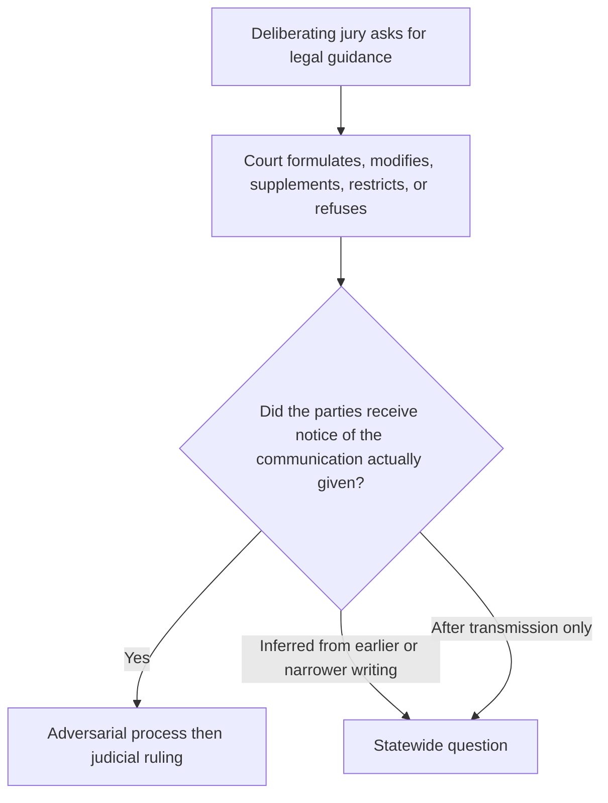
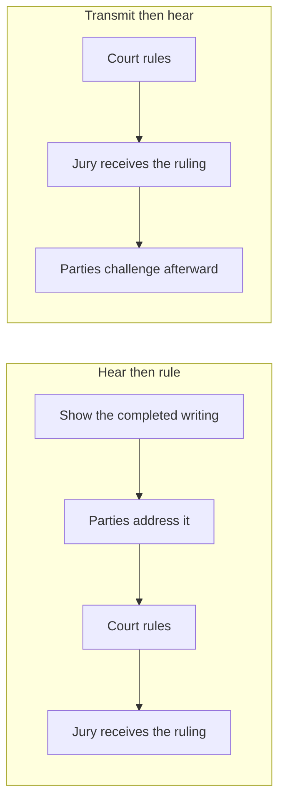
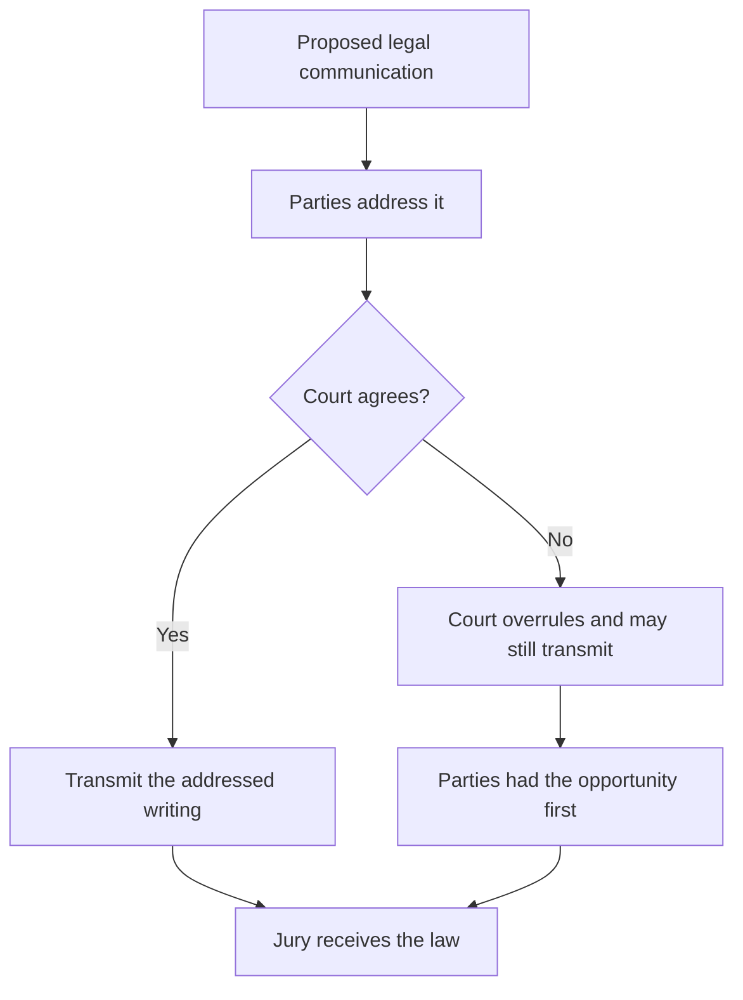
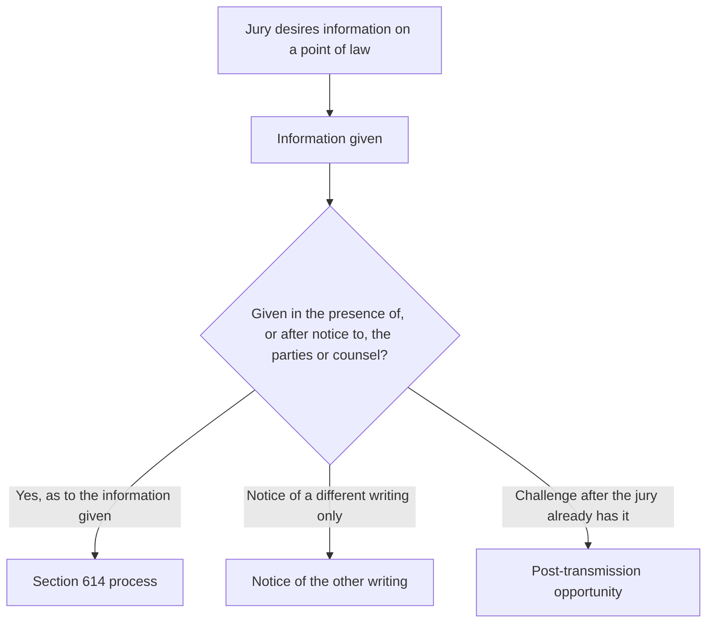
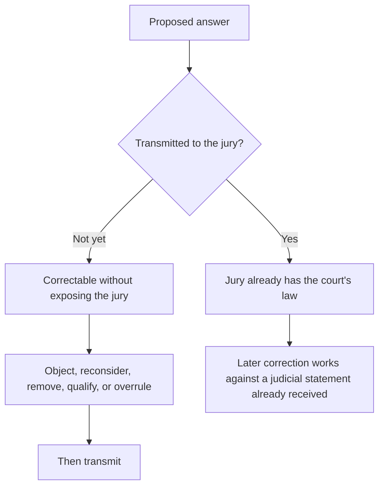
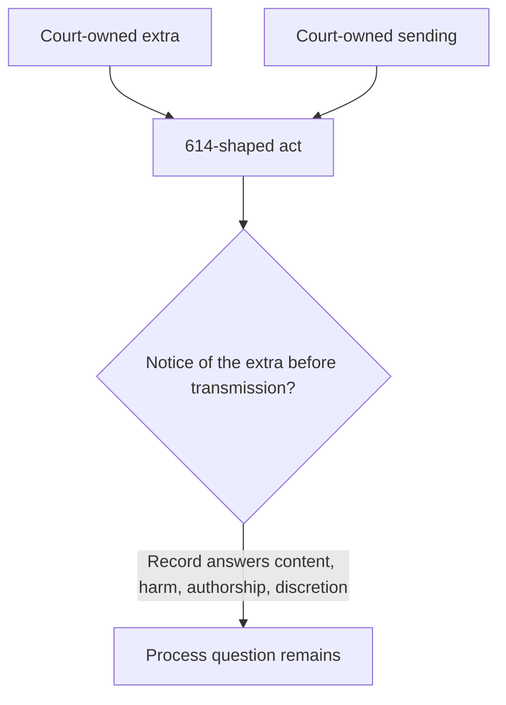
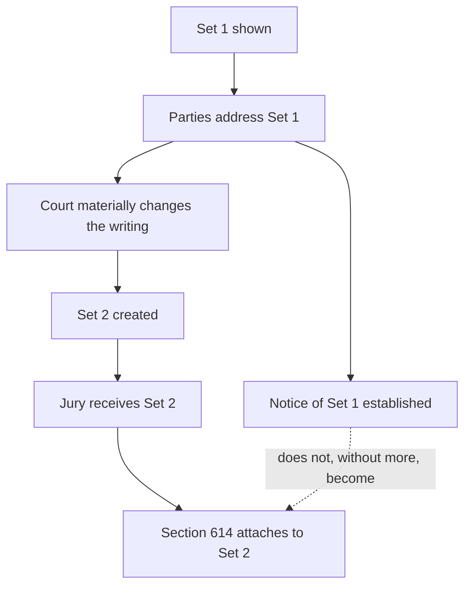
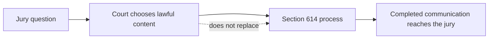
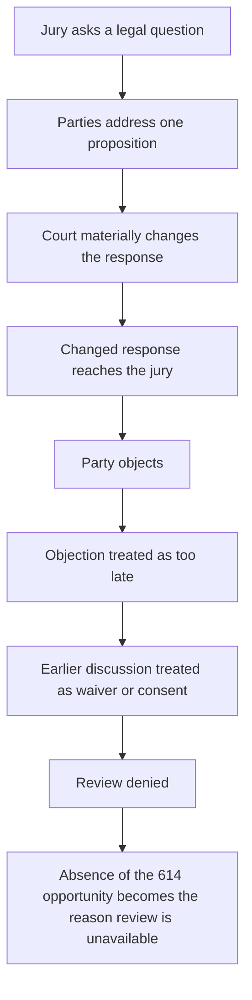
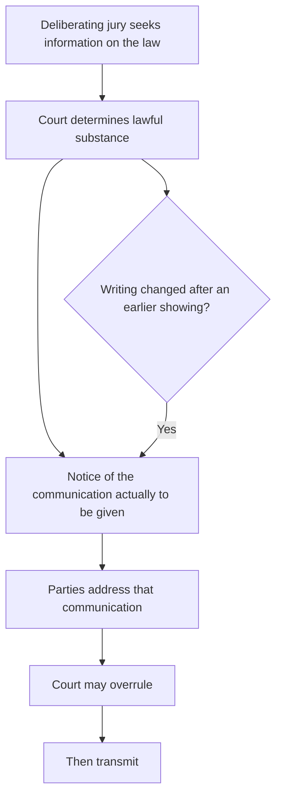

# The Statewide Question

> **This page is commentary published October 17, 2026.** It is published as speech under the First Amendment to the United States Constitution and article I, section 2 of the California Constitution. It is not a court filing. It is not service of any paper on any party. It does not restart any Code of Civil Procedure section 128.7 period. Formal positions remain those stated in papers already on file.

## Contents

1. [The broader question](#1-the-broader-question)
2. [The governing principle](#2-the-governing-principle)
3. [The judge decides the law](#3-the-judge-decides-the-law)
4. [But the decision must remain adversarial](#4-but-the-decision-must-remain-adversarial)
5. [Section 614 is the statutory safeguard](#5-section-614-is-the-statutory-safeguard)
6. [The jury receives rules, not ordinary information](#6-the-jury-receives-rules-not-ordinary-information)
7. [The principle reaches more than added language](#7-the-principle-reaches-more-than-added-language)
8. [Why transmission is the critical dividing line](#8-why-transmission-is-the-critical-dividing-line)
9. [What the record proved](#9-what-the-record-proved)
10. [Notice of one version is not necessarily notice of another](#10-notice-of-one-version-is-not-necessarily-notice-of-another)
11. [Post-transmission objection is different](#11-post-transmission-objection-is-different)
12. [Judicial discretion has a procedural boundary](#12-judicial-discretion-has-a-procedural-boundary)
13. [Forfeiture, waiver, and invited error](#13-forfeiture-waiver-and-invited-error)
14. [The circularity problem](#14-the-circularity-problem)
15. [The broader statewide rule](#15-the-broader-statewide-rule)
16. [Why the issue extends beyond this case](#16-why-the-issue-extends-beyond-this-case)
17. [Why review is warranted](#17-why-review-is-warranted)

---

## 1. The broader question

The statewide question is broader than whether a trial judge may add one sentence to one jury response.

It is this:

**When a deliberating civil jury asks the court for legal guidance, what procedural limits constrain the court's authority to formulate, modify, supplement, restrict, or refuse that guidance before the court's answer becomes part of the jury's deliberative framework?**

More specifically:

**May a trial court exercise its discretion over the substance of a mid-deliberation legal response without first giving the parties notice of the substantive communication that will actually reach the jury and a meaningful opportunity to address it?**

And when the communication ultimately transmitted materially differs from what the parties previously addressed:

**May compliance with Code of Civil Procedure section 614 be inferred from notice of an earlier or narrower proposition, or must the statutory opportunity attach to the substantive judicial communication actually given?**

These questions concern the administration of every civil jury trial in California.

| Layer | Question |
| --- | --- |
| Broad | What procedural limits constrain mid-deliberation legal guidance before it becomes the jury's framework? |
| Specific | May the court decide the substance without first giving notice of the communication that will actually reach the jury? |
| When the writing changes | May section 614 compliance be inferred from notice of an earlier or narrower proposition? |

---

## 2. The governing principle

The broader principle is simple:

**The judge decides the law. But the judicial act of deciding the law does not eliminate the parties' right to participate in the process before the court's substantive legal communication reaches a deliberating jury.**

| What the parties do not have | What the court may still do |
| --- | --- |
| Control of the judge's answer | Reject their arguments |
| A veto | Overrule their objections |
| A right to their proposed language merely because they object | Give an instruction neither party prefers |

But there is a fundamental difference between:

**hearing the parties and ruling against them,**

and

**ruling first, communicating the ruling to the deliberating jury, and allowing the parties to challenge the completed communication afterward.**

The first is judicial decisionmaking within the adversarial process.

The second raises the statewide question presented here.

| Path | Sequence | Character |
| --- | --- | --- |
| Adversarial ruling | Notice, hearing, ruling, then transmission | The court decides the law after the parties address the completed communication |
| Completed communication first | Ruling, transmission, then later challenge | The parties address an event that has already entered the jury room |

---

## 3. The judge decides the law

Judicial independence in determining the law is not in dispute.

When a jury asks a question, the trial court must exercise judgment.

It may have to determine:

| Discretion over content | Example |
| --- | --- |
| Governing law | What statute governs |
| Instruction | What instruction applies |
| Premise | Whether the jury's premise is mistaken |
| Sufficiency | Whether an existing instruction is sufficient |
| Clarification | Whether clarification is appropriate |
| Addition | Whether additional legal information should be supplied |
| Misleading risk | Whether requested information would be misleading |
| Scope | How much explanation is necessary |
| Refusal | Whether the requested instruction should be refused |

Those are exercises of judicial authority.

Section 614 does not transfer that authority to the parties.

The question is not whether the parties must consent to the judge's ultimate ruling.

They need not.

The question is whether the judge's authority to decide the ruling includes authority to bypass the procedure by which the parties are allowed to address the ruling before it enters the jury room.

---

## 4. But the decision must remain adversarial

The adversarial process has little meaning if it begins only after the judicial act capable of affecting the verdict has already occurred.

A party's opportunity to address a proposed legal communication serves several functions.

| Function before transmission | What it does |
| --- | --- |
| Controlling authority | Identify authority the court overlooked |
| Qualification | Identify an omitted qualification |
| Interaction | Explain that a proposed definition changes another instruction |
| Premise | Show that the jury's question rests on an incorrect legal premise |
| Completeness | Argue that a statute not in the proposed response governs |
| Partial answer | Identify prejudice from answering only part of the question |
| Clarification | Request a clarifying instruction |
| Preservation | Preserve an objection for review |

None of those functions requires that the court agree.

Their value lies in occurring **before the court's answer becomes authoritative law inside the jury room.**

The statewide principle therefore is not party control.

It is adversarial participation before judicial transmission.

---

## 5. Section 614 is the statutory safeguard

Code of Civil Procedure section 614 gives that principle a specific statutory form after deliberations begin.

When jurors desire information on a point of law, the statute requires that the information be given "in the presence of, or after notice to, the parties or counsel."

The object of the statutory protection is the information given.

That distinction matters.

| What occurred | What it establishes | What it does not establish |
| --- | --- | --- |
| Notice that the jury asked a question | Notice of the request | Notice of what the court will tell the jury |
| Notice of one proposed response | Notice of that writing | Notice of a materially different response |
| Notice of one legal proposition | Notice of that proposition | Notice of a later inserted proposition |
| Opportunity to object after transmission | A later challenge | The opportunity the statute places before the information is given |

Section 614 therefore places a procedural boundary around the court's substantive authority.

---

## 6. The jury receives rules, not ordinary information

A judicial answer to a jury's legal question is different from ordinary information entering a trial.

| Source | What the jury may do with it |
| --- | --- |
| Witness | Accept or reject testimony |
| Attorney | Treat argument as argument, not evidence |
| Exhibit | Evaluate evidence |
| Judge answering a question of law | Follow the answer as the legal framework |

A witness gives testimony that the jury may accept or reject.

An attorney makes arguments that the jury is told are not evidence.

An exhibit supplies evidence the jury evaluates.

But when the trial judge answers a question of law, the jury receives the answer as an authoritative statement of the legal framework governing its decision.

The jury is expected to follow it.

That makes a substantive judge-to-jury communication uniquely consequential.

The communication can determine the rules under which deliberation proceeds.

| What the answer can set | Effect inside the jury room |
| --- | --- |
| Legal duties | Which duties matter |
| Facts | Which facts are legally relevant |
| Consideration | What propositions jurors may consider |
| Exclusion | What propositions jurors must disregard |
| Statutory language | How the terms should be understood |
| Elements | What must be established |
| Instruction relationship | How competing instructions relate |
| Verdict rules | What rules govern the verdict |

A mid-deliberation legal answer therefore does more than provide information.

**It can change the rules under which deliberation proceeds.**

That is why the procedural protection must attach before transmission.

---

## 7. The principle reaches more than added language

The statewide problem should not be limited to a judge physically adding words to a draft.

The same principle applies whenever the court materially changes the legal framework communicated to a deliberating jury.

That can occur by:

| Material change | Example |
| --- | --- |
| Addition | Adding a legal proposition |
| Deletion | Deleting a qualification |
| Definition | Supplying a statutory definition |
| Modification | Modifying an existing instruction |
| New instruction | Giving a new instruction |
| Refusal | Refusing requested legal guidance |
| Partial answer | Answering only part of a jury's question |
| Combination | Combining separate legal propositions into one response |
| Restriction | Restricting consideration of a subject |
| Characterization | Characterizing a legal subject as unavailable to the jury |
| Undisclosed resolution | Resolving an ambiguity in a way not previously disclosed |
| Later change | Materially changing the proposed response after the parties addressed an earlier version |

The controlling question should therefore concern **substantive judicial communication**, not merely textual addition.

The rule should follow substance rather than drafting mechanics.

---

## 8. Why transmission is the critical dividing line

Transmission is the critical event because that is when the court's proposed answer becomes the jury's legal instruction.

Before transmission, the process remains correctable without exposing the jury to the disputed communication.

| Before transmission | What can still happen |
| --- | --- |
| Objection | A party may object |
| Reconsideration | The court may reconsider |
| Removal | Language may be removed |
| Qualification | A missing qualification may be supplied |
| Correction | A legal error may be corrected |
| Ambiguity | An ambiguity may be resolved |
| Overrule | The court may reject the objection and transmit the answer unchanged |

But the important point is that the adversarial process has performed its function before judicial authority enters the jury room.

After transmission, the problem changes.

The jury has received the answer from the court.

Any later correction must operate against something the jury has already been told by the judge.

The difference is therefore not merely chronological.

It is structural.

**Before transmission, the parties participate in determining whether an error reaches the jury. After transmission, they can only ask the court to repair an event that has already occurred.**

| Timing | What the parties can still do |
| --- | --- |
| Before transmission | Participate in whether the error reaches the jury |
| After transmission | Ask the court to repair an event that has already occurred |

---

## 9. What the record proved

The material predicate presented here is the judicial act itself.

Additional legal language was supplied by the court.

The supplemented response was communicated to the deliberating jury.

Those propositions rest on the court's own descriptions of what occurred rather than on an Evidence Code section 600(b) deduction.

The court described the street sentence as "gratuitous on the part of the Court" and stated that "the Court is defining."

Rosario charged, "you sent that back."

The court spoke of "delivering it to the Jury" and later asserted its "discretion to issue these responses."

When confronted with the additional language, the court defended the legal proposition itself:

"It says, 'Highway includes street.'"

Counsel responded:

"I have nothing to add, Your Honor, to what Your Honor said."

The significant distinction is between two separate questions.

| Question | Subject |
| --- | --- |
| Was the judicially supplied proposition legally correct? | Substance |
| Was the statutory procedure followed before that proposition was communicated to the jury? | Section 614 |

A court's confidence in the substantive correctness of its answer does not itself establish compliance with the procedure governing transmission.

| Asked | Court's answer on this record | Question left |
| --- | --- | --- |
| Extra added? | "gratuitous on the part of the Court"; "the Court is defining" | Substance owned |
| Extra sent? | "you sent that back"; "delivering it to the Jury"; "discretion to issue these responses" | Sending owned |
| Is the extra correct? | "It says, 'Highway includes street.'" | Content |
| Was section 614 followed as to the extra? | Not answered by those verbs | Process |

---

## 10. Notice of one version is not necessarily notice of another

The distinction becomes especially important when the parties have previously seen or discussed some version of the response.

Suppose the parties are shown Set 1.

They address Set 1.

The court thereafter materially changes Set 1 and creates Set 2.

The jury receives Set 2.

The statutory question concerns Set 2.

Showing the parties Set 1 establishes that the parties saw Set 1.

It does not answer whether the parties received notice of the material difference between Set 1 and Set 2 before Set 2 was transmitted.

Otherwise, the first presentation would function as an unlimited authorization for later judicial modifications.

Section 614 contains no obvious reason to treat notice that broadly.

The information that matters is the substantive judicial communication actually given to the jury.

| Writing | What notice of that writing proves |
| --- | --- |
| Set 1 | The parties saw Set 1 |
| Set 2, the writing given | The statutory object |
| Set 1 used as notice of Set 2 | An inference the statute does not supply |

---

## 11. Post-transmission objection is different

The difference between pre-transmission participation and post-transmission objection is substantial.

Before transmission, a party can say:

**This should not be given to the jury in this form.**

After transmission, the party must say:

**The jury has already received this from the court; now something must be done about it.**

Those procedural positions are not equivalent.

The latter may require work that a pre-transmission objection does not.

| After transmission | What may then be required |
| --- | --- |
| Corrective instruction | A new writing against the first answer |
| Explanation of the correction | An account of why the first answer changed |
| Withdrawal | Removal of an earlier proposition already received |
| Curability | Additional argument over whether the first answer can be undone |
| Prejudice | Consideration of the effect already produced |
| Incurable effect | Consideration of whether the effect can be cured at all |

The point is not that every defect necessarily requires reversal or mistrial.

The point is that **the statutory opportunity before transmission serves a preventive function that a later opportunity cannot perfectly reproduce.**

| Moment | What the party can say |
| --- | --- |
| Before transmission | This should not be given to the jury in this form |
| After transmission | The jury has already received this from the court; now something must be done about it |

---

## 12. Judicial discretion has a procedural boundary

This produces the central statewide distinction:

**Judicial discretion governs the lawful substance of a jury response. It does not necessarily govern whether the statutory procedure protecting adversarial participation will occur.**

The court may decide the law.

The court may reject an objection.

The court may refuse an instruction.

The court may formulate its own answer.

But those substantive powers should not automatically carry an additional procedural power to decide:

**I may communicate this materially different legal ruling first and hear the parties afterward.**

If substantive discretion carried that procedural authority, the statutory protection would depend upon the discretion it is supposed to regulate.

The same judge would then control both the law the jury receives and whether anyone may challenge the completed legal communication before the jury receives it.

Section 614 supplies the boundary between those powers.

| Power | Who holds it | Limit |
| --- | --- | --- |
| Lawful substance of the response | The trial court | The court decides the law |
| Process of delivery | Section 614 | Presence or notice before the information is given |
| Combining the two | Not supplied by content discretion | The safeguard would then depend on the discretion it regulates |

---

## 13. Forfeiture, waiver, and invited error

The procedural distinction also matters when an appellate court considers preservation.

Waiver, forfeiture, and invited error should be tied to the judicial act actually challenged.

A reviewing court should therefore distinguish among:

| Label sometimes treated as one agreement | Distinct object |
| --- | --- |
| Agreement with an earlier draft | That draft |
| Agreement with one proposition inside a response | That proposition |
| Agreement that jurors may not independently research uninstructed law | The research limit |
| Acquiescence in a procedural step | That step |
| Failure to object after adequate notice | The noticed communication |
| Actual assent to the completed writing transmitted | The challenged communication itself |

Those are not automatically equivalent.

If the challenged error is a judicial addition, modification, restriction, refusal, or other substantive change, the preservation inquiry should ask whether the party had the statutory opportunity to address **that challenged act** before it occurred.

The court should not be permitted to collapse a series of distinct propositions into one generalized finding of "agreement" without identifying what the party actually accepted.

---

## 14. The circularity problem

Otherwise the process can become circular.

The jury asks a legal question.

The parties address one proposition.

The court materially changes the legal response.

The changed response reaches the jury.

The party learns what occurred and objects.

The objection is deemed too late.

The earlier discussion of another proposition is then characterized as waiver or consent.

And appellate review is denied because the party supposedly failed to object to the very communication the party contends was transmitted without the required prior opportunity to object.

That sequence would make the procedural violation capable of creating its own forfeiture.

The statutory safeguard cannot meaningfully operate if the absence of the protected opportunity is later used as the reason review is unavailable.

---

## 15. The broader statewide rule

The statewide rule should therefore extend beyond judicial additions to any material substantive communication concerning the law during jury deliberations:

**When a deliberating civil jury seeks information concerning the law, the trial court retains authority to determine the lawful substance of its response. But before a substantive judicial communication that adds, modifies, clarifies, restricts, refuses, or otherwise materially defines the legal framework of deliberation is transmitted to the jury, Code of Civil Procedure section 614 requires notice sufficient to provide the parties a meaningful opportunity to address that communication.**

**Party consent to the court's ultimate ruling is not required. The court remains free to reject the parties' positions. But judicial discretion over the substance of the response does not include discretion to eliminate the adversarial procedure governing its transmission.**

**When the communication ultimately given materially differs from the communication previously disclosed, notice of the earlier communication does not, without more, establish notice of the later judicial act.**

**And waiver, forfeiture, or invited error should rest upon conduct directed to the challenged communication itself, after the party has received the opportunity the law provides to address it.**

The principle can be stated still more broadly:

> **The judge controls the ruling. The law controls the process by which that ruling reaches the deliberating jury.**

Or:

> **Judicial independence determines the law; adversarial process governs how a new judicial statement of that law enters the jury room.**

That boundary protects both principles without diminishing either.

---

## 16. Why the issue extends beyond this case

The issue is not confined to one Vehicle Code provision, one jury request, one civil action, or one disputed sentence.

It arises whenever a California civil jury asks a question of law.

| Recurring jury ask | Why section 614 attaches |
| --- | --- |
| What does this instruction mean? | The court is asked to define the given law |
| What law applies? | The court is asked to select the governing rule |
| May we consider this? | The court is asked to open or close a legal subject |
| What does this statutory term mean? | The court is asked to define a statute |
| What happens if we find this fact? | The court is asked to state the legal consequence |
| Are these two instructions inconsistent? | The court is asked to reconcile the charge |
| Does this legal duty apply? | The court is asked to decide the duty's reach |
| May we use this legal provision? | The court is asked to admit or refuse a statute |
| What is required before liability exists? | The court is asked to state the elements |
| What legal rule controls our next decision? | The court is asked to set the next rule |

At that moment, the court's answer may become more influential than an instruction given before deliberations began because the answer responds to a legal uncertainty the jury itself has identified.

Trial courts therefore need a uniform procedural rule.

Litigants need to know when their opportunity to object exists.

And reviewing courts need a common standard for determining whether that opportunity occurred and whether it was relinquished.

The issue affects every civil action capable of reaching a jury.

| Civil actions reached by the same procedural question |
| --- |
| Negligence |
| Contract |
| Employment |
| Insurance |
| Products liability |
| Professional liability |
| Statutory cause of action |
| Damages |
| Comparative fault |

The substantive law will change from case to case.

The procedural question does not.

---

## 17. Why review is warranted

The question concerns the boundary between judicial discretion and adversarial procedure during deliberations.

It concerns when the court may communicate substantive law to the jury.

It concerns what section 614 means by notice.

It concerns whether notice attaches merely to the existence of a jury request or instead to the substantive judicial information ultimately provided.

It concerns whether a material modification requires a renewed opportunity to be heard.

It concerns whether a post-transmission objection can substitute for the statutory opportunity that would have existed before transmission.

And it concerns whether forfeiture, waiver, or invited error may be founded on conduct occurring before the party had notice of the judicial communication actually challenged.

| Question that needs a uniform answer | Why |
| --- | --- |
| When may the court communicate substantive law to a deliberating jury? | Transmission is the dividing line |
| What does section 614 mean by notice? | The object is the information given |
| Does notice of the request suffice? | The request is not the answer |
| Does a material modification require a renewed opportunity? | Set 1 is not Set 2 |
| Can a post-transmission objection substitute? | Prevention is the statutory function |
| May forfeiture rest on conduct before notice of the challenged act? | Preservation follows the act actually challenged |

Those questions require a uniform statewide answer.

The broader principle is:

**The court possesses authority to determine the law, but that authority operates within an adversarial judicial process. Once a jury has begun deliberating, section 614 protects that process at the precise point where a new judicial statement of law is about to enter the jury room.**

The judge may ultimately decide the question alone.

The judge should not decide it outside the process that gives the parties an opportunity to address the completed legal communication before the jury receives it.

That is not a limitation on the judiciary's authority to determine law.

**It is the procedural condition under which that authority is exercised during jury deliberations.**

The Supreme Court should grant review to define that boundary for California civil trials.
