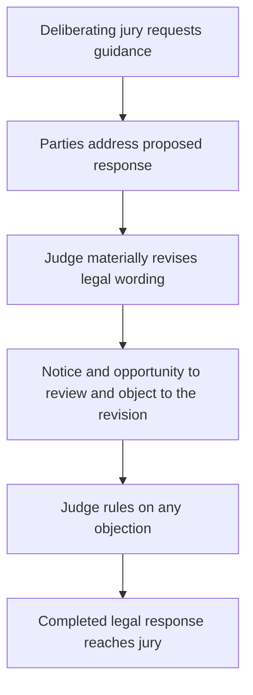
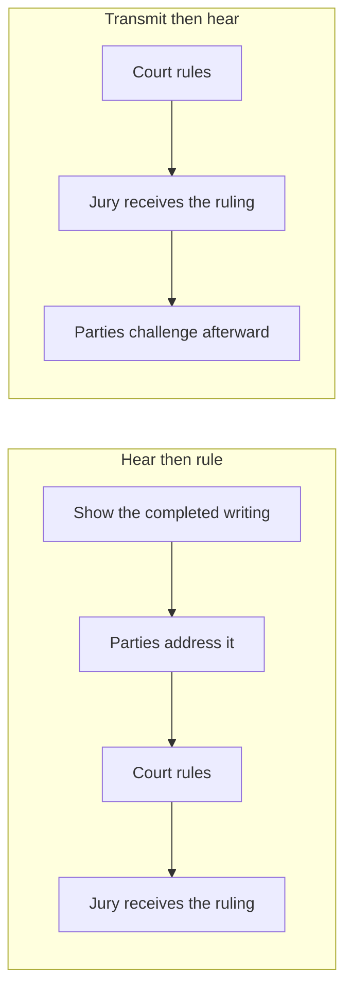
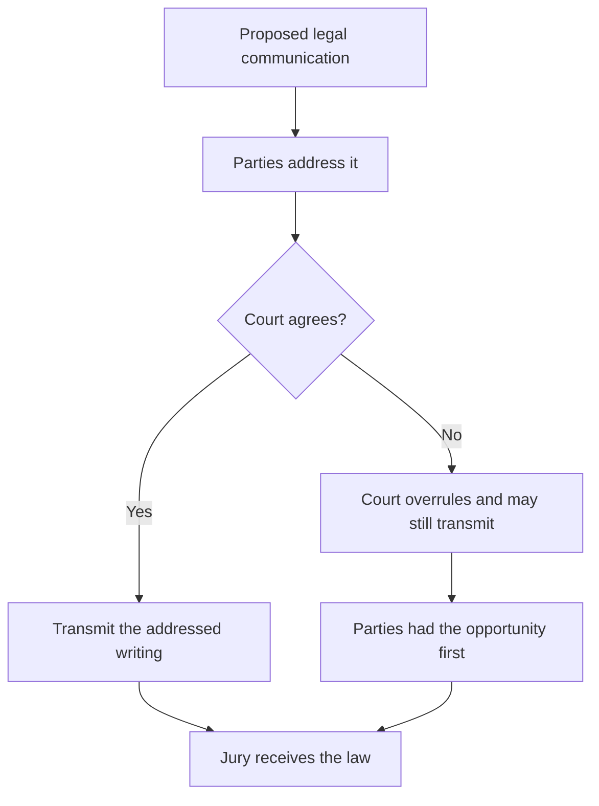
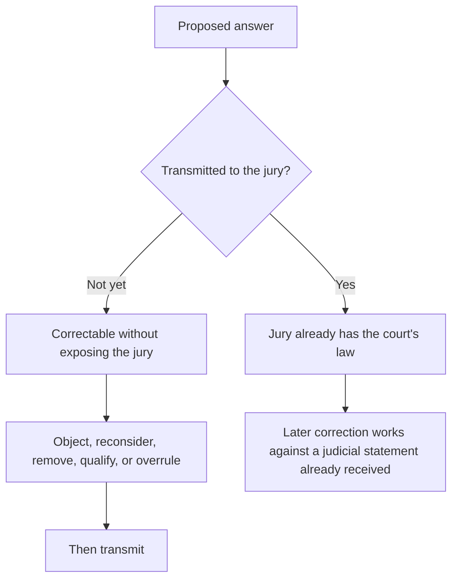
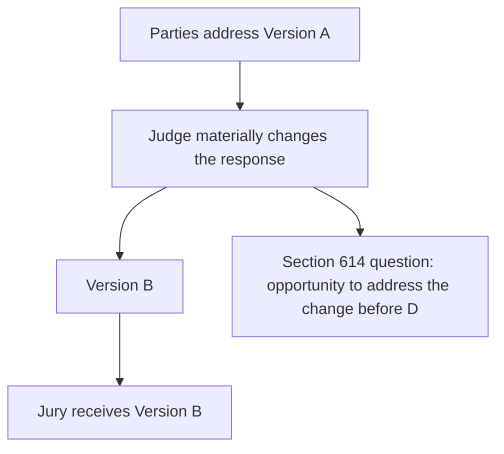
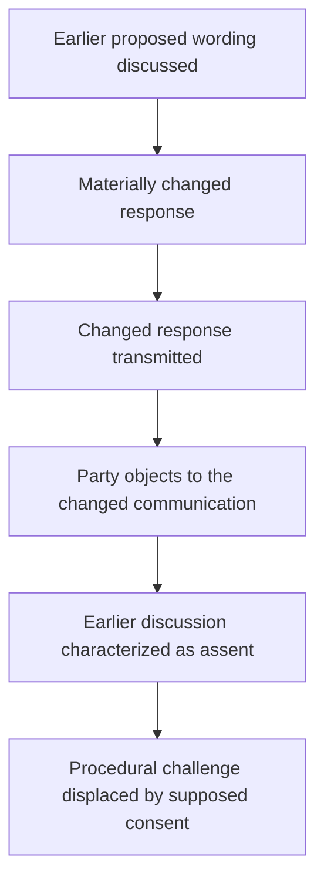
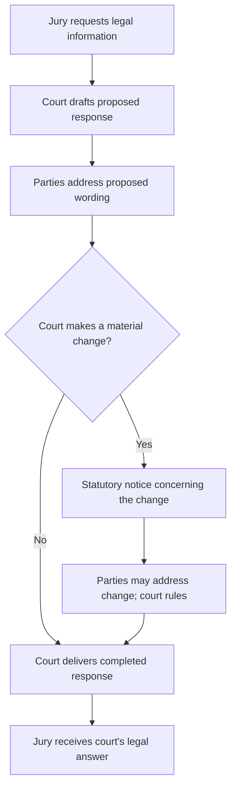

# The Statewide Question

> **This page is commentary published October 17, 2026.** It is published as speech under the First Amendment to the United States Constitution and article I, section 2 of the California Constitution. It is not a court filing. It is not service of any paper on any party. It does not restart any Code of Civil Procedure section 128.7 period. Formal positions remain those stated in papers already on file.

## The charge and its consequence

**Franciscus Dylan Rosario accuses San Francisco Superior Court Judge Garrett L. Wong of materially changing legal responses to a deliberating civil jury and transmitting the completed changes before Rosario received an opportunity to review and object to the revised language.** The asserted wrong is **denial of the opportunity to review and object before transmission**. The judge did not need Rosario’s consent to the final legal wording. A judge may decide the law over a party's objection; the dispute is whether the judge can bypass the statutory procedure governing how a newly modified legal communication reaches the jury.

**The consequence is immediate and institutional.** A supplemental legal response does not enter the jury room as ordinary testimony that jurors can weigh or reject. It arrives as the judge's authoritative statement of the law they must apply. If the court changes that statement without the review-and-objection opportunity section 614 is urged to require, the jury receives court-authored law before the adversarial process can identify and address a material alteration. The California Supreme Court has characterized unauthorized post-retirement judge-to-jury communication as an irregularity affecting the substance of the jury-trial right. *Nelson v. Southern Pacific Co.* (1937) 8 Cal.2d 648, 655. The resulting statutory defect can affect whether a civil verdict stands; its constitutional significance lies in the alleged denial of a meaningful opportunity to be heard before court-authored law governs deliberations.

**The accusation and the judge's answer appear in the reporter's transcript.** Judge Wong stated that the response to **Jury Request No. 1** had been presented to each party before delivery. (11 RT 6:19–21.) He then discussed **Jury Request No. 2**, including the highway/street definition, and defended the court's supplementation as potentially gratuitous but harmless. (11 RT 7:10–8:6.) Rosario immediately answered, **“Inaccurate, Your Honor,”** accused the judge of adding the street language, and said, **“You enhanced the statement and you sent that back.”** (11 RT 8:7–12.) Wong responded with the statutory wording, not an express denial of the enhancement and sending. (11 RT 8:13–16.) Later, after objections to both responses, he invoked **“discretion to issue these responses.”** (11 RT 11:28–12:4.)

**Rosario's asserted inference is an inferred acknowledgment through justification:** in response to accusations that materially modified communications reached jurors without prior opportunity for review and objection, the judge defended their content, effect, and issuance without identifying a pre-delivery review of the particular enhancement. The question for the California Supreme Court is whether substantive judicial authority can stand in place of the procedure Code of Civil Procedure section 614 requires when the court changes the legal answer after the parties' earlier discussion. **The judge may determine the law; the parties must receive the legally required opportunity to review and object to material changes before the completed answer is communicated to the jury.**

## Contents

0. [The charge and its consequence](#the-charge-and-its-consequence)
1. [The broader question](#1-the-broader-question)
2. [The governing principle](#2-the-governing-principle)
3. [The judge decides the law](#3-the-judge-decides-the-law)
4. [But the decision must remain adversarial](#4-but-the-decision-must-remain-adversarial)
5. [Section 614 is the statutory safeguard](#5-section-614-is-the-statutory-safeguard)
6. [The jury receives rules, not ordinary information](#6-the-jury-receives-rules-not-ordinary-information)
7. [The principle reaches more than added language](#7-the-principle-reaches-more-than-added-language)
8. [Why transmission is the critical dividing line](#8-why-transmission-is-the-critical-dividing-line)
9. [What the record proved](#9-what-the-record-proved)
   - [The ten recorded accusations](#item-1--the-ten-recorded-accusations-and-objection-preservation-statements)
   - [Response-score table](#item-2--response-score-table-the-judges-actual-words-and-verbs)
   - [The central recorded exchange](#item-3--the-primary-exchange-claimed-presentation-identified-enhancement-and-non-denial)
   - [Earlier and later objections distinguished](#item-4--the-earlier-vehicle-definition-objection-and-the-later-material-change-accusation)
   - [Inferred acknowledgment and statutory consequence](#item-5--the-reasoned-inference-of-acknowledgment-through-justification)
10. [Notice of one version is not necessarily notice of another](#10-notice-of-one-version-is-not-necessarily-notice-of-another)
11. [Post-transmission objection is different](#11-post-transmission-objection-is-different)
12. [Judicial discretion has a procedural boundary](#12-judicial-discretion-has-a-procedural-boundary)
13. [Forfeiture, waiver, and invited error](#13-forfeiture-waiver-and-invited-error)
14. [The circularity problem](#14-the-circularity-problem)
15. [The broader statewide rule](#15-the-broader-statewide-rule)
16. [Why the issue extends beyond this case](#16-why-the-issue-extends-beyond-this-case)
17. [Why review is warranted](#17-why-review-is-warranted)

---

## 1. The broader question

**When a civil trial judge materially changes proposed legal guidance during deliberations, may the judge transmit the completed change to the jury before the parties are afforded notice and a meaningful opportunity to review and object to that change?** The question arises from Rosario's reported accusations against Judge Garrett L. Wong in *Rosario v. Abdelhalim*, not from disagreement over which substantive Vehicle Code definition the judge should have given.

The allegation is that **a modified legal response entered the jury room without Rosario first having the opportunity to inspect and object to the modified language**. A party's earlier discussion of a proposed response is a different event from an opportunity to review the particular legal words subsequently supplied by the judge. The completed communication, rather than a preliminary draft or the general subject of a jury question, should determine what notice section 614 requires.

The practical and constitutional significance is the authority carried by the communication. A witness supplies evidence for evaluation; a trial judge supplies law the jury is supposed to obey. When a judge introduces new or altered legal language in a response to a deliberating jury, an undisclosed change affects the rules available for the jury's decision. Review after delivery may identify the error, but it cannot recreate an opportunity to prevent the communication from entering the jury room.

**Proposed statewide rule:** The judge retains discretion to decide what lawful guidance to provide, including authority to overrule objections. Code of Civil Procedure section 614 nevertheless requires the legally sufficient presence or notice before the information is given. That safeguard must be applied to a material judicial revision made after an earlier proposed response was discussed. A defense of the revised wording's accuracy, neutrality, or harmlessness cannot itself establish that the parties received the opportunity to review and object before transmission.

---

## 2. The governing principle

The principle illustrated by Rosario’s confrontation with Judge Garrett L. Wong is the division between **the judge’s power to determine the law** and **the party’s claimed statutory right to review and object to material revisions before those revisions are sent to the jury**.

The broader principle is simple:

**The judge decides the law. But the judicial act of deciding the law does not eliminate the parties' right to participate in the process before the court's substantive legal communication reaches a deliberating jury.**

The parties do not have:

1. Control of the judge's answer.
2. A veto.
3. A right to their proposed language merely because they object.

The court may still:

1. Reject their arguments.
2. Overrule their objections.
3. Give an instruction neither party prefers.

But there is a fundamental difference between:

**hearing the parties and ruling against them,**

and

**ruling first, communicating the ruling to the deliberating jury, and allowing the parties to challenge the completed communication afterward.**

The first is judicial decisionmaking within the adversarial process.

The second raises the statewide question presented here. It was not raised abstractly: **Rosario accused the judge of adding a street definition and already sending the enhanced answer to jurors** (Charge 5, 11 RT 8:7–12). The court's answer defended the words in the code; its later answer defended the discretion to issue **“these responses”** (11 RT 11:28–12:4). That is precisely the dividing line between defending a judicial choice and establishing that the statutory procedure preceded delivery.

| Path | Sequence | Character |
| --- | --- | --- |
| Adversarial ruling | Notice, hearing, ruling, then transmission | The court decides the law after the parties address the completed communication |
| Completed communication first | Ruling, transmission, then later challenge | The parties address an event that has already entered the jury room |

The legal ramification is the difference between an overruled objection and an unheard one. In the first path, the record contains the completed writing, the party's position on that writing, and the court's ruling. Review then asks whether the ruling was correct. In the second path, the jury already has the court's law before the party speaks to that law. Review is then asked to treat a later protest as tardy, or to treat an earlier discussion of a different writing as consent. The first path preserves both judicial authority and appellate review. The second path can extinguish review of the very communication the statute required the parties to see first.

---

## 3. The judge decides the law

Judicial independence in determining the law is not in dispute.

When a jury asks a question, the trial court must exercise judgment.

It may have to determine:

1. What statute governs.
2. What instruction applies.
3. Whether the jury's premise is mistaken.
4. Whether an existing instruction is sufficient.
5. Whether clarification is appropriate.
6. Whether additional legal information should be supplied.
7. Whether requested information would be misleading.
8. How much explanation is necessary.
9. Whether the requested instruction should be refused.

Those are exercises of judicial authority.

Section 614 does not transfer that authority to the parties.

The question is not whether the parties must consent to the judge's ultimate ruling.

They need not.

The question is whether the judge's authority to decide the ruling includes authority to bypass the procedure by which the parties are allowed to address the ruling before it enters the jury room. **When Rosario told the judge that he “enhanced the statement and ... sent that back,” the accusation was directed to the judge's exercise of authority over a completed jury communication, not simply to the merits of a statutory definition** (11 RT 8:7–12).

Those nine determinations are the content of the response. They remain with the court after the parties are heard. Section 614 does not assign any of them to counsel. This commentary urges a sequence that gives effect to its presence-or-notice protection: the material legal communication is disclosed, the parties have an opportunity to address it, and the court then transmits its completed answer. Collapsing the sequence into the content decision treats a ruling on the law as a ruling that the parties need not see the law first. That collapse is the statewide problem. The court still decides what the answer will be. The statute decides when that answer may enter the jury room.

---

## 4. But the decision must remain adversarial

Rosario’s statutory accusation has a concrete constitutional consequence: Judge Garrett L. Wong allegedly transmitted enhanced legal guidance while the jury was deliberating, without first affording Rosario an opportunity to review and object to the actual enhancement. The adversarial process has little meaning if it begins only after the judicial act capable of affecting the verdict has already occurred.

A party's opportunity to address a proposed legal communication serves several functions:

1. Identify controlling authority the court overlooked.
2. Identify an omitted qualification.
3. Explain that a proposed definition changes another instruction.
4. Show that the jury's question rests on an incorrect legal premise.
5. Argue that a statute not in the proposed response governs.
6. Identify prejudice from answering only part of the question.
7. Request a clarifying instruction.
8. Preserve an objection for review.

None of those functions requires that the court agree.

Their value lies in occurring **before the court's answer becomes authoritative law inside the jury room.**

The statewide principle therefore is not party control.

It is adversarial participation before judicial transmission. That is also the meaning of Rosario's repeated record correction: he contested the court's assertion that no objection had been made, recalled objections to materials “sent back,” and asked to reconstruct the unreported discussion (11 RT 10:12, 10:23–11:13). **The charge was not merely “I dislike the final words.” It was “the judge changed and sent the legal message, and my earlier opportunity did not encompass the completed change.”** This final sentence is a synthesis of Rosario's recorded positions, not a supposed verbatim quotation.

Each of those functions operates on a proposed writing that has not yet become the jury's law. Counsel can still point to a missing qualification, an omitted statute, or a definition that changes another instruction, and the court can still overrule. After transmission, the same points must be recast as a request to retract the court's own statement. The legal comparison is therefore not between a winning objection and a losing one. It is between an objection that can prevent the communication and an objection that can only ask the court to unsay it. The first is the opportunity this commentary contends section 614 protects. The second is a different remedy, with a different burden and a different effect on deliberations already underway.

---

## 5. Section 614 is the statutory safeguard

Code of Civil Procedure section 614 provides that, after deliberations begin, when jurors seek information on a point of law, the information “must be given in the presence of, or after notice to, the parties or counsel.” [Cal. Code Civ. Proc., § 614](https://codes.findlaw.com/ca/code-of-civil-procedure/ccp-sect-614/). **The statute is invoked here because Rosario repeatedly accused the trial judge of sending additional legal information into an already-deliberating jury**, including an identified street-language enhancement in Reply No. 2 (11 RT 5:20–27; 8:7–12; 13:16–22). The issue is the court's communication procedure, not whether the original trial evidence physically included the statutes.

The statutory object is **the information given**, including the material change the judge allegedly transmitted without providing an opportunity for prior review and objection. That object is central when the court first discusses one proposed response and then materially changes it.

| Recorded event | Procedural significance |
| --- | --- |
| Jury asks a legal question | The court is called upon to supply legal guidance. |
| Parties discuss proposed response A | Their participation concerns the proposition or wording they actually addressed. |
| Court materially changes A to B | The court has supplied a different substantive communication. |
| Court sends B to the jury | B becomes the court's authoritative legal answer in deliberations. |
| Party objects to the change and the sending | The record identifies the disputed judicial communication and the timing of the objection. |

The construction urged here follows the object of the statute: when B is the information given, meaningful notice concerns B's material differences. The statute's presence-or-notice language supplies a procedural protection distinct from the judge's discretion to formulate a lawful answer.

In *Nelson v. Southern Pacific Co.* (1937) 8 Cal.2d 648, 655, the California Supreme Court addressed an unauthorized communication to a deliberating jury and described the section 614 procedure as a protection related to the substance of trial by jury. [*Nelson](https://scocal.stanford.edu/opinion/nelson-v-southern-pacific-co-28878)*. This page draws the related statewide question presented by materially changed jury-response wording: **what must be disclosed, and when, for the notice requirement to serve its function?**

---

## 6. The jury receives rules, not ordinary information

The significance of Rosario’s charge against Judge Wong lies in the difference between ordinary trial information and **authoritative legal language reaching the deliberating jury without a pre-transmission opportunity to review and object**. A judicial answer to a jury's legal question is different from ordinary information entering a trial.

| Source | What the jury may do with it |
| --- | --- |
| Witness | Accept or reject testimony |
| Attorney | Treat argument as argument, not evidence |
| Exhibit | Evaluate evidence |
| Judge answering a question of law | Follow the answer as the legal framework |

A witness gives testimony that the jury may accept or reject.

An attorney makes arguments that the jury is told are not evidence.

An exhibit supplies evidence the jury evaluates.

But when the trial judge answers a question of law, the jury receives the answer as an authoritative statement of the legal framework governing its decision.

The jury is expected to follow it.

That makes a substantive judge-to-jury communication uniquely consequential.

The communication can determine:

1. What legal duties matter.
2. Which facts are legally relevant.
3. What propositions jurors may consider.
4. What propositions jurors must disregard.
5. How statutory language should be understood.
6. What elements must be established.
7. How competing instructions relate to one another.
8. What rules govern the verdict.

A mid-deliberation legal answer therefore does more than provide information.

**It can change the rules under which deliberation proceeds.**

That is why the procedural protection must attach before transmission. **The seriousness of Charge 5 lies in its target:** Rosario did not accuse a witness of adding an exhibit; he accused **the judicial officer charged with instructing the jury** of enhancing the legal message and returning it to jurors. The judge's answer had legal authority for the jury regardless of either party's agreement with it.

The comparison is between evidence the jury may weigh and law the jury must apply. Testimony, argument, and exhibits remain subject to the jury's evaluation. A mid-deliberation judicial answer does not. The jurors have identified the legal uncertainty on which the verdict may turn, and the court has answered it. That answer can open or close duties, redefine statutory terms, and tell the jury what it may not consider. The ramification is that an unnoticed addition, restriction, or refusal is not an unnoticed piece of evidence. It is an unnoticed change in the rules. Section 614 exists at that moment because the communication is the court's law, not a party's proof.

---

## 7. The principle reaches more than added language

The charge against Judge Wong concerns a material change allegedly transmitted **without advance opportunity to review and object**. The material-change rule should follow what the jury received, not the mechanical form of the court's revision. A substantive change can be made by inserting a definition, deleting a qualification, expanding an exclusion, adding a new command, combining previously separate propositions, or refusing guidance in a response that earlier addressed only the jurors' own use of outside legal material.

The common event is **a difference between the response the parties addressed and the response the judge sent to the jury**. The court may make that change. Section 614 raises the separate question of how and when the parties receive notice of the material change before it is communicated.

That formulation keeps both jury responses in view without conflating their contents. Reply No. 2 concerns the addition of the street language to the vehicle/highway definition. Reply No. 1 concerns the difference between the juror-use proposition Rosario described accepting and the court's completed prohibition-and-refusal response. The source of the change, the words changed, and the judge's substantive rationale must be stated separately for each reply.

The statewide rule therefore addresses **materially altered judge-to-jury legal communications**, whatever drafting technique produced the alteration. **Rosario's charges name both a particular added sentence (“highways also indicates street,” 11 RT 8:7–12) and the broader act of “sending back enhancements” (11 RT 13:17–22).** The later accusation is what keeps the statewide principle from depending on one word or one definition.

---

## 8. Why transmission is the critical dividing line

The relevant statutory event is **transmission of a materially revised legal response without an opportunity to review and object to the revision first**. Transmission is the point at which the court's proposed answer becomes the jury's legal instruction. **“You enhanced the statement and you sent that back” identifies both acts and their order** (11 RT 8:11). The sentence does not say Rosario saw the enhanced statement first. It says the enhanced statement was already sent. **“Second off, you sending back enhancements”** renews the sending charge after the judge explicitly asked for the asserted irregularities (11 RT 13:16–22). The repeated accusation makes transmission without a prior opportunity for Rosario to review and object a reported controversy, not a merely hypothetical procedural hazard.

Before transmission, the process remains correctable without exposing the jury to the disputed communication:

1. A party may object.
2. The court may reconsider.
3. Language may be removed.
4. A missing qualification may be supplied.
5. A legal error may be corrected.
6. An ambiguity may be resolved.
7. The court may reject the objection and transmit the answer unchanged.

But the important point is that the adversarial process has performed its function before judicial authority enters the jury room.

After transmission, the problem changes.

The jury has received the answer from the court.

Any later correction must operate against something the jury has already been told by the judge.

The difference is therefore not merely chronological.

It is structural.

**Before transmission, the parties participate in determining whether an error reaches the jury. After transmission, they can only ask the court to repair an event that has already occurred.**

| Timing | What the parties can still do |
| --- | --- |
| Before transmission | Participate in whether the error reaches the jury |
| After transmission | Ask the court to repair an event that has already occurred |

The ramification of that comparison is practical and legal. Before transmission, an objection can keep the disputed sentence out of the jury room. After transmission, the same sentence is already the court's instruction. A later "correction" asks the jury to disregard a statement the judge has just made, or to prefer a second statement over the first. That is a different proceeding. It introduces questions of curability and prejudice that section 614 is designed to avoid by requiring notice first. Equating the two moments treats a repair as the statutory opportunity. The statute calls for presence or notice before the information is given; the earlier moment is the one this commentary seeks to protect.

---

## 9. What the record proved

**Rosario's central charge against Judge Garrett L. Wong is procedural:** the judge materially enhanced the legal responses, returned the completed communications to the deliberating jury, and thereby deprived Rosario of an opportunity to **review and object to the material enhancements before their delivery**. Whether the judge's additions correctly stated the Vehicle Code is a separate issue. Rosario did not need a veto over the final wording; he needed the legally required opportunity to address the completed changes before jurors received them.

The evidentiary method is to put **each charge first**, quote the judge's recorded answer, and draw the inference from what the judge actually *said and did*. This allows a reader to distinguish a denial of the charged act from a defense of its content, a ruling on relief, or an assertion of judicial discretion.

### Item 1 — The ten recorded accusations and objection-preservation statements

**Read the recorded accusations and preservation statements first.** Rosario directed repeated allegations of court-authored enhancement and jury transmission to San Francisco Superior Court Judge **Garrett L. Wong**. The quotations below identify what Rosario said and the particular act he challenged. The judge's answers are analyzed in Item 2 and the following items. **Reply No. 1 and Reply No. 2 concern different legal communications; their words must not be interchanged.**

1. **Charge 1 — The court inserted Vehicle Code information into the jury's deliberations.** (**11 RT 4:1–7**.)

   > “The Court also, through its own admission, clarified something to the Jury by submitting a actual Vehicle Code, which was not introduced during the evidence, and by that cause alone, Your Honor, you had inserted information into the Jury which then -- by providing them information that was not available in the evidence itself.”

   **Target:** The **judge**, as the source of legal information sent to the jury.

2. **Charge 2 — Rosario challenged an addition following the juror-use proposition he described accepting.** (**11 RT 4:8–14**.)

   > “I do agree with the first one, the response to number one: You may not consider it because it is not part of the instructions. But when you added that into the second one, it caused this, because the Jury had to make the decision based upon the available evidence that was there.”

   **Target:** The alleged **addition**, distinguished from Rosario's description of the juror-use restriction. The completed Reply No. 1 later read by the judge contained both a prohibition and a refusal to instruct (**11 RT 6:23–27**). The highway/street enhancement is separately identified in Charge 5.

3. **Charge 3 — The judge inserted new information and supplied a code.** (**11 RT 4:26–5:8**.)

   > “The second one, they asked something that they did not have. And, again, that is information that was not presented in the evidence and suddenly new evidence or new information has been inserted by yourself. So those two clauses alone, there was no request for a code here. You provided a code.”

   **Target:** Judicial authorship of **additional legal information**.

4. **Charge 4 — The court inserted information after the jury had retired.** (**11 RT 5:20–27**.)

   > “Absolutely that is prejudice. The officer and the Defense had an opportunity to enter that Vehicle Code as well as the definition of a vehicle in their evidence. They did not do that. Inserting that information into the Jury after the fact, after they have gone into the sealed room back there, essentially, is extraneous influence over the Jury and their knowledge about this case.”

   **Target:** The **timing** of judicial communication to an already deliberating jury.

5. **Charge 5 — Reply No. 2 was enhanced by the highway/street language and sent back.** (**11 RT 8:7–12**.)

   > “Inaccurate, Your Honor. You enhanced it by adding that highways also indicates street. That is not in the actual black-letter law. You enhanced the statement and you sent that back. That is a direct influence over the Jury.”

   **Target:** The specific **highway/street enhancement** and **completed transmission** of Reply No. 2. This is the central material-change-and-sending accusation.

6. **Statement 6 — Rosario confirmed he wanted objections concerning both completed responses placed on the record.** (**11 RT 10:4–8**.)

   The judge reported that the courtroom clerk had informed him Rosario sought to place objections to Jury Request Forms Nos. 1 and 2 on the record. Rosario responded:

   > “Yes.”

   **Target:** The **recording of objections to both responses**, rather than a new accusation of modification in this one-word reply.

7. **Charge 7 — Rosario disputed the court's description of the earlier understanding.** (**11 RT 10:9–12**.)

   When the judge began stating that no objection was raised when the responses were completed, Rosario interrupted:

   > “That wasn't our understanding.”

   **Target:** The judge's account of **prior objection and agreement**.

8. **Charge 8 — Rosario identified an objection outside the reporter's presence and sought reconstruction.** (**11 RT 10:23–11:13**.)

   Rosario said, in pertinent part:

   > “Given that outside the presence of the Court Reporter, Plaintiff did object to any language or materials sent back because the information was already common knowledge, was unnecessary to be defined, specifically also the one that was defined by yourself to the Jury themselves.”
   >
   > “The citation on -- more specifically, the citation on what constitutes a vehicle, I did object to that, and that is inaccurate also.”
   >
   > “I would like to either reconstruct the record or we file my objection for that.”

   **Target:** His **earlier objection to giving a vehicle definition or clarification**, and the requested record correction. The statement does not specify a separate pre-transmission objection to the particular highway/street enhancement.

9. **Charge 9 — Rosario specified what he had objected to: giving the vehicle clarification.** (**11 RT 11:14–22**.)

   When the judge asked, “What's the correction?”, Rosario responded:

   > “The correction is that I objected to any of the material going back, the codes, because they were common knowledge; it wasn't necessary for anything to be sent back to the Jury, anything, any kind of clarification of vehicles, anything like that. It was unnecessary. I stated that. It was all common knowledge.”

   **Target:** The court's choice to **provide a definition or clarification of “vehicle” at all**. This is distinct from the later accusation that an enhanced version was transmitted.

10. **Charge 10 — Rosario renewed his accusation that the judge sent enhancements.** (**11 RT 13:16–22**.)

    After the judge asked, “What are the irregularities, sir?”, Rosario identified two separate concerns:

    > “The jurors -- I just went over that, the jurors having access to extemporaneous information, first off; second off, you sending back enhancements to a testimony that was not in, and any of the enhancements or any of the evidence would be used in their assessment.”

    **Target:** The court's own **sending of enhancements**, separate from the allegation of outside juror access.

**The central allegation is No. 5, repeated in No. 10:** Rosario accused Judge Wong of **enhancing and sending Reply No. 2 without an opportunity to review and object to the completed enhancement before delivery**, while the earlier unreported objection described in Charges 8–9 concerned **whether a vehicle definition should be given**. The distinction fixes the section 614 issue on the materially enhanced communication, not the wisdom of supplying the definition in the first place.

### Item 2 — Response-score table: the judge's actual words and verbs

The scoring measures a specific question: **how directly did the court's quoted response identify a pre-transmission opportunity to object to the particular material enhancement in Reply No. 2?** It is a record-response measure, not a score of the merits of the jury instructions or the eventual judgment. **0** means the quoted response addresses something else; **1** means the court asserts a prior procedural step concerning Reply No. 1 or earlier agreement; **2** means the response expressly identifies pre-transmission notice of the **completed highway/street enhancement** in Reply No. 2. The judicial verbs are taken from what the judge actually said or did on the reported record.

| No. | Rosario's recorded charge and pin | Judge's actual words and pin | Judicial verb / actual response | § 614 notice answer for the challenged enhancement | Score |
|:--:|---|---|---|---|:--:|
| **1** | **Inserted Vehicle Code information into the jury.** 11 RT 4:1–7. | “First, the motion for a mistrial is denied.” (11 RT 6:14–15.) Later: “the Court is defining” and “I find no harm nor prejudice.” (11 RT 7:27–8:6.) | **Denied the motion; defined; found no prejudice.** | Answered the remedy, content, and effect—not prior notice of the added street language. | **0** |
| **2** | **Challenged an addition beyond the stated juror-use proposition.** 11 RT 4:8–14. | “So you don't have an objection to the instruction given in response to Jury request number one?” (11 RT 4:15–17.) Later: “The Court presented that response in Jury request number one to each party before delivering it to the Jury.” (11 RT 6:19–21.) | **Asked; asserted prior presentation of Reply No. 1.** | Expressly asserted a pre-delivery step for **Reply No. 1**; did not identify notice of Reply No. 2's street enhancement. | **1** |
| **3** | **Accused the judge of supplying a code and inserting new information.** 11 RT 4:26–5:8. | “the Court is defining something that is the word ‘vehicle’ for the purpose of the jury's use in this matter.” (11 RT 7:27–8:2.) | **Defined; justified the court-supplied information.** | Explained judicial authorship and purpose rather than pre-transmission notice of the enhancement. | **0** |
| **4** | **Charged insertion after jurors entered the sealed deliberation room.** 11 RT 5:20–27. | “I find no harm nor prejudice against either party in this case.” (11 RT 8:3–4.) | **Assessed prejudice.** | Addressed the effect of the court's supplied definition, not when the specific added language was disclosed. | **0** |
| **5** | **“You enhanced the statement and you sent that back.”** Reply No. 2. 11 RT 8:7–12. | **Immediate answer:** “Sir, do you want to take a look at this code section? It says, ‘Highway includes street’, close quote.” (11 RT 8:13–16.) | **Offered the code; defended its text.** | Answered the statutory-accuracy issue after the enhancement-and-sending accusation; did not identify an earlier opportunity to object to the enhancement. | **0** |
| **6** | **Confirmed a request to record objections to both completed responses.** 11 RT 10:4–8. | “there was no objection entered as to the answer to Jury request number one or to Jury request number two; that, in fact, there was a acquiescence by you.” (11 RT 10:14–17.) | **Asserted nonobjection and acquiescence.** | Asserted an earlier state of agreement, but did not specify advance disclosure of the particular street-language addition. | **0** |
| **7** | **“That wasn't our understanding.”** 11 RT 10:12. | “Excuse me, sir,” followed by “there was no objection entered” and “there was a acquiescence by you.” (11 RT 10:13–19.) | **Interrupted; asserted a contrary account of earlier objection.** | Contested the prior-understanding account; did not identify notice of the completed Reply No. 2 enhancement. | **0** |
| **8** | **Recounted an unreported objection to sending a vehicle definition and sought reconstruction.** 11 RT 10:23–11:13. | “Well, your objection is noted. What's the correction?” (11 RT 11:14–15.) | **Noted; requested the correction.** | Collected the asserted earlier objection history; did not identify an earlier objection opportunity as to the material street addition. | **0** |
| **9** | **Specified the earlier objection to giving any vehicle definition or clarification.** 11 RT 11:16–22. | “Very well. Your objection's noted.” (11 RT 11:23–24.) Later: “Your objections are noted. They are overruled and the Court believes that this is within its discretion to issue these responses.” (11 RT 11:28–12:4.) | **Noted; overruled; invoked discretion to issue.** | Addressed the objection and the authority to issue both completed replies, not advance notice of the particular enhancement. | **0** |
| **10** | **Renewed “you sending back enhancements.”** 11 RT 13:17–22. | “Sir, CCP Section 657 are grounds for a new trial. You are premature.” (11 RT 13:23–25.) Later: “That is denied.” (11 RT 14:3.) | **Characterized the remedy as premature; denied relief.** | Addressed the procedural vehicle for relief, not pre-transmission notice of the accused enhancement. | **0** |

**Score reading:** The court expressly **claimed prior presentation of Reply No. 1** in one passage (11 RT 6:19–21). Across the ten charge-response pairs, the quoted judicial answers instead **denied relief, asked for clarification, defined the legal term, found no prejudice, asserted acquiescence, noted and overruled objections, defended discretion, and treated the requested remedy as premature**. None of the quoted answers identifies **pre-transmission notice of the completed highway/street enhancement in Reply No. 2**. The different judicial verbs matter: **“overruled”** is a ruling on an objection, **“issued”** is an assertion of authority to communicate, and **“highway includes street”** is a defense of legal content; none recites an earlier opportunity to object to the specific addition.

**Affirmative inference from the table.** Taken together, the recorded answers support an inference that Judge Wong was **defending the court-authored enhancement and its delivery**, rather than disputing Rosario's accusation that the completed addition was sent to jurors before he had an opportunity to review and object to that addition. Rosario repeatedly named judicial insertion and transmission; the court answered with **substantive correctness, a finding of harmlessness, discretion to issue, rulings on objections, and timing of the requested relief**. The record thus presents the particular § 614 process charge Rosario made: **a completed, materially enhanced legal response was transmitted to a deliberating jury, and the court's recorded defenses did not identify an opportunity to address that enhancement before transmission**. Rosario maintains that this sequence violated § 614 and the Fourteenth Amendment's protection of a fair opportunity to be heard. The statewide legal question is whether a court's reasons for the enhanced communication can stand in place of the statutory process preceding its delivery.

---

### Item 3 — The primary exchange: claimed presentation, identified enhancement, and non-denial

**Judge Wong first asserted a presentation-before-delivery sequence for Jury Reply No. 1:**

> “The Court presented that response in Jury request number one to each party before delivering it to the Jury.” (11 RT 6:19–21.)

In the **same continuous turn**, he then discussed **Jury Reply No. 2**, read the vehicle and highway definitions, and included “'Highway' includes street.” (11 RT 7:10–26.) He described the court's addition in conditional terms as “gratuitous on the part of the Court,” identified the court as the actor “defining” the term for the jury, and found “no harm nor prejudice.” (11 RT 7:27–8:6.) These descriptions concern the judge's own legal communication and its asserted effect. They were stated **before** Rosario's next accusation.

**Rosario's next turn directly challenged the modification and its return to the jury:**

> “Inaccurate, Your Honor. You enhanced it by adding that highways also indicates street. That is not in the actual black-letter law. You enhanced the statement and you sent that back. That is a direct influence over the Jury.” (11 RT 8:7–12.)

This is the central accusation of a **changed response already delivered without prior review of the specific enhancement and an opportunity to object to it**. Rosario did not merely debate the definition. He assigned the act of changing and transmitting the message to the sitting judge. The immediate judicial response was:

> “Sir, do you want to take a look at this code section? It says, 'Highway includes street', close quote.” (11 RT 8:13–16.)

**The judge defended the language; he did not expressly deny adding or sending the enhanced response.** Nor did that answer identify when the specific street-language enhancement was disclosed for Rosario to review and challenge before delivery. Judge Wong's express statement about prior presentation identified **Reply No. 1**; it did not expressly describe prior presentation of the later-discussed highway/street wording in **Reply No. 2**. The statutory inference must be drawn against those precise subjects and that sequence.

### Item 4 — The earlier vehicle-definition objection and the later material-change accusation

Rosario challenged the judge's account of earlier agreement: “That wasn't our understanding.” (11 RT 10:12.) He then stated that he had objected **outside the court reporter's presence** to providing the jury with legal material that he considered common knowledge, specifying the vehicle definition and asking to correct or reconstruct the record. (11 RT 10:23–11:13.) When the judge asked, “What's the correction?”, Rosario explained that a vehicle clarification “wasn't necessary” because the subject was common knowledge. (11 RT 11:14–22.)

**The object of that earlier objection was the decision to provide a definition of “vehicle.”** The later accusation at 11 RT 8:7–12 targeted something more specific: **the judge's addition of the highway/street language to the response that was sent to the jury**. An earlier objection to giving a definition at all does not establish that Rosario received a pre-delivery opportunity to review and object to the additional words ultimately included. The unreported objection may have been communicated before or after delivery; the decisive question is whether a meaningful opportunity concerned **the particular completed enhancement before transmission**.

The court later acknowledged objections concerning both completed response forms. Judge Wong said:

> “Your objections are noted. They are overruled and the Court believes that this is within its discretion to issue these responses in order to clarify for the Jury some issues that they have raised by way of their requests.” (11 RT 11:28–12:4.)

He subsequently said the objections to “Jury request form number one and Jury request form number two” had been submitted, considered, and overruled. (11 RT 12:27–13:9.) **The court acknowledged and disposed of objections; its explanation invoked discretion to issue the communications.** That is a substantive and procedural ruling on the objections then being taken, not an express account of a pre-delivery opportunity to examine the particular enhanced Reply No. 2.

The accusation was repeated when Judge Wong asked, “What are the irregularities, sir?” Rosario identified two separate concerns and then accused the judge of “you sending back enhancements.” (11 RT 13:16–22.) The judge responded that the request under section 657 was premature. (11 RT 13:23–25.) Once again, the answer concerned the requested remedy rather than an express denial that court-authored enhancements were sent.

### Item 5 — The reasoned inference of acknowledgment through justification

**A court may acknowledge conduct by defending it rather than expressly confessing a legal violation.** Here Rosario repeatedly identified a judicial actor, an enhancement, a completed transmission, and an asserted absence of an opportunity to review and object to the modified wording before delivery. Judge Wong's successive responses concerned the legality of the words, the asserted absence of prejudice, his discretion to issue **“these responses,”** and the timing of the requested remedy. Read together, these responses support Rosario's inference that the court was defending its conduct in supplying and returning the enhanced communications, rather than denying that conduct or identifying a pre-delivery review opportunity for the completed enhancement.

The **factual inference advanced** is that Judge Wong materially modified the legal communications and transmitted them to the deliberating jury **without first affording Rosario a meaningful opportunity to review and object to the completed changes**. The evidence supporting that inference is cumulative: Rosario's immediate “Inaccurate” charge, the judge's identification of court-supplied language, his code-book justification, the contested history of objections to the vehicle definition, the acknowledgment and overruling of objections to both forms, the plural assertion of discretion to issue them, and Rosario's renewed “you sending back enhancements” accusation. (11 RT 4:1–5:27; 6:16–8:17; 10:4–12:4; 13:16–25.)

**The statutory consequence of that inferred sequence is the point for which review is sought:** if a materially modified legal answer was communicated to the jury before the parties received the notice and opportunity to address the material revision required by section 614, the communication violated that statutory procedure. The resulting intrusion into the adversarial process implicates the integrity of the jury-trial right. In *Nelson v. Southern Pacific Co.* (1937) 8 Cal.2d 648, 655, the California Supreme Court treated unauthorized judge-to-jury communication after retirement as an irregularity affecting the substance of trial by jury, ordinarily prejudicial except in exceptional circumstances. That principle makes the timing of notice and the opportunity to object a question with consequences for the validity of a civil verdict, not merely a disagreement over drafting style.

**The statewide rule urged is therefore direct:** a judge may select and defend the legal answer, but cannot use correctness, harmlessness, or judicial discretion as a substitute for the statutory process governing the transmission of **materially changed legal instructions without prior party review and an opportunity to object**. The judge may overrule an objection; the issue is whether the party was first afforded the opportunity to make it while the completed change could still be addressed before the jury received it.

---

## 10. Notice of one version is not necessarily notice of another

The statutory distinction is the alleged **denial of review and objection before Judge Wong sent an enhanced legal answer to jurors**. The distinction becomes important as soon as the court and the parties discuss a proposed response and the court thereafter supplies a materially changed one. In the reported confrontation, **Rosario alleged that the judge was the one who supplied the added language and returned the enhanced statement to the jury** (Charges 1, 3, 5, and 10). He also contested the claim that his earlier discussion amounted to acquiescence in the completed replies (Charges 7–9).

Call the response initially discussed **Version A**. Call the materially changed response actually returned to the jury **Version B**. The question posed by this case is whether the procedure associated with Version A can be treated as adequate notice of the material change embodied in Version B.

Rosario's enhancement-and-sending accusation concerns exactly that distinction. His objection was to a judicially augmented response already communicated to the jury. The court's answer defended the language supplied, not a showing of the material change to him before return.

| Communication | Relevant act |
| --- | --- |
| Version A | Wording or proposition the parties earlier discussed. |
| Court's material alteration | Judicial addition, restriction, refusal, or new definition. |
| Version B | Completed legal response the jury receives. |
| Section 614 question | Whether the parties had the statutory opportunity concerning the **material difference** before Version B was given. |

The rule urged is that **the legal communication actually given determines the object of section 614 notice**. A material judicial alteration is not transformed into a previously reviewed communication merely because some earlier wording was discussed.

---

## 11. Post-transmission objection is different

The act charged here is **sending a materially changed legal response without first affording Rosario an opportunity to review and object to the change**. Timing gives that act its procedural significance. **Rosario expressly located judicial insertion after the jury entered its sealed deliberation room (11 RT 5:24–27), then identified the exact highway/street enhancement as already sent (11 RT 8:7–12).** These are the charged acts to which the pre-transmission opportunity must be related.

Before transmission, a party may identify the change, object to the new wording, and ask the court to reconsider or qualify it. The judge may overrule the objection and still transmit the answer. After transmission, the jury already has the court's authoritative language, and the party must instead seek an alteration to something already communicated.

| Before transmission | After transmission |
| --- | --- |
| “This is the material change I object to before the jury receives it.” | “The court has already sent the material change; I object to what was sent.” |
| The court can decide the objection before delivery. | The court must address a completed communication. |
| The jury has not yet received the challenged words. | The jury has received the challenged words as judicial guidance. |

The jury's exposure is why the chronology matters. A post-delivery objection identifies and preserves a challenge to the event; it does not turn the already delivered words into a proposed response awaiting review.

**Section 614's notice requirement should be understood at the moment the court moves from a proposed answer to an authoritative communication given to the jury.** The party's statutory participation must concern the material alteration while it can still be addressed before delivery.

---

## 12. Judicial discretion has a procedural boundary

The record identifies the competing concepts in Judge Garrett L. Wong’s own recorded responses. Rosario’s charge is **transmission without prior review and opportunity to object**; Wong’s responses emphasized authority, content, effect, or remedy.

The record identifies the exact competing concepts. On Reply No. 2, the court called its definition neutral and said there was **“no harm nor prejudice.”** On Reply No. 1, the court said the cited statutes were **“not part of the evidence.”** Later, addressing the completed responses in the plural, it claimed **“discretion to issue these responses.”** (11 RT 7:4–9; 7:27–8:6; 11:28–12:4.) **These are three judicial explanations attached to distinct accusations: the substance of Reply No. 2, the completed substance of Reply No. 1, and the authority to issue both. None of those explanations itself describes pre-delivery disclosure of the highway/street enhancement to Rosario.**

These were answers about **the substance, purpose, or authority** for what the judge sent. Rosario's procedural complaint was about **the material change and its return to the jury before he could address it**.

**Substantive discretion and the section 614 procedure answer different questions.** Whether the definition came from a code book does not itself describe how the changed response was disclosed before transmission. Whether the court considered a response harmless does not itself identify when the parties saw the material change. The authority to issue instructions does not itself replace the statutory method for giving requested legal information to the jury.

The principle therefore remains:

> **The judge determines the lawful content of a jury response. Section 614 determines the procedure through which the judge's completed legal information reaches the jury.**

This is a limit on how judicial authority is exercised, not a veto over the legal answer. The court is free to reject an objection to the changed language; it must preserve the statutory process through which that objection can be made before the change reaches the jury.

---

## 13. Forfeiture, waiver, and invited error

A preservation rule that treats objections to a draft as consent to an allegedly unreviewed final enhancement would leave the §614 notice question unanswered. The content of the communication also controls the preservation inquiry. A party's acceptance of one proposition is an act directed to that proposition; it does not automatically speak to additional material inserted in the communication subsequently returned to the jury. **Rosario affirmatively requested that objections to Forms Nos. 1 and 2 be placed on the record, contested the judge's statement about the earlier understanding, identified objections to returned materials, and asked for reconstruction** (11 RT 10:4–11:22). The judge later expressly described objections concerning both forms as submitted, considered, and overruled (11 RT 12:27–13:9). Those are recorded objections to identified acts, not an absence of complaint.

The specific distinctions presented by the record are:

1. **Reply No. 1:** Rosario identified his agreement as concerning the direction that jurors may not consider material outside the instructions. The court's completed reply also contained the separate statement that it would not instruct on identified Vehicle Code provisions. The court's substantive explanation addressed that completed reply.
2. **Reply No. 2:** Rosario challenged the highway/street addition and specifically stated that the court **“enhanced the statement and ... sent that back.”** The court answered by defending the added legal definition.
3. **Both replies:** Rosario contested the court's account of assent, sought to correct the record concerning his objections, and the court later described the objections to both responses as considered and overruled.

Forfeiture and invited error should be assessed against **the material communication challenged**, not against a generalized label of “agreement” that leaves the object of agreement undefined.

The same principle applies without taking any position on the correct substantive instruction. **The issue is what revised legal communication the judge actually transmitted and what opportunity the party had to object to that revision before it was sent.**

---

## 14. The circularity problem

The circularity arises when a materially changed judicial communication allegedly transmitted **without prior opportunity for review and objection** is treated as already accepted merely because the parties previously discussed an earlier proposition. **Rosario's objections attributed enhancement and return of legal material to the judge** (Charges 1, 3–5, 8–10); Rosario also disputed the court's account of the earlier understanding (Charges 2 and 7), and the judge overruled the objections to both responses. Identifying the exact challenged act is essential before labeling it invited or forfeited.

The sequence alleged in the reported exchange is straightforward. A jury asks for legal information. The court supplies additional or changed language. Rosario identifies the enhancement and says the judge **“sent that back.”** He objects to the court's insertion of material and disputes the court's account that he had acquiesced. The judge defends the completed language and invokes discretion to issue **“these responses.”**

If the party's earlier statement concerning different wording is then used to characterize the completed altered reply as unopposed, **the earlier conversation becomes a substitute for the statutory opportunity to address what was actually sent.**

The statewide rule should prevent this substitution. It should connect the opportunity to object to the **materially changed communication**, and it should identify the relevant judicial act as **delivery of that changed communication**, not the wisdom of the legal choice it contained.

---

## 15. The broader statewide rule

The rule responds to Rosario’s accusation against Judge Garrett L. Wong: a court materially changed and transmitted legal guidance before Rosario could review and object to the changed wording. **That denial of a pre-transmission opportunity, if established, is the claimed section 614 defect and the premise of the related due-process argument.**

This commentary proposes the following statewide construction of Code of Civil Procedure section 614. **Rosario's ten recorded charges establish the practical setting for the rule: a party directly and repeatedly accuses the judge of changing and sending jury communications, while the judge defends the completed answers on their content, effect, and his authority to issue them.**

**When a deliberating civil jury asks for information on a point of law, the trial court retains authority to determine the lawful substance of its answer. When the court materially modifies a response that was previously presented or discussed, however, the statutory presence-or-notice requirement must apply to the material modification before the completed response is given to the jury. The court may overrule objections to the modification. It may not substitute its substantive reasons for the change for the procedure required before communicating that change.**

**Notice of a proposed response should not automatically count as notice of a materially different response. Nor should agreement to one proposition automatically count as assent to a changed legal communication that the court subsequently sends to the jury. The appellate inquiry must identify the changed response, the court's transmission of it, and the party's opportunity to address that change before transmission.**

The rule is about **procedure**, not whether the judge correctly interpreted the Vehicle Code, correctly refused an instruction, or correctly evaluated prejudice. A judge may believe the supplemented language is legally accurate and harmless. That belief is a substantive explanation. Section 614 addresses the separate sequence by which the court communicates its selected legal guidance to a deliberating jury.

> **The judge may change the legal answer. The statute governs how that changed answer reaches the jury.**

> **Judicial discretion determines the lawful content; adversarial procedure protects the opportunity to address a material change before the jury receives it.**

---

## 16. Why the issue extends beyond this case

A statutory protection against **materially revised judicial legal instructions being sent without prior opportunity for party review and objection** matters in every form of civil jury case. The issue is not confined to one Vehicle Code provision, one jury request, one civil action, or one disputed sentence.

It arises whenever a California civil jury asks:

1. What does this instruction mean?
2. What law applies?
3. May we consider this?
4. What does this statutory term mean?
5. What happens if we find this fact?
6. Are these two instructions inconsistent?
7. Does this legal duty apply?
8. May we use this legal provision?
9. What is required before liability exists?
10. What legal rule controls our next decision?

At that moment, the court's answer may become more influential than an instruction given before deliberations began because the answer responds to a legal uncertainty the jury itself has identified.

Trial courts therefore need a uniform procedural rule.

Litigants need to know when their opportunity to object exists.

And reviewing courts need a common standard for determining whether that opportunity occurred and whether it was relinquished.

The issue affects every civil action capable of reaching a jury:

1. Negligence.
2. Contract.
3. Employment.
4. Insurance.
5. Products liability.
6. Professional liability.
7. Statutory causes of action.
8. Damages proceedings.
9. Comparative-fault cases.

The substantive law will change from case to case.

The procedural question does not.

The comparison across those jury asks, and across those civil fields, is the same comparison drawn above. The statute named in the note will change. The requested definition will change. The verdict form will change. The court's authority to decide the lawful answer remains. The proposed section 614 rule concerning a materially changed completed answer remains the same. A uniform rule is needed because a reviewing court in a contract case and a trial judge in a negligence case will otherwise treat notice of a draft, or a post-transmission invitation to object, as interchangeable with notice of the information given. Those substitutes are the same substitutes in every civil jury trial. The ramifications do not depend on Vehicle Code section 22107. They depend on whether section 614 follows the writing the jury received.

---

## 17. Why review is warranted

The institutional consequence comes first: if a judge may materially alter the legal instruction sent to deliberating jurors without giving the parties the opportunity to review and object to that alteration, the court can change the rules of decision while preventing the adversarial process from operating before delivery. Rosario attributes that conduct to San Francisco Superior Court Judge **Garrett L. Wong**.

The proposed statewide question is narrow enough to administer uniformly and broad enough to matter across civil trials. **That boundary was tested by repeated accusations to the sitting superior court judge that he personally enhanced the jury responses and sent the additions back**, followed by the judge's responses concerning statutory wording, lack of prejudice, absence of the sections from the evidence, and discretion to issue the responses. The procedural significance arises from **what the judge was accused of doing and what he actually said in answer** (11 RT 4:1–5:27; 6:16–8:17; 10:4–12:4; 13:16–25).

**When the court changes a legal response after discussion with the parties, does section 614 require the parties to receive notice of the material change before the revised response is delivered to the deliberating jury?**

The record presents the issue through concrete judicial communications. Rosario identified an enhanced legal definition and accused the court of sending that enhanced statement back. The judge identified the definition as court-supplied, called it potentially gratuitous, found no harm, and answered the accusation by defending the street language. In a separate reply, the judge read the completed restriction-and-refusal text, offered a different substantive explanation, and expressly identified delivery. When the two responses were challenged, the judge defended his discretion to issue **“these responses”** and acknowledged overruling objections to both.

The statewide importance lies in the **relationship between the altered writing and the statutory opportunity to address it**. Every civil trial judge may need to send supplemental legal guidance to a deliberating jury. Every litigant needs to know whether participation concerning an earlier draft protects the opportunity to object to materially different final language. Reviewing courts need a consistent way to identify the particular response and the particular act of judicial transmission.

The Court should grant review to articulate that procedural boundary. The question can be resolved without making the underlying Vehicle Code dispute the principal issue:

> **A trial judge may decide what law to communicate, but material changes to a proposed legal communication remain subject to the statutory process governing what reaches the jury and when.**

**The ultimate inference Rosario urges is that Judge Wong’s repeated explanations of statutory correctness, lack of prejudice, and discretion to issue both responses amount to an acknowledgment by justification of the court-authored enhancements and their delivery, while the record of those answers identifies no prior opportunity to review and object to the specific enhanced wording.** The asserted violation is **not transmission in itself**, but **transmission of materially modified legal information and a materially different instruction to the deliberating jury without giving Rosario the required opportunity to review and object before delivery**. Under the construction of section 614 sought here, that is a failure of the statutory process; its consequence includes the jury-trial protections recognized in *Nelson* and the related Fourteenth Amendment fair-hearing concern.

---

### Authorities and record references

- [Code of Civil Procedure, § 614](https://codes.findlaw.com/ca/code-of-civil-procedure/ccp-sect-614/) — communication of information requested by a deliberating jury.
- [*Nelson v. Southern Pacific Co.* (1937) 8 Cal.2d 648, 655](https://scocal.stanford.edu/opinion/nelson-v-southern-pacific-co-28878) — jury communication and the section 614 procedural protection.
- **11 RT** — reporter's transcript, April 23, 2025, *Rosario v. Abdelhalim*, CGC-21-594102. Pinpoint references above identify the printed transcript page and line, not lines in this commentary.
