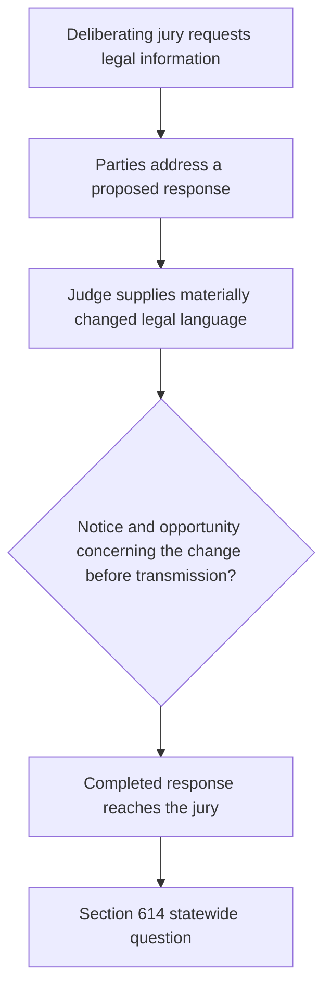
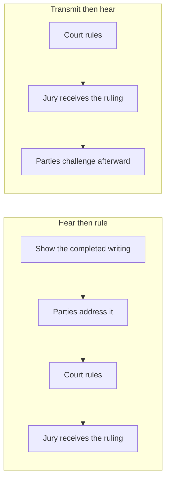
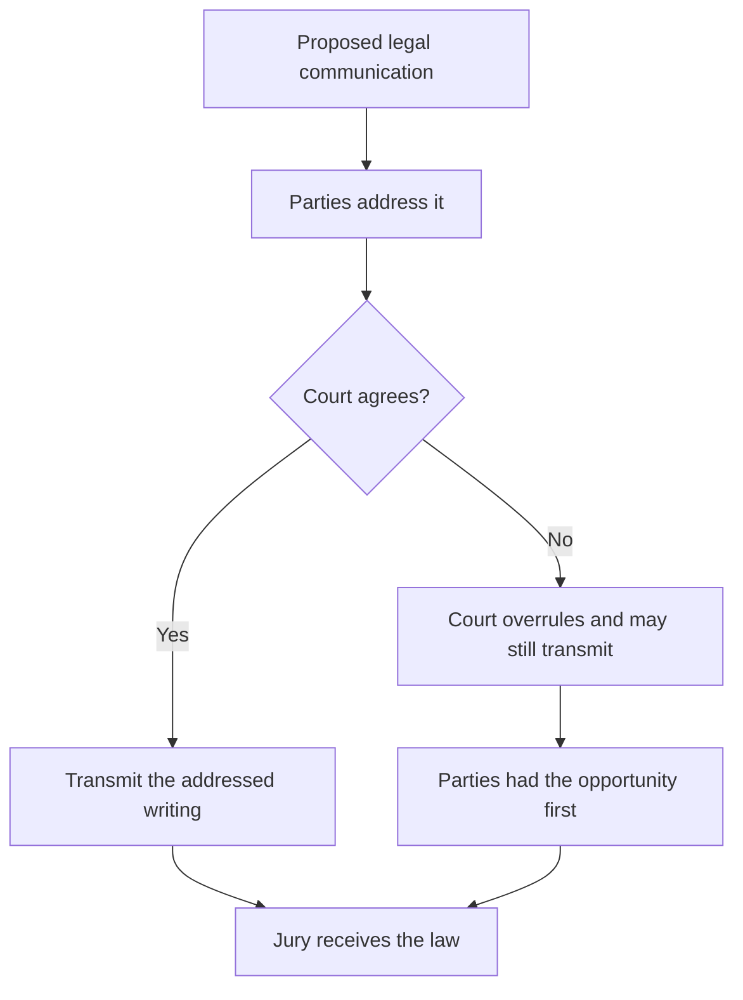
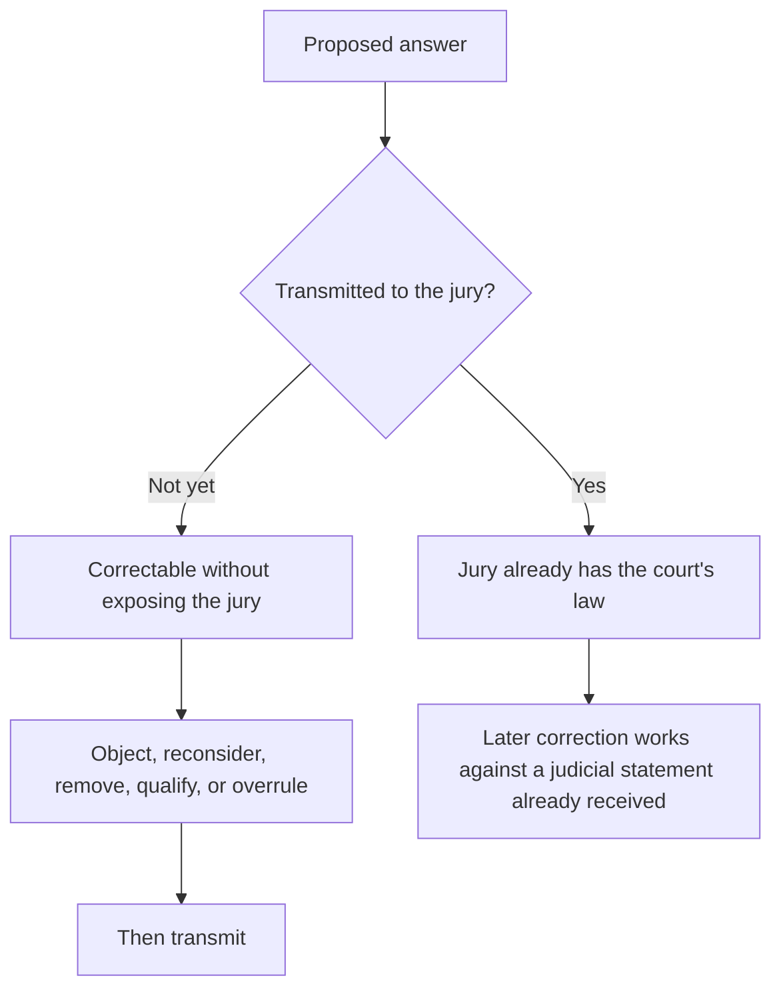
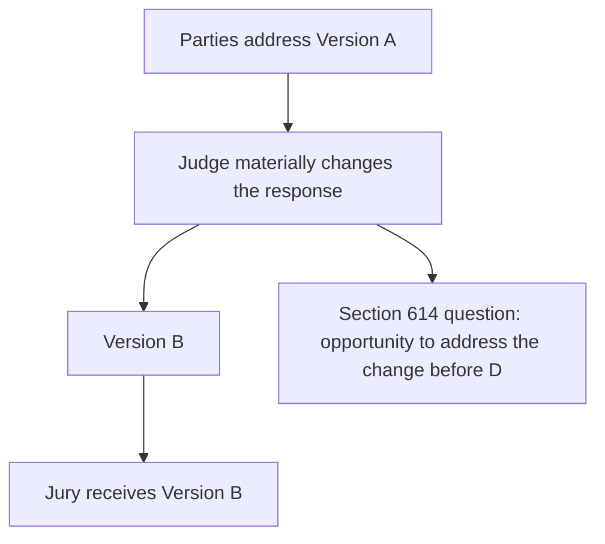
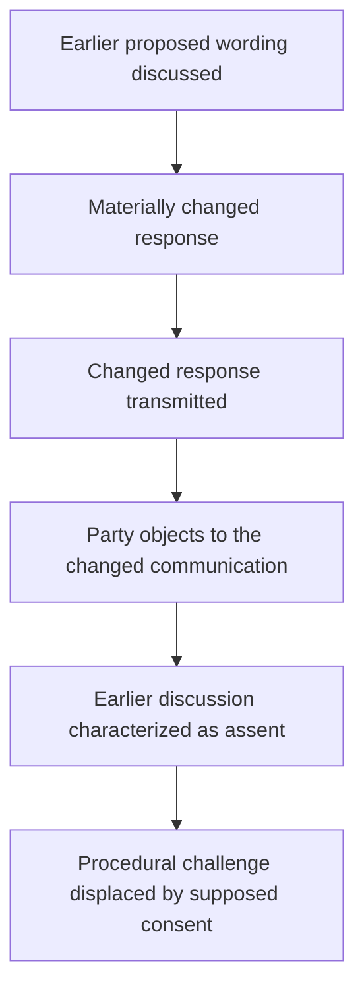
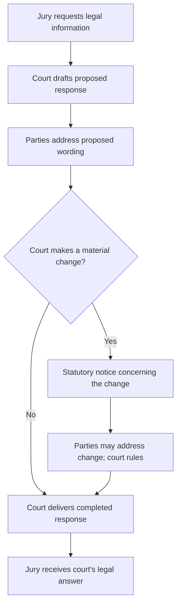

```markdown
# The Statewide Question

> **This page is commentary published October 17, 2026.** It is published as speech under the First Amendment to the United States Constitution and article I, section 2 of the California Constitution. It is not a court filing. It is not service of any paper on any party. It does not restart any Code of Civil Procedure section 128.7 period. Formal positions remain those stated in papers already on file.

## Contents

1. [The broader question](#1-the-broader-question)
2. [The governing principle](#2-the-governing-principle)
3. [The judge decides the law](#3-the-judge-decides-the-law)
4. [But the decision must remain adversarial](#4-but-the-decision-must-remain-adversarial)
5. [Section 614 is the statutory safeguard](#5-section-614-is-the-statutory-safeguard)
6. [The jury receives rules, not ordinary information](#6-the-jury-receives-rules-not-ordinary-information)
7. [The principle reaches more than added language](#7-the-principle-reaches-more-than-added-language)
8. [Why transmission is the critical dividing line](#8-why-transmission-is-the-critical-dividing-line)
9. [What the record proved](#9-what-the-record-proved)
    - [The fundamental wrong](#the-fundamental-wrong)
    - [The hinge: presented-then-delivered, then “Inaccurate”](#the-hinge-presented-then-delivered-then-inaccurate)
    - [The charges against the sitting trial judge](#the-charges-against-the-sitting-trial-judge)
    - [The court's responses to those charges](#the-courts-responses-to-those-charges)
    - [Reply No. 2 — the highway/street enhancement and sending](#reply-no-2--the-highwaystreet-enhancement-and-sending)
    - [Reply No. 1 — the separately challenged completed response](#reply-no-1--the-separately-challenged-completed-response)
    - [The plural response — objections and judicial issuance](#the-plural-response--objections-to-both-replies-and-judicial-authority-to-issue-them)
    - [Accusation-to-answer map](#accusation-to-answer-map)
    - [Admission by acquiescence: justification rather than denial](#admission-by-acquiescence-justification-rather-than-denial)
    - [The irrefutable chain](#the-irrefutable-chain)
10. [Notice of one version is not necessarily notice of another](#10-notice-of-one-version-is-not-necessarily-notice-of-another)
11. [Post-transmission objection is different](#11-post-transmission-objection-is-different)
12. [Judicial discretion has a procedural boundary](#12-judicial-discretion-has-a-procedural-boundary)
13. [Forfeiture, waiver, and invited error](#13-forfeiture-waiver-and-invited-error)
14. [The circularity problem](#14-the-circularity-problem)
15. [The broader statewide rule](#15-the-broader-statewide-rule)
16. [Why the issue extends beyond this case](#16-why-the-issue-extends-beyond-this-case)
17. [Why review is warranted](#17-why-review-is-warranted)

---

## 1. The broader question

The statewide question is not whether the trial judge correctly withheld a Vehicle Code instruction or correctly defined the word *highway*. The issue is **whether the court materially changed the legal response that would reach the deliberating jury and transmitted that changed response without Rosario's view of the completed writing, without his approval of it, and without his opportunity to object to it before delivery.** Correctness of the Vehicle Code text is a separate subject. The fundamental wrong is the unseen sending. The issue arose through **repeated accusations directed by Rosario to the sitting superior court judge**: “you had inserted information into the Jury” (11 RT 4:5–7), “You enhanced the statement and you sent that back” (11 RT 8:11), and “you sending back enhancements” (11 RT 13:19–20). **Section 9 maps each accusation to the judge's actual response, shows the court's pattern of justifying rather than denying, and sets out the irrefutable chain.**

**When a trial court materially changes a legal response discussed with the parties, what does Code of Civil Procedure section 614 require before the changed response may be communicated to a deliberating civil jury?**

That question encompasses a change made by adding language, inserting a definition, expanding a limitation, or combining a restriction with a refusal. The lawfulness of the resulting instruction is a separate subject. The procedural act is the court's preparation and delivery of the material change.

The specific statutory question is:

**Does notice of an earlier proposed response satisfy section 614 when the judge subsequently supplies materially different legal language and sends the completed response to the jury, or must notice extend to the material change that the jury actually receives?**

This commentary advances the latter rule. The parties need not approve the judge's final legal decision; they must be given the statutory opportunity to address the materially changed response before the judge transmits it.

The record supplies two separately identified jury replies. Reply No. 2 contains the particular highway/street addition that Rosario expressly accused the court of enhancing and sending. Reply No. 1 contains a juror-use restriction Rosario described accepting and a completed refusal clause read by the court, with a different stated justification. **The replies are not interchangeable.** Together, the court's responses and its later reference to **“these responses”** illuminate the statewide boundary between deciding what law to communicate and following the required process of communicating it.



---

## 2. The governing principle

The broader principle is simple:

**The judge decides the law. But the judicial act of deciding the law does not eliminate the parties' right to participate in the process before the court's substantive legal communication reaches a deliberating jury.**

The parties do not have:

1. Control of the judge's answer.
2. A veto.
3. A right to their proposed language merely because they object.

The court may still:

1. Reject their arguments.
2. Overrule their objections.
3. Give an instruction neither party prefers.

But there is a fundamental difference between:

**hearing the parties and ruling against them,**

and

**ruling first, communicating the ruling to the deliberating jury, and allowing the parties to challenge the completed communication afterward.**

The first is judicial decisionmaking within the adversarial process.

The second raises the statewide question presented here. It was not raised abstractly: **Rosario accused the judge of adding a street definition and already sending the enhanced answer to jurors** (Charge 5, 11 RT 8:7–12). The court's answer defended the words in the code; its later answer defended the discretion to issue **“these responses”** (11 RT 11:28–12:4). That is precisely the dividing line between defending a judicial choice and establishing that the statutory procedure preceded delivery.

| Path | Sequence | Character |
| --- | --- | --- |
| Adversarial ruling | Notice, hearing, ruling, then transmission | The court decides the law after the parties address the completed communication |
| Completed communication first | Ruling, transmission, then later challenge | The parties address an event that has already entered the jury room |

The legal ramification is the difference between an overruled objection and an unheard one. In the first path, the record contains the completed writing, the party's position on that writing, and the court's ruling. Review then asks whether the ruling was correct. In the second path, the jury already has the court's law before the party speaks to that law. Review is then asked to treat a later protest as tardy, or to treat an earlier discussion of a different writing as consent. The first path preserves both judicial authority and appellate review. The second path can extinguish review of the very communication the statute required the parties to see first.



---

## 3. The judge decides the law

Judicial independence in determining the law is not in dispute.

When a jury asks a question, the trial court must exercise judgment.

It may have to determine:

1. What statute governs.
2. What instruction applies.
3. Whether the jury's premise is mistaken.
4. Whether an existing instruction is sufficient.
5. Whether clarification is appropriate.
6. Whether additional legal information should be supplied.
7. Whether requested information would be misleading.
8. How much explanation is necessary.
9. Whether the requested instruction should be refused.

Those are exercises of judicial authority.

Section 614 does not transfer that authority to the parties.

The question is not whether the parties must consent to the judge's ultimate ruling.

They need not.

The question is whether the judge's authority to decide the ruling includes authority to bypass the procedure by which the parties are allowed to address the ruling before it enters the jury room. **When Rosario told the judge that he “enhanced the statement and ... sent that back,” the accusation was directed to the judge's exercise of authority over a completed jury communication, not simply to the merits of a statutory definition** (11 RT 8:7–12).

Those nine determinations are the content of the response. They remain with the court after the parties are heard. Section 614 does not assign any of them to counsel. This commentary urges a sequence that gives effect to its presence-or-notice protection: the material legal communication is disclosed, the parties have an opportunity to address it, and the court then transmits its completed answer. Collapsing the sequence into the content decision treats a ruling on the law as a ruling that the parties need not see the law first. That collapse is the statewide problem. The court still decides what the answer will be. The statute decides when that answer may enter the jury room.

---

## 4. But the decision must remain adversarial

The adversarial process has little meaning if it begins only after the judicial act capable of affecting the verdict has already occurred.

A party's opportunity to address a proposed legal communication serves several functions:

1. Identify controlling authority the court overlooked.
2. Identify an omitted qualification.
3. Explain that a proposed definition changes another instruction.
4. Show that the jury's question rests on an incorrect legal premise.
5. Argue that a statute not in the proposed response governs.
6. Identify prejudice from answering only part of the question.
7. Request a clarifying instruction.
8. Preserve an objection for review.

None of those functions requires that the court agree.

Their value lies in occurring **before the court's answer becomes authoritative law inside the jury room.**

The statewide principle therefore is not party control.

It is adversarial participation before judicial transmission. That is also the meaning of Rosario's repeated record correction: he contested the court's assertion that no objection had been made, recalled objections to materials “sent back,” and asked to reconstruct the unreported discussion (11 RT 10:12, 10:23–11:13). **The charge was not merely “I dislike the final words.” It was “the judge changed and sent the legal message, and my earlier opportunity did not encompass the completed change.”** This final sentence is a synthesis of Rosario's recorded positions, not a supposed verbatim quotation.

Each of those functions operates on a proposed writing that has not yet become the jury's law. Counsel can still point to a missing qualification, an omitted statute, or a definition that changes another instruction, and the court can still overrule. After transmission, the same points must be recast as a request to retract the court's own statement. The legal comparison is therefore not between a winning objection and a losing one. It is between an objection that can prevent the communication and an objection that can only ask the court to unsay it. The first is the opportunity this commentary contends section 614 protects. The second is a different remedy, with a different burden and a different effect on deliberations already underway.



---

## 5. Section 614 is the statutory safeguard

Code of Civil Procedure section 614 provides that, after deliberations begin, when jurors seek information on a point of law, the information “must be given in the presence of, or after notice to, the parties or counsel.” [Cal. Code Civ. Proc., § 614](https://codes.findlaw.com/ca/code-of-civil-procedure/ccp-sect-614/). **The statute is invoked here because Rosario repeatedly accused the trial judge of sending additional legal information into an already-deliberating jury**, including an identified street-language enhancement in Reply No. 2 (11 RT 5:20–27; 8:7–12; 13:16–22). The issue is the court's communication procedure, not whether the original trial evidence physically included the statutes.

The statutory object is **the information given**. That object is central when the court first discusses one proposed response and then materially changes it.

| Recorded event | Procedural significance |
| --- | --- |
| Jury asks a legal question | The court is called upon to supply legal guidance. |
| Parties discuss proposed response A | Their participation concerns the proposition or wording they actually addressed. |
| Court materially changes A to B | The court has supplied a different substantive communication. |
| Court sends B to the jury | B becomes the court's authoritative legal answer in deliberations. |
| Party objects to the change and the sending | The record identifies the disputed judicial communication and the timing of the objection. |

The construction urged here follows the object of the statute: when B is the information given, meaningful notice concerns B's material differences. The statute's presence-or-notice language supplies a procedural protection distinct from the judge's discretion to formulate a lawful answer.

In *Nelson v. Southern Pacific Co.* (1937) 8 Cal.2d 648, 655, the California Supreme Court addressed an unauthorized communication to a deliberating jury and described the section 614 procedure as a protection related to the substance of trial by jury. [*Nelson](https://scocal.stanford.edu/opinion/nelson-v-southern-pacific-co-28878)*. This page draws the related statewide question presented by materially changed jury-response wording: **what must be disclosed, and when, for the notice requirement to serve its function?**

---

## 6. The jury receives rules, not ordinary information

A judicial answer to a jury's legal question is different from ordinary information entering a trial.

| Source | What the jury may do with it |
| --- | --- |
| Witness | Accept or reject testimony |
| Attorney | Treat argument as argument, not evidence |
| Exhibit | Evaluate evidence |
| Judge answering a question of law | Follow the answer as the legal framework |

A witness gives testimony that the jury may accept or reject.

An attorney makes arguments that the jury is told are not evidence.

An exhibit supplies evidence the jury evaluates.

But when the trial judge answers a question of law, the jury receives the answer as an authoritative statement of the legal framework governing its decision.

The jury is expected to follow it.

That makes a substantive judge-to-jury communication uniquely consequential.

The communication can determine:

1. What legal duties matter.
2. Which facts are legally relevant.
3. What propositions jurors may consider.
4. What propositions jurors must disregard.
5. How statutory language should be understood.
6. What elements must be established.
7. How competing instructions relate to one another.
8. What rules govern the verdict.

A mid-deliberation legal answer therefore does more than provide information.

**It can change the rules under which deliberation proceeds.**

That is why the procedural protection must attach before transmission. **The seriousness of Charge 5 lies in its target:** Rosario did not accuse a witness of adding an exhibit; he accused **the judicial officer charged with instructing the jury** of enhancing the legal message and returning it to jurors. The judge's answer had legal authority for the jury regardless of either party's agreement with it.

The comparison is between evidence the jury may weigh and law the jury must apply. Testimony, argument, and exhibits remain subject to the jury's evaluation. A mid-deliberation judicial answer does not. The jurors have identified the legal uncertainty on which the verdict may turn, and the court has answered it. That answer can open or close duties, redefine statutory terms, and tell the jury what it may not consider. The ramification is that an unnoticed addition, restriction, or refusal is not an unnoticed piece of evidence. It is an unnoticed change in the rules. Section 614 exists at that moment because the communication is the court's law, not a party's proof.

---

## 7. The principle reaches more than added language

The material-change rule should follow what the jury received, not the mechanical form of the court's revision. A substantive change can be made by inserting a definition, deleting a qualification, expanding an exclusion, adding a new command, combining previously separate propositions, or refusing guidance in a response that earlier addressed only the jurors' own use of outside legal material.

The common event is **a difference between the response the parties addressed and the response the judge sent to the jury**. The court may make that change. Section 614 raises the separate question of how and when the parties receive notice of the material change before it is communicated.

That formulation keeps both jury responses in view without conflating their contents. Reply No. 2 concerns the addition of the street language to the vehicle/highway definition. Reply No. 1 concerns the difference between the juror-use proposition Rosario described accepting and the court's completed prohibition-and-refusal response. The source of the change, the words changed, and the judge's substantive rationale must be stated separately for each reply.

The statewide rule therefore addresses **materially altered judge-to-jury legal communications**, whatever drafting technique produced the alteration. **Rosario's charges name both a particular added sentence (“highways also indicates street,” 11 RT 8:7–12) and the broader act of “sending back enhancements” (11 RT 13:17–22).** The later accusation is what keeps the statewide principle from depending on one word or one definition.

---

## 8. Why transmission is the critical dividing line

Transmission is the critical event because that is when the court's proposed answer becomes the jury's legal instruction. **“You enhanced the statement and you sent that back” identifies both acts and their order** (11 RT 8:11). The sentence does not say Rosario saw the enhanced statement first. It says the enhanced statement was already sent. **“Second off, you sending back enhancements”** renews the sending charge after the judge explicitly asked for the asserted irregularities (11 RT 13:16–22). The repeated accusation makes transmission without Rosario's view, approval, or prior opportunity to object a reported controversy, not a merely hypothetical procedural hazard.

Before transmission, the process remains correctable without exposing the jury to the disputed communication:

1. A party may object.
2. The court may reconsider.
3. Language may be removed.
4. A missing qualification may be supplied.
5. A legal error may be corrected.
6. An ambiguity may be resolved.
7. The court may reject the objection and transmit the answer unchanged.

But the important point is that the adversarial process has performed its function before judicial authority enters the jury room.

After transmission, the problem changes.

The jury has received the answer from the court.

Any later correction must operate against something the jury has already been told by the judge.

The difference is therefore not merely chronological.

It is structural.

**Before transmission, the parties participate in determining whether an error reaches the jury. After transmission, they can only ask the court to repair an event that has already occurred.**



| Timing | What the parties can still do |
| --- | --- |
| Before transmission | Participate in whether the error reaches the jury |
| After transmission | Ask the court to repair an event that has already occurred |

The ramification of that comparison is practical and legal. Before transmission, an objection can keep the disputed sentence out of the jury room. After transmission, the same sentence is already the court's instruction. A later "correction" asks the jury to disregard a statement the judge has just made, or to prefer a second statement over the first. That is a different proceeding. It introduces questions of curability and prejudice that section 614 is designed to avoid by requiring notice first. Equating the two moments treats a repair as the statutory opportunity. The statute calls for presence or notice before the information is given; the earlier moment is the one this commentary seeks to protect.

---

## 9. What the record proved

### The fundamental wrong

**The fundamental wrong is this: the judge sent a legal message into the deliberating jury without Rosario's view of that message, without Rosario's approval of that message, and without Rosario's opportunity to object to that message before it reached the jury.**

That sentence is the charge. Every surrounding detail (highway includes street, Vehicle Code text, harmlessness, discretion) is secondary. The procedural accusation under Code of Civil Procedure section 614, and the due-process interest protected by the Fourteenth Amendment to the United States Constitution, is the **unseen, unapproved, unobjected-to delivery** of the court's completed legal communication. Strip away the surrounding words and that delivery remains. Leave that delivery out, and the rest of the episode loses its meaning.

The judge may decide the law. The judge may choose language neither party prefers. What the statute and the constitutional process charge forbid is **ruling first, transmitting that ruling into the sealed jury room, and only then facing the party's challenge to a completed communication the party never saw in the form the jury received**.

### The hinge: presented-then-delivered, then “Inaccurate”

**This is one of the most important passages in the record.** It is a single sequence. Counsel should read it as one confrontation, not as two unrelated subjects.

In one continuous judicial speech (**11 RT 6:14–8:6**), the sitting trial judge first claimed the statutory sequence for Jury request form number one:

> “The Court presented that response in Jury request number one to each party before delivering it to the Jury.” **11 RT 6:19–21.**

In that same speech, the judge then turned to Jury request form number two, read the completed answer including **“'Highway' includes street,”** and defended the Court's own act of defining the term for the jury's use as potentially gratuitous, neutral, and without harm. **11 RT 7:10–8:6.**

**The next speaker turn is Rosario's.** He does not wait. He does not negotiate the Vehicle Code citation. He opens by charging that the court's account is false, and he identifies the completed act:

> “Inaccurate, Your Honor. You enhanced it by adding that highways also indicates street. That is not in the actual black-letter law. You enhanced the statement and you sent that back. That is a direct influence over the Jury.” **11 RT 8:7–12.**

That is the charge of lying about the completed communication. The judge had just described presentation to the parties and delivery to the jury. Rosario answered that the statement that went back was an **enhancement**, and that the judge **had already sent it**. The objection is that the enhanced writing reached the jury; it is not a later preference about statutory wording.

**The judge did not refute that objection.** He did not say “I did not send it.” He did not say “you saw the enhanced writing before it went back.” He answered that the code contains the words. **11 RT 8:13–16.** Correctness of the text leaves the sending charge standing.

**Every claim afterwards stands in the face of that unrebutted objection.** The later statements about discretion to “issue these responses” (**11 RT 11:28–12:4**), prematurity of section 657 relief (**11 RT 13:23–25**), and renewed accounts of earlier nonobjection (**11 RT 10:9–19**) were spoken **after** Rosario had already told the court, on the record, that the enhanced statement had been sent back. The judge never returned to deny that sending. Justification after an unrebutted sending objection is not a cure of the missing view, approval, or opportunity to object.

### The charges against the sitting trial judge

The significance of this episode begins with **who Rosario accused and what he accused that person of doing**. Rosario was not merely disagreeing with an instruction or criticizing an opposing lawyer. In open court, while the jury was deliberating, he repeatedly accused the sitting superior court judge of **personally inserting legal material into jury responses, changing language, and returning the enhanced responses to jurors without Rosario first seeing, approving, or objecting to the completed writing**. The statutory charge is section 614. The constitutional charge is deprivation of the adversarial opportunity that due process requires before a court-authored legal rule enters jury deliberations. These accusations concern the manner in which the judge exercised judicial authority, not whether a Vehicle Code proposition was substantively sound.

The ten recorded charges are set out below **before the court's answers**, so that each answer can be evaluated against the question it confronted. Quoted words are transcript excerpts; the charge headings identify the acts Rosario was attributing to the court. **In every charge that names sending or insertion, the missing predicate is the same: Rosario did not have the completed message for his view, his approval, or his objection before delivery.**

1. **Charge 1 — Judicial insertion of legal information into the deliberating jury's materials.** Rosario accused the court itself of supplying a Vehicle Code provision that had not been introduced as evidence: “The Court also, through its own admission, clarified something to the Jury by submitting a actual Vehicle Code ... you had inserted information into the Jury.” **11 RT 4:1–7.** This charge identifies the **court**, rather than a juror, as the actor supplying the information.

2. **Charge 2 — Difference between the restriction Rosario described accepting and an asserted added component.** Rosario first identified the limited proposition he said he accepted: “I do agree with the first one, the response to number one: You may not consider it because it is not part of the instructions.” He immediately objected: “But when you added that into the second one, it caused this, because the Jury had to make the decision based upon the available evidence that was there.” **11 RT 4:8–14.** His charge concerns an addition beyond the proposition he identified as agreed. For **Reply No. 1**, the completed writing later read by the judge contains the distinct clause **“nor will the Court instruct the Jury on those provisions.”** **11 RT 6:23–27.** The two clauses, and the question of what was changed or approved, must be kept separate from the highway/street sentence in Reply No. 2.

3. **Charge 3 — New information inserted by the court, including a code the court supplied.** Rosario said: “new evidence or new information has been inserted by yourself” and “You provided a code.” **11 RT 4:26–5:8.** This again assigns responsibility for the supplied material to the trial judge.

4. **Charge 4 — Insertion after the jury had retired.** Rosario stated: “Inserting that information into the Jury after the fact, after they have gone into the sealed room back there, essentially, is extraneous influence over the Jury and their knowledge about this case.” **11 RT 5:20–27.** The allegation identifies **judicial communication during deliberations**, the setting to which section 614 speaks.

5. **Charge 5 — Immediate charge that the court's presented-then-delivered account was inaccurate: Reply No. 2 was enhanced and already sent back without Rosario's view.** Immediately after the judge's continuous speech claiming presentation to the parties before delivery and then reading the highway/street answer (**11 RT 6:14–8:6**), Rosario said: “Inaccurate, Your Honor. You enhanced it by adding that highways also indicates street. That is not in the actual black-letter law. You enhanced the statement and you sent that back. That is a direct influence over the Jury.” **11 RT 8:7–12.** This is the specific **addition-and-transmission charge**, and it is also a direct challenge to the truth of the completed-communication narrative the judge had just spoken. Judicial author, identified words, completed transmission **already accomplished**, and asserted influence on jurors. The wrong is not that the statute contains those words. The wrong is that **the enhanced statement went to the jury before Rosario saw it, approved it, or objected to it as the completed writing.** The judge did not refute that sending objection.

6. **Charge 6 — Objections concerning both completed forms.** When the judge reported that the clerk had informed him Rosario wished to place objections concerning **Jury Request Forms Nos. 1 and 2** on the record, Rosario answered **“Yes.”** **11 RT 10:4–8.** This identifies the two responses as the subjects of his requested record correction.

7. **Charge 7 — The completed replies differed from Rosario's stated understanding.** When the judge asserted that there had been no objection at completion, Rosario immediately interrupted: **“That wasn't our understanding.”** **11 RT 10:9–12.** The interruption contests the judge's account of the earlier discussion; it is not acceptance of the court's characterization.

8. **Charge 8 — Previously voiced objection to language and materials sent back, and request to reconstruct the record.** Rosario stated that, outside the reporter's presence, **“Plaintiff did object to any language or materials sent back”** and specified material **“defined by yourself to the Jury themselves.”** He identified the definition of a vehicle and requested that the record be **“corrected or supplemented”** or reconstructed. **11 RT 10:23–11:13.** This charge concerns both the judicial communication and the record of Rosario's opportunity to contest it.

9. **Charge 9 — Specific objection to the transmission of codes and vehicle clarification.** Asked by the judge what correction he sought, Rosario answered: **“The correction is that I objected to any of the material going back, the codes”** and objected to **“any kind of clarification of vehicles.”** **11 RT 11:14–22.** Rosario thus described an objection to the **sending**, not merely a preference for different substantive law.

10. **Charge 10 — Renewed direct accusation of sending enhancements.** Later, **the judge himself asked**, “What are the irregularities, sir?” Rosario distinguished his concern about possible juror access from the second and separate irregularity: **“second off, you sending back enhancements to a testimony that was not in.”** **11 RT 13:13–22.** This renewed accusation names **the judge's sending of enhancements** as its own procedural irregularity. After multiple accusations, the judge still received a direct invitation to deny the sending and instead answered the remedy's timing. The renewed charge keeps the fundamental wrong in view: **enhancements already sent back, still without a judicial showing that Rosario saw, approved, or objected to the completed writing first.**

The two response numbers must not be conflated. **Charge 5 specifically identifies the “highway includes street” enhancement in Reply No. 2. Charges 2 and 7 bear on Rosario's account of the earlier understanding and the completed Reply No. 1, including its separate refusal clause. Charges 1, 3, 4, 8, 9, and 10 establish the breadth and repetition of the allegation that the court itself supplied and returned legal information.** Charges 6 through 9 also explain why Rosario sought to put objections to **both forms** on the record.

The notice accusation is the essential procedural inference joining these statements. In ordinary terms, Rosario's position was: **the judge sent a materially enhanced legal response without Rosario's view of that completed writing, without his approval of it, and without his opportunity to object to it before delivery**. That formulation is the **inference from Rosario's own recorded statements**: an identified addition, a completed return to the jury, a contested understanding, and a request to reconstruct the objections. The accusation is about **the completed enhanced writing already in the jury's hands**, not merely the original subject of the jury's question.

### The court's responses to those charges

Read against the ten charges, the court's spoken answers fall into a single pattern. The judge answers **content**, **harmlessness**, **discretion**, or **timing of the remedy**. He does not answer: “I did not send it,” “Rosario saw the completed writing first,” or “Rosario had the statutory opportunity to object before delivery.”

1. **To Charges 1, 3, and 4 (judicial insertion after retirement):** the court later described its own definition as something the Court was supplying for the jury's use, potentially “gratuitous,” neutral, and causing “no harm nor prejudice.” **11 RT 7:27–8:6.** That is a defense of the information. It is not a statement that Rosario viewed the completed writing before transmission.

2. **To Charges 2 and 7 (scope of Reply No. 1 and contested understanding):** the court read the complete two-clause No. 1 answer, claimed prior presentation of that response, and explained that the cited codes “were not part of the evidence.” **11 RT 6:16–7:9.** Rosario contested the asserted understanding. **11 RT 10:9–12.** The controversy includes whether the completed writing was the writing Rosario saw and could object to.

3. **To Charge 5 (enhanced and sent):** the judge answered with the code-book text: “Highway includes street.” **11 RT 8:13–16.** That is a defense that **the answer was correct**. It is not a denial that the enhanced statement had already been sent. It is not a claim that Rosario saw, approved, or objected to that completed enhancement before delivery.

4. **To Charges 6, 8, and 9 (objections to both forms and materials sent back):** the judge noted and overruled the objections and invoked discretion to “issue these responses.” **11 RT 11:28–12:4.** That is a defense of **authority to issue**. It treats the responses as already issued subjects of later objection, not as writings still awaiting Rosario's view.

5. **To Charge 10 (renewed “you sending back enhancements”):** the judge answered that CCP section 657 relief was premature. **11 RT 13:23–25.** That is a defense of **timing of the remedy**. It is not a factual denial of the sending.

On the face of an accusation that the sitting judge violated section 614 and the due-process interest protected by the Fourteenth Amendment (authoritative judicial law reaching deliberating jurors without the party's prior adversarial opportunity), the recorded judicial posture is: **the answer was correct; the definition was neutral; issuance was within discretion; the remedy is premature.** That is justification. It is not denial of the unseen delivery.

### Reply No. 2 — the highway/street enhancement and sending

**The charge:** Rosario accused the judge of adding the highway/street language and returning the enhanced response to the jury **without Rosario first seeing that completed enhancement**. **11 RT 8:7–12 (Charge 5).** He had already accused the court of inserting Vehicle Code material after the jury retired. **11 RT 4:1–7; 5:20–27 (Charges 1 and 4).**

**The court's continuous speech immediately before that charge (**11 RT 6:14–8:6**):** The same judicial turn first claimed presentation to the parties before delivery on form number one:

> “The Court presented that response in Jury request number one to each party before delivering it to the Jury.” **11 RT 6:19–21.**

Without ending that speech, the judge then turned to form number two, read the vehicle and highway definitions, including **“'Highway' includes street,”** and stated:

> “The Court -- even if this was something that was gratuitous on the part of the Court, the Court is defining something that is the word 'vehicle' for the purpose of the jury's use in this matter. I find no harm nor prejudice against either party in this case. It is simply a neutral definition coming from the Vehicle Code which defines vehicle and highway.” **11 RT 7:27–8:6.**

That language matters because the judge identified **the Court** as the actor supplying the definition and addressed whether that judicial addition was gratuitous, neutral, and harmful. **“Even if” is the judge's own conditional description; the direct admission is that “the Court is defining” for the jury's use.** The passage is a judicial defense of the information placed in the response. It is also the second half of a speech that began by claiming the parties had seen the court's response before delivery.

**The immediate charge of inaccuracy:** Rosario's next turn begins with **“Inaccurate, Your Honor.”** He then identifies both the enhancement and the completed sending:

> “Inaccurate, Your Honor. You enhanced it by adding that highways also indicates street. That is not in the actual black-letter law. You enhanced the statement and you sent that back. That is a direct influence over the Jury.” **11 RT 8:7–12.**

**The judge's immediate answer:**

> “Sir, do you want to take a look at this code section? It says, 'Highway includes street', close quote.” **11 RT 8:13–16.**

The judge answered the **statutory correctness** portion of Charge 5. **He did not refute the sending objection.** He did not answer **“I did not enhance the response,”** **“I did not send it back,”** or **“Rosario saw the completed writing before it went to the jury.”** The accusation was expressly directed to the sitting trial judge, named an exact modification, and asserted that the judge had already sent it to the deliberating jury. In that setting, a factual denial of the specified act, or a showing that Rosario had viewed and objected to the completed enhancement first, would have been the natural response if the court intended to contest the section 614 charge. The recorded answer instead defended **the words inserted**. **The resulting inference is that the judge contested the asserted impropriety of the addition and its effect, rather than the occurrence of the addition-and-sending without Rosario's view.**

The presentation-then-delivery claim, the highway/street reading, and the harmlessness defense all precede Rosario's precise accusation in one continuous court turn. The code-book answer immediately follows it. The sequence supplies **a claimed party-view procedure, then two substantive defenses surrounding one specific factual accusation**: the definition is neutral and causes no harm, and the words appear in the statute. Neither defense identifies prior disclosure of the **enhanced** wording before its delivery. **Correctness of the Vehicle Code text does not supply Rosario's missing view, approval, or opportunity to object.** Any later claim that the responses were properly issued was spoken **in the face of that unrebutted objection** that the enhanced statement had already been sent back.

### Reply No. 1 — the separately challenged completed response

**The charge:** Rosario identified a juror-use restriction with which he agreed, immediately spoke of an addition beyond that proposition, and later contested the judge's assertion concerning the earlier understanding. **11 RT 4:8–14; 10:9–12 (Charges 2 and 7).** This charge is distinct from the street sentence in Reply No. 2.

**The completed response read by the court:**

> “You may not consider Vehicle Code Sections 22107 and or 21804 subdivision A, nor will the Court instruct the Jury on those provisions.” **11 RT 6:23–27.**

The first clause tells jurors what they may not consider. The second announces what **the court** will not provide. The procedural subject is the scope of the response that was prepared and delivered, **not whether withholding those particular statutes was the correct legal ruling**.

**The court's separate account:** On Reply No. 1, the judge asserted:

> “The Court presented that response in Jury request number one to each party before delivering it to the Jury.” **11 RT 6:19–21.**

The judge also stated that Rosario had not objected and had waived the request. **11 RT 6:16–22.** Rosario later contested that account and requested correction or reconstruction of his earlier objections. **11 RT 10:12; 10:23–11:13 (Charges 7 and 8).** Thus the transcript affirmatively records **the judge's pre-delivery-presentation account for Reply No. 1 and Rosario's challenge to the account of agreement and objection**. The court's statement concerning presentation of **Reply No. 1** cannot be silently transferred to the added street sentence in **Reply No. 2**.

**The court's explanation of the completed No. 1 language:** The judge read the refusal clause and stated that Vehicle Code sections 22107 and 21804(a) **“were not part of the evidence,”** so the jury was not permitted to consider them as evidence. **11 RT 7:4–9.** This identifies the judge's reason for the completed content he delivered. The §614 accusation is directed to the **judicial change and the opportunity to address it before delivery**. It does not require this commentary to prove that the underlying decision to withhold those statutory instructions was wrong.

### The plural response — objections to both replies, and judicial authority to issue them

**The charges:** After disputing the court's account of earlier assent, Rosario expressly asserted that he had objected to language and materials **“sent back”** and to **“any kind of clarification of vehicles.”** **11 RT 10:23–11:22 (Charges 7–9).** The judge took and overruled objections concerning **both response forms**. **11 RT 11:23–12:4; 12:27–13:9.**

**The judge's answer to those objections:**

> “Your objections are noted. They are overruled and the Court believes that this is within its discretion to issue these responses in order to clarify for the Jury some issues that they have raised by way of their requests.” **11 RT 11:28–12:4.**

**“These responses”** is a plural judicial assertion of authority concerning the completed jury communications then under objection. That is not a statement that nothing was sent; it is an explanation of why the court considered itself authorized to **issue the responses**. The other two judicial explanations—**“no harm nor prejudice”** for No. 2 and **“not part of the evidence”** for No. 1—address different completed responses and must remain assigned to them.

Defense counsel added **“I have nothing to add, Your Honor, to what Your Honor said.”** **11 RT 11:26–27.** This shows that counsel offered no alternative factual account in that exchange. It does not substitute counsel's words for the judge's own answers.

**The renewed charge:** The record did not end with that ruling. When the judge asked Rosario to identify the irregularities, Rosario again accused the judge of **“you sending back enhancements.”** **11 RT 13:16–22 (Charge 10).** The court responded:

> “Sir, CCP Section 657 are grounds for a new trial. You are premature.” **11 RT 13:23–25.**

Rosario reiterated that he had requested a mistrial; the court denied the motion. **11 RT 13:26–14:5.** Here, too, the judge answered the procedural **timing of the requested remedy**, rather than denying that he sent enhancements. This is a second reported opportunity, following Charge 5, in which the accusation of judicial transmission received **a defense or disposition other than a factual denial of the transmission**.

### Accusation-to-answer map

| Charge and transcript | Accusation directed to the judge | Judge's recorded answer | Inference drawn from the exchange |
| --- | --- | --- | --- |
| **1, 3, 4** — 11 RT 4:1–7; 4:26–5:8; 5:20–27 | The judge personally inserted legal material into jurors' deliberations, after retirement. | The court later described its own definition as potentially “gratuitous,” neutral, and causing “no harm nor prejudice.” **11 RT 7:27–8:6.** | The court defended the information it supplied as appropriate for jurors' use. |
| **2, 7** — 11 RT 4:8–14; 10:9–12 | Rosario distinguished his stated agreement from the completed reply and disputed the asserted earlier understanding. | The court read the complete two-clause No. 1 answer, claimed prior presentation, and explained that the cited codes “were not part of the evidence.” **11 RT 6:16–7:9.** | The recorded controversy includes the **scope and timing of presentation of Reply No. 1**, not merely which statutes the judge selected. |
| **5** — 11 RT 8:7–12 (immediately after the court's 6:14–8:6 speech claiming presentation before delivery) | Rosario opens **“Inaccurate, Your Honor”** and charges that the judge enhanced **Reply No. 2** with the highway/street sentence and **already sent that enhanced reply back without Rosario's view, approval, or prior opportunity to object**. | The judge answered with the code-book text: “Highway includes street.” **11 RT 8:13–16.** **He did not refute the sending.** | The charge of lying about the completed communication met **a defense that the answer was correct**. The sending objection stands unrebutted. Every later claim sits in the face of that objection. |
| **6, 8, 9** — 11 RT 10:4–8; 10:23–11:22 | Rosario sought to place objections to both forms on the record, identified returned material, and asked to reconstruct prior objections. | The judge noted and overruled the objections and invoked discretion to **“issue these responses.”** **11 RT 11:23–12:4; 12:27–13:9.** | The judge acknowledged and ruled on **both objections** while defending the issuance of both responses. |
| **10** — 11 RT 13:16–22 | Rosario expressly renewed the accusation: **“you sending back enhancements.”** | The judge responded that §657 relief was premature. **11 RT 13:23–25.** | The judge responded to the **requested remedy**, not with a factual denial of sending enhancements. |

### Admission by acquiescence: justification rather than denial

Faced with repeated accusations of a section 614 violation, and with the constitutional due-process charge that follows from sending authoritative judicial law to deliberating jurors without the party's prior opportunity to be heard, the sitting trial judge had a direct route available if the accusation were false: **deny the act**. He could have said that the completed writing was shown to Rosario first. He could have said that Rosario objected and was overruled before transmission. He could have said that nothing enhanced was sent.

He said none of those things.

Instead, across the exchanges, he:

1. Defended the **correctness** of the inserted words (“Highway includes street”). **11 RT 8:13–16.**
2. Defended the **neutrality and harmlessness** of the Court's own definition. **11 RT 7:27–8:6.**
3. Defended the **discretion to issue these responses**. **11 RT 11:28–12:4.**
4. Defended the **premature timing** of the requested new-trial remedy. **11 RT 13:23–25.**

That sequence is **admission by acquiescence**. The charge was: you sent an enhanced legal message into the jury without Rosario's view, without his approval, and without his opportunity to object. The judicial answer was: the message was correct, harmless, and within discretion. **Justification of the content and of the issuance is not a denial of the unseen delivery.** On an accusation that a judge violated section 614 and the Fourteenth Amendment's guarantee of a meaningful opportunity to be heard before court-authored law binds the jury, answering “the answer was correct” submits to the occurrence of the sending and contests only whether the sending was wrongful.

A denial of the violation would have been: “I did not send it without your view.” The record contains the opposite posture: **I sent what the code says, and I was justified.**

**And so any claim afterwards was spoken in the face of the objection that the enhanced statement had already been sent back.** The judge claimed presentation to the parties and then delivery. Rosario immediately answered “Inaccurate” and charged the enhancement-and-sending. **The judge did not refute that.** Later discretion language and prematurity language do not erase an unrebutted sending objection already on the record.

### The irrefutable chain

Counsel need not reconstruct this from silence alone. The transcript supplies an explicit chain. Each link is a spoken statement. The chain closes on the fundamental wrong: **delivery without Rosario's view, approval, or opportunity to object.**

1. **Rosario accuses the judge of inserting legal information into the deliberating jury.** “you had inserted information into the Jury.” **11 RT 4:5–7 (Charge 1).**
2. **Rosario places the insertion after the jury had retired.** “after they have gone into the sealed room back there.” **11 RT 5:20–27 (Charge 4).**
3. **In one continuous speech, the judge claims he presented the response to each party before delivering it to the jury**, then turns to form number two, reads **“'Highway' includes street,”** and defends the Court as defining the term for the jury's use. **11 RT 6:19–21; 7:10–8:6.** That speech asserts the party-view-then-delivery sequence and simultaneously discloses the completed No. 2 content.
4. **Immediately, Rosario charges that account as inaccurate and identifies the completed sending.** “Inaccurate, Your Honor. ... You enhanced the statement and you sent that back.” **11 RT 8:7–12 (Charge 5).** The completed transmission is stated as already done. The missing statutory predicates are Rosario's view of that completed statement, his approval of it, and his opportunity to object to it before delivery.
5. **The judge does not refute that sending objection.** He does not say he did not enhance it. He does not say he did not send it. He does not say Rosario saw the enhanced writing first. He answers that the code says the words are correct. **11 RT 8:13–16.**
6. **Rosario contests the court's account of earlier understanding and asserts objections to language and materials already sent back.** **11 RT 10:9–12; 10:23–11:22 (Charges 7–9).** Those later claims by the court about nonobjection are made **after** the unrebutted Charge 5 sending objection.
7. **The judge overrules and justifies issuance of “these responses.”** **11 RT 11:28–12:4.** Overruling after the fact treats delivery as already accomplished. That justification also stands in the face of the unrebutted sending objection.
8. **The judge invites identification of the irregularities.** Rosario renews: “you sending back enhancements.” **11 RT 13:16–22 (Charge 10).**
9. **The judge again declines a factual denial of the sending**, and answers that section 657 relief is premature. **11 RT 13:23–25.**

**That chain is closed.** The hinge is links 3 to 5: presented-then-delivered claim, immediate “Inaccurate ... you sent that back,” no refutation of the sending. Multiple accusations of a section 614 violation. No straight denial of the sending. A succession of justifications: correctness, harmlessness, discretion, prematurity. The final judicial posture is justification of the act charged, not repudiation of it. The judge cannot wiggle out by later claiming the enhancement was never sent, or that Rosario somehow approved a completed writing he was still trying to get onto the record after the fact. The record already contains both the accusation of unseen delivery and the court's choice to defend the message rather than deny the delivery.

A sitting judge's legal communication is authoritative to jurors. The procedural charge was made to that same judge. It alleged that the judge himself altered a legal answer after deliberations began and caused the altered answer to reach the jury **without Rosario seeing it, approving it, or objecting to it first**. That interest is what section 614 protects. It is also the due-process interest under the Fourteenth Amendment: a meaningful opportunity to be heard before the court's law becomes the jury's law. In [*Nelson v. Southern Pacific Co.* (1937) 8 Cal.2d 648, 655](https://scocal.stanford.edu/opinion/nelson-v-southern-pacific-co-28878), the California Supreme Court treated an unauthorized post-retirement judicial communication as an irregularity going to the substance of trial by jury.

**This is the constitutional and statutory process charge the Court should confront: the trial judge determined the legal communication, sent the completed message into the deliberating jury without Rosario's view, without his approval, and without his opportunity to object, and then justified the content and the issuance rather than denying the unseen delivery.** The requested statewide rule concerns **that process of changing and sending a judicial message without the party's prior adversarial opportunity**, not the separate merits of the law stated in the message.

---

## 10. Notice of one version is not necessarily notice of another

The distinction becomes important as soon as the court and the parties discuss a proposed response and the court thereafter supplies a materially changed one. In the reported confrontation, **Rosario alleged that the judge was the one who supplied the added language and returned the enhanced statement to the jury** (Charges 1, 3, 5, and 10). He also contested the claim that his earlier discussion amounted to acquiescence in the completed replies (Charges 7–9).

Call the response initially discussed **Version A**. Call the materially changed response actually returned to the jury **Version B**. The question posed by this case is whether the procedure associated with Version A can be treated as adequate notice of the material change embodied in Version B.

Rosario's enhancement-and-sending accusation concerns exactly that distinction. His objection was to a judicially augmented response already communicated to the jury. The court's answer defended the language supplied, not a showing of the material change to him before return.

| Communication | Relevant act |
| --- | --- |
| Version A | Wording or proposition the parties earlier discussed. |
| Court's material alteration | Judicial addition, restriction, refusal, or new definition. |
| Version B | Completed legal response the jury receives. |
| Section 614 question | Whether the parties had the statutory opportunity concerning the **material difference** before Version B was given. |



The rule urged is that **the legal communication actually given determines the object of section 614 notice**. A material judicial alteration is not transformed into a previously reviewed communication merely because some earlier wording was discussed.

---

## 11. Post-transmission objection is different

The act at issue here is the sending of a materially changed legal response. Timing gives that act its procedural significance. **Rosario expressly located judicial insertion after the jury entered its sealed deliberation room (11 RT 5:24–27), then identified the exact highway/street enhancement as already sent (11 RT 8:7–12).** These are the charged acts to which the pre-transmission opportunity must be related.

Before transmission, a party may identify the change, object to the new wording, and ask the court to reconsider or qualify it. The judge may overrule the objection and still transmit the answer. After transmission, the jury already has the court's authoritative language, and the party must instead seek an alteration to something already communicated.

| Before transmission | After transmission |
| --- | --- |
| “This is the material change I object to before the jury receives it.” | “The court has already sent the material change; I object to what was sent.” |
| The court can decide the objection before delivery. | The court must address a completed communication. |
| The jury has not yet received the challenged words. | The jury has received the challenged words as judicial guidance. |

The jury's exposure is why the chronology matters. A post-delivery objection identifies and preserves a challenge to the event; it does not turn the already delivered words into a proposed response awaiting review.

**Section 614's notice requirement should be understood at the moment the court moves from a proposed answer to an authoritative communication given to the jury.** The party's statutory participation must concern the material alteration while it can still be addressed before delivery.

---

## 12. Judicial discretion has a procedural boundary

The record identifies the exact competing concepts. On Reply No. 2, the court called its definition neutral and said there was **“no harm nor prejudice.”** On Reply No. 1, the court said the cited statutes were **“not part of the evidence.”** Later, addressing the completed responses in the plural, it claimed **“discretion to issue these responses.”** (11 RT 7:4–9; 7:27–8:6; 11:28–12:4.) **These are three judicial explanations attached to distinct accusations: the substance of Reply No. 2, the completed substance of Reply No. 1, and the authority to issue both. None of those explanations itself describes pre-delivery disclosure of the highway/street enhancement to Rosario.**

These were answers about **the substance, purpose, or authority** for what the judge sent. Rosario's procedural complaint was about **the material change and its return to the jury before he could address it**.

**Substantive discretion and the section 614 procedure answer different questions.** Whether the definition came from a code book does not itself describe how the changed response was disclosed before transmission. Whether the court considered a response harmless does not itself identify when the parties saw the material change. The authority to issue instructions does not itself replace the statutory method for giving requested legal information to the jury.

The principle therefore remains:

> **The judge determines the lawful content of a jury response. Section 614 determines the procedure through which the judge's completed legal information reaches the jury.**

This is a limit on how judicial authority is exercised, not a veto over the legal answer. The court is free to reject an objection to the changed language; it must preserve the statutory process through which that objection can be made before the change reaches the jury.

---

## 13. Forfeiture, waiver, and invited error

The content of the communication also controls the preservation inquiry. A party's acceptance of one proposition is an act directed to that proposition; it does not automatically speak to additional material inserted in the communication subsequently returned to the jury. **Rosario affirmatively requested that objections to Forms Nos. 1 and 2 be placed on the record, contested the judge's statement about the earlier understanding, identified objections to returned materials, and asked for reconstruction** (11 RT 10:4–11:22). The judge later expressly described objections concerning both forms as submitted, considered, and overruled (11 RT 12:27–13:9). Those are recorded objections to identified acts, not an absence of complaint.

The specific distinctions presented by the record are:

1. **Reply No. 1:** Rosario identified his agreement as concerning the direction that jurors may not consider material outside the instructions. The court's completed reply also contained the separate statement that it would not instruct on identified Vehicle Code provisions. The court's substantive explanation addressed that completed reply.
2. **Reply No. 2:** Rosario challenged the highway/street addition and specifically stated that the court **“enhanced the statement and ... sent that back.”** The court answered by defending the added legal definition.
3. **Both replies:** Rosario contested the court's account of assent, sought to correct the record concerning his objections, and the court later described the objections to both responses as considered and overruled.

Forfeiture and invited error should be assessed against **the material communication challenged**, not against a generalized label of “agreement” that leaves the object of agreement undefined.

The same principle applies without taking any position on the correct substantive instruction. **The issue is what revised legal communication the judge actually transmitted and what opportunity the party had to object to that revision before it was sent.**

---

## 14. The circularity problem

The circularity arises when a materially changed judicial communication is treated as already accepted because the parties discussed an earlier proposition. **Rosario's objections attributed enhancement and return of legal material to the judge** (Charges 1, 3–5, 8–10); Rosario also disputed the court's account of the earlier understanding (Charges 2 and 7), and the judge overruled the objections to both responses. Identifying the exact challenged act is essential before labeling it invited or forfeited.

The sequence alleged in the reported exchange is straightforward. A jury asks for legal information. The court supplies additional or changed language. Rosario identifies the enhancement and says the judge **“sent that back.”** He objects to the court's insertion of material and disputes the court's account that he had acquiesced. The judge defends the completed language and invokes discretion to issue **“these responses.”**

If the party's earlier statement concerning different wording is then used to characterize the completed altered reply as unopposed, **the earlier conversation becomes a substitute for the statutory opportunity to address what was actually sent.**



The statewide rule should prevent this substitution. It should connect the opportunity to object to the **materially changed communication**, and it should identify the relevant judicial act as **delivery of that changed communication**, not the wisdom of the legal choice it contained.

---

## 15. The broader statewide rule

This commentary proposes the following statewide construction of Code of Civil Procedure section 614. **Rosario's ten recorded charges establish the practical setting for the rule: a party directly and repeatedly accuses the judge of changing and sending jury communications, while the judge defends the completed answers on their content, effect, and his authority to issue them.**

**When a deliberating civil jury asks for information on a point of law, the trial court retains authority to determine the lawful substance of its answer. When the court materially modifies a response that was previously presented or discussed, however, the statutory presence-or-notice requirement must apply to the material modification before the completed response is given to the jury. The court may overrule objections to the modification. It may not substitute its substantive reasons for the change for the procedure required before communicating that change.**

**Notice of a proposed response should not automatically count as notice of a materially different response. Nor should agreement to one proposition automatically count as assent to a changed legal communication that the court subsequently sends to the jury. The appellate inquiry must identify the changed response, the court's transmission of it, and the party's opportunity to address that change before transmission.**

The rule is about **procedure**, not whether the judge correctly interpreted the Vehicle Code, correctly refused an instruction, or correctly evaluated prejudice. A judge may believe the supplemented language is legally accurate and harmless. That belief is a substantive explanation. Section 614 addresses the separate sequence by which the court communicates its selected legal guidance to a deliberating jury.

> **The judge may change the legal answer. The statute governs how that changed answer reaches the jury.**

> **Judicial discretion determines the lawful content; adversarial procedure protects the opportunity to address a material change before the jury receives it.**



---

## 16. Why the issue extends beyond this case

The issue is not confined to one Vehicle Code provision, one jury request, one civil action, or one disputed sentence.

It arises whenever a California civil jury asks:

1. What does this instruction mean?
2. What law applies?
3. May we consider this?
4. What does this statutory term mean?
5. What happens if we find this fact?
6. Are these two instructions inconsistent?
7. Does this legal duty apply?
8. May we use this legal provision?
9. What is required before liability exists?
10. What legal rule controls our next decision?

At that moment, the court's answer may become more influential than an instruction given before deliberations began because the answer responds to a legal uncertainty the jury itself has identified.

Trial courts therefore need a uniform procedural rule.

Litigants need to know when their opportunity to object exists.

And reviewing courts need a common standard for determining whether that opportunity occurred and whether it was relinquished.

The issue affects every civil action capable of reaching a jury:

1. Negligence.
2. Contract.
3. Employment.
4. Insurance.
5. Products liability.
6. Professional liability.
7. Statutory causes of action.
8. Damages proceedings.
9. Comparative-fault cases.

The substantive law will change from case to case.

The procedural question does not.

The comparison across those jury asks, and across those civil fields, is the same comparison drawn above. The statute named in the note will change. The requested definition will change. The verdict form will change. The court's authority to decide the lawful answer remains. The proposed section 614 rule concerning a materially changed completed answer remains the same. A uniform rule is needed because a reviewing court in a contract case and a trial judge in a negligence case will otherwise treat notice of a draft, or a post-transmission invitation to object, as interchangeable with notice of the information given. Those substitutes are the same substitutes in every civil jury trial. The ramifications do not depend on Vehicle Code section 22107. They depend on whether section 614 follows the writing the jury received.

---

## 17. Why review is warranted

The proposed statewide question is narrow enough to administer uniformly and broad enough to matter across civil trials. **That boundary was tested by repeated accusations to the sitting superior court judge that he personally enhanced the jury responses and sent the additions back**, followed by the judge's responses concerning statutory wording, lack of prejudice, absence of the sections from the evidence, and discretion to issue the responses. The procedural significance arises from **what the judge was accused of doing and what he actually said in answer** (11 RT 4:1–5:27; 6:16–8:17; 10:4–12:4; 13:16–25).

**When the court changes a legal response after discussion with the parties, does section 614 require the parties to receive notice of the material change before the revised response is delivered to the deliberating jury?**

The record presents the issue through concrete judicial communications. Rosario identified an enhanced legal definition and accused the court of sending that enhanced statement back. The judge identified the definition as court-supplied, called it potentially gratuitous, found no harm, and answered the accusation by defending the street language. In a separate reply, the judge read the completed restriction-and-refusal text, offered a different substantive explanation, and expressly identified delivery. When the two responses were challenged, the judge defended his discretion to issue **“these responses”** and acknowledged overruling objections to both.

The statewide importance lies in the **relationship between the altered writing and the statutory opportunity to address it**. Every civil trial judge may need to send supplemental legal guidance to a deliberating jury. Every litigant needs to know whether participation concerning an earlier draft protects the opportunity to object to materially different final language. Reviewing courts need a consistent way to identify the particular response and the particular act of judicial transmission.

The Court should grant review to articulate that procedural boundary. The question can be resolved without making the underlying Vehicle Code dispute the principal issue:

> **A trial judge may decide what law to communicate, but material changes to a proposed legal communication remain subject to the statutory process governing what reaches the jury and when.**

---

### Authorities and record references

- [Code of Civil Procedure, § 614](https://codes.findlaw.com/ca/code-of-civil-procedure/ccp-sect-614/) — communication of information requested by a deliberating jury.
- [*Nelson v. Southern Pacific Co.* (1937) 8 Cal.2d 648, 655](https://scocal.stanford.edu/opinion/nelson-v-southern-pacific-co-28878) — jury communication and the section 614 procedural protection.
- **11 RT** — reporter's transcript, April 23, 2025, *Rosario v. Abdelhalim*, CGC-21-594102. Pinpoint references above identify the printed transcript page and line, not lines in this commentary.

```
